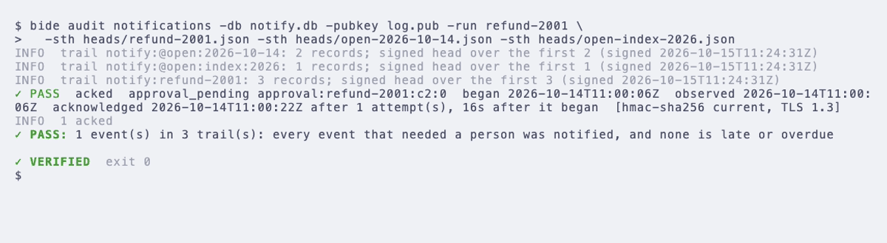
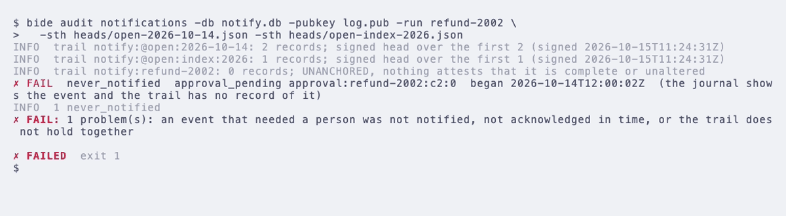
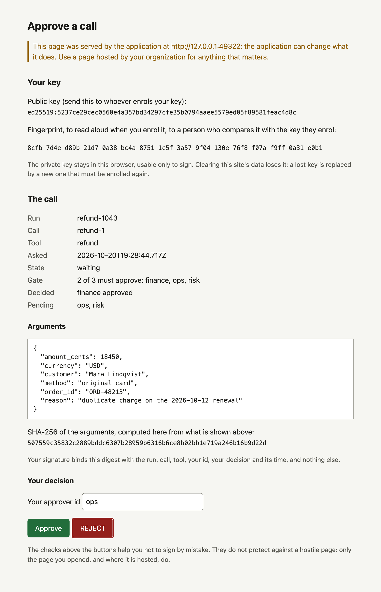
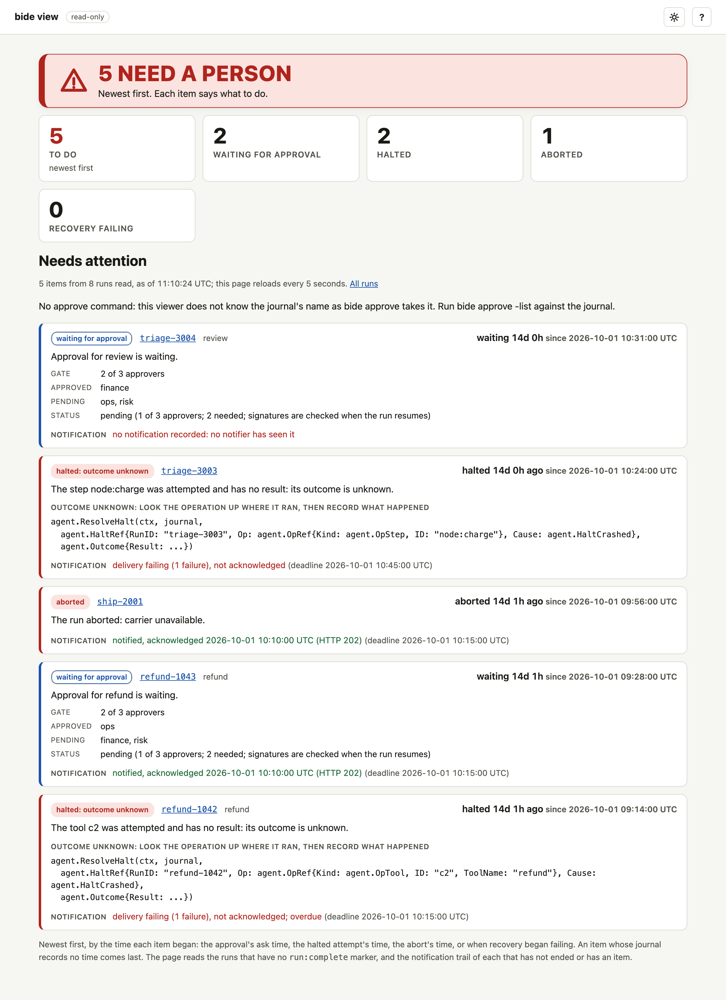

**English** · [简体中文](docs/i18n/README.zh-CN.md) · [Русский](docs/i18n/README.ru.md) · [हिन्दी](docs/i18n/README.hi.md) · [العربية](docs/i18n/README.ar.md) &nbsp; [](https://codecov.io/gh/bide-ai/bide)

<p align="center">
  
</p>

<p align="center">
  <strong>Durable, accountable AI agents in Go, for agents that move money, change records, or act under audit.</strong>
  <br>
  A Go framework for AI agents that move money: risky calls approved, every action recorded and verifiable.
</p>

<p align="center"></p>
<p align="center">
  &nbsp;&nbsp;<em>A pause you can clear beats a double-fire you can't.</em>&nbsp;&nbsp;
</p>

```sh
# Install (or: go install github.com/bide-ai/bide/cmd/bide@latest)
brew install bide-ai/tap/bide
# Something fails? bide doctor checks Go, SQLite, the module cache and your project, and says how to fix each
# 1. See it: kill an agent mid-payment; it does not charge twice (no API key)
bide demo
# 2. Build: a plan flow with a 2-of-3 approval gate, on SQLite, no API key
bide init refund && cd refund && go mod tidy && go run .
# 3. Inspect: the runs in a local, read-only page (a run list, then each run; it prints the address to open)
bide view -db run.db
#    Optional, no code needed: explore a sample journal of 14 runs in every state
bide sample
#    A call waits at an approval gate? List it, and sign your decision from the terminal
#    (a key in an HSM or a KMS: bide-hsm approve, built from source; see docs/guides/key-custody.md)
bide approve -db run.db -list
# 4. Prove: verify the run's evidence offline
bide audit verify-evidence -evidence evidence.json -pubkey keys/log.pub
# 5. Be told, and prove it: a halt or a waiting approval notifies a person; check offline that they were
bide audit notifications -db run.db -pubkey keys/log.pub -sth notify-run.sth.json
```

One append-only journal, in a plain-Go library, gives five guarantees:

- Side effects fire at most once, even across a crash, so they need not be idempotent.
- Thousands of concurrent durable runs in one process. It is a library; there is no cluster to run.
- A cryptographically verifiable audit trail: RFC 6962 Merkle proofs, checkable offline without trusting the vendor.
- Provably convergent shared state: the convergence conditions are machine-checked.
- People in control: k-of-n signed approvals with the requester excluded (separation of duties), signing keys in an HSM or a cloud KMS, and a notifier that tells a person and records that it did.

Bide is built toward what a bank asks of software that moves money: keys outside the application, separation of duties, a tamper-evident trail, explicit failure modes. It is not certified against, and does not claim compliance with, any standard; [key custody](docs/guides/key-custody.md) and the [threat model](docs/trust/threat-model.md) state what is and is not covered.

**Ambient agents.** An ambient agent runs unattended: it sleeps until a trigger (a schedule or an
event) wakes it, works over hours or days, and pauses to ask a human only when it needs judgment,
with nobody watching each step. Such an agent has to be safe to crash, safe to re-trigger, and
provable afterwards. Bide provides the durable lifecycle for this: durable `Sleep`/`WaitUntil` timers, a pluggable `Waker` for time- or event-driven wakeups, and
durable `Interrupt`/`AnswerInterrupt` for typed human-in-the-loop, all on the same journal. You bring the
trigger source and the oversight UI; the runtime keeps each run correct across sleeps, crashes and
node handoffs.

Status: working v0, live-verified end to end. Requires Go 1.27.

<p align="center">
  
  
</p>

<p align="center">
  <picture>
    <source media="(prefers-color-scheme: dark)" srcset="docs/guides/img/cli-approve-dark.gif">
    
  </picture>
</p>

<p align="center">
  <picture>
    <source media="(prefers-color-scheme: dark)" srcset="docs/guides/img/cli-audit-notifications-pass-dark.png">
    
  </picture>
  <picture>
    <source media="(prefers-color-scheme: dark)" srcset="docs/guides/img/cli-audit-notifications-fail-dark.png">
    
  </picture>
</p>

<p align="center">
  <picture>
    <source media="(prefers-color-scheme: dark)" srcset="docs/guides/img/approve-page-waiting-dark.png">
    
  </picture>
  <picture>
    <source media="(prefers-color-scheme: dark)" srcset="docs/guides/img/run-viewer-needs-attention-dark.png">
    
  </picture>
</p>

**Decide from a terminal, and prove people were told.** `bide approve` shows the call it reads from the journal, its arguments and the SHA-256 your signature binds, refuses a requester whose decision would not count, and leaves a receipt, which `bide audit verify-receipts` later checks against the signed heads to notice a decision deleted after a head committed to it. `bide audit notifications` checks offline, against the run journals and the signed trail, that every halt and every waiting approval was delivered and acknowledged in time, and fails on one nobody was told about. See the [approval guide](docs/guides/hitl-approval.md#deciding-from-the-terminal), the [audit guide](docs/guides/audit.md#decision-receipts-noticing-a-decision-deleted-before-it-was-anchored) and the [notifications guide](docs/guides/notifications.md#auditing-were-the-people-told).

**Approver identity (certificate-bound approvers).** `bide view` and `bide approve -list` show, for a gate whose approver is bound to a certificate, the verified identifier, tier, basis and status time as recorded by the gate; only an audit result makes anything green, and a provisional count is always visibly different. `bide approve -verify-receipt -identity-policy` and `bide audit verify-receipts -identity-policy` check such a receipt's chain and identity (not revocation). See the [run viewer guide](docs/guides/run-viewer.md#the-page) and the [approval guide](docs/guides/hitl-approval.md).

**See a flow's risk before it ships.** `bide view -config flow.yaml` colors each node by what a crash does to it (a side effect halts and asks; a read-only step re-runs) and checks the flow's `assert:` policy, such as `every path to charge passes approval >= 2 of 3`, on the graph. A violation comes with its shortest counterexample path, in red. `bide check flow.yaml` runs the same checks in CI and exits 1. See the [run viewer guide](docs/guides/run-viewer.md#check-a-flow-config).

<p align="center"></p>

## One journal, five guarantees

The agent loop is about 40 lines. The five guarantees come from the durable, append-only journal
underneath it.

### 1 · At most once (measured)

Temporal, DBOS, LangGraph, trpc-agent-go, ADK and eino resume by re-running: activities or steps
must be idempotent, so a non-idempotent side effect (a charge, an email, a shipment) can fire twice
across a crash. A crash-injection benchmark ([`chaos/`](chaos), cross-SDK results in
[`benchmarks/`](benchmarks/README.md)) drives a non-idempotent `charge` through every crash point:

<p align="center"></p>

Each framework either never repeated the charge or charged again; the worst-case count depends on
how often a framework saves state, so it is not a ranking. Each competitor adapter passes a fairness test (a run with no crash charges exactly once, and where
the framework has a resume, it works), and LangGraph runs in its most durable documented mode. What
none of the benchmarked frameworks has: a durable attempt marker written before a non-idempotent
write, and halt-on-unknown-outcome on resume: if a write's result was never journaled, the run
stops for a human decision.

### When the outcome is unknown, it stops

The hard case is a side effect whose call left the process but whose result never reached the
journal. The attempt marker lets a resumed run tell "never started" from "started, outcome
unknown", and the unknown case is resolved in a fixed order:

<p align="center">
  
</p>

Which tier a tool lands in is set by its declared `Safety`: mark it read-only or idempotent and
an unknown outcome auto-retries; declare none of those and it
halts. Retry-safety is opt-in; without it, the default is to pause.

Most unknowns never reach a person: an idempotency key lets the provider dedupe a safe retry, and
for systems without one (email, internal services) a reconciler resolves the step from the record
it left (`agent.ResolveHalt`). A person is asked only when neither applies.

> [!IMPORTANT]
> When an action moves money, changes a record, or happens under audit and its outcome cannot be
> known, the run stops. A human or a reconciler can clear a pause; a double charge cannot be taken
> back.

### 2 · Durable execution as a library

Temporal provides durable execution with a server and a worker fleet. Here it comes from a store
adapter you already run (SQLite locally, Postgres in production). A hello-world imports only the
standard library: no Temporal, gRPC or vector database dependency (enforced by
`architecture_test.go`).

One process can keep many durable runs in flight at once. Agent work is I/O-bound (waiting on model and tool calls), which goroutines absorb
without a cluster. The [`cmd/bench`](cmd/bench/README.md) harness measures it: 20,000 runs, 5,000 in
flight at a time, each blocking ~100ms on the model, finish in about half a second (~470ms) of
wall-clock on a 10-core Apple silicon Mac (measured at v0.7.0), and about one second on a standard 4-vCPU CI runner,
on a few thousand goroutines and tens of MB (`go run ./cmd/bench -runs 20000 -concurrency 5000
-latency 50ms`; reproducible with the [Benchmark workflow](.github/workflows/bench.yml)). This measures throughput; per-call latency is the provider's. At high fan-out the limit is the
durable store's write throughput. Every concurrent run is on the same journal, so it keeps the guarantees above. For reliability
under load there are per-attempt timeouts, retry with backoff that classifies transient and
terminal errors, hedged model calls (race a backup, take the first, for tail latency and provider
failover), and a rate limiter for model and tool calls
([middleware](middleware), [docs/guides/reliability.md](docs/guides/reliability.md)).

For high availability, any node resumes any run from the shared store, and competing drivers
coordinate through a per-run lease (`agent.Lease`): normally one process drives a run at a time,
and a crashed holder's lease expires so another node's `agent.RecoverLoop` takes it over. A holder
that stalls past its lease can wake still driving, but it cannot fire a side effect a second time:
at-most-once rests on the attempt claim, not on the lease. Tests cover concurrent-worker mutual exclusion, crash-and-takeover, and at-most-once under concurrent
drivers on the in-memory store (`agent/ha_e2e_test.go`), and on Postgres across real processes that
the tests kill, stall past their lease and restart (`store/postgres/ha_multiproc_test.go`; the
Postgres backend implements the lease with a DB-clock upsert).

### 3 · A verifiable audit trail from the same journal

<p align="center"></p>

The journal that makes resume safe is also the audit record, committed with the cryptography
Certificate Transparency uses ([RFC 6962](https://datatracker.ietf.org/doc/html/rfc6962), checked
against the published reference vectors). A third party checks a proof without trusting you, your
database or your logs:

- **Inclusion proof**: prove one specific action happened (this charge, this approval) in
  O(log n), revealing no other record (only its position and the run's size). Selective
  disclosure for an auditor.
- **Consistency proof**: prove the history was only ever appended to, never rewritten or
  reordered.
- **Signed tree head + continuous anchoring**: `AuditedStore` signs a commitment per step and
  publishes it out-of-band to an external transparency log, so tampering can be proven. `anchor/awss3`
  ships one for S3 Object Lock ([anchoring](docs/guides/anchoring.md)) and `anchor/gcs` one for a Google
  Cloud Storage bucket with a locked retention policy ([anchoring](docs/guides/anchoring-gcs.md)).
- **Who acted, under what authority**: the same leaf can commit to the acting identity (actor, on
  whose behalf, under which signed grant) and enforce delegated authority as a governed invariant,
  so a proof shows who was authorized for what happened. Bring your own IdP; this
  makes the authorized action provable, it does not replace authentication.

Produce a portable `ProofBundle` for one action (`audit.ProveToolCall`), or a whole-run `EvidencePackage`
(`audit.Evidence`) bundling every material action's proof into one file, and hand it to an auditor
who verifies it offline with `bide audit verify` / `verify-evidence` or a stdlib-only verifier that
never imports the SDK. The same spine carries the rest of the accountability layer, all
verifiable offline: proof-carrying runs (one `RunCertificate` attesting a
whole run's policy compliance), signed capability grants with attenuating delegation, authority
earned from a clean audit trail, and governed k-of-n quorum. → [docs/guides/audit.md](docs/guides/audit.md)

### 4 · Provably convergent shared state (gsm)

Many agents can change shared state concurrently, even with events that conflict and break
invariants, and every replica converges to the same valid state. The idea is **convergence
by compensation**: repair always terminates and commutes with events, so the order events replay in
cannot change the result. The theory, [normalization
confluence](https://github.com/blackwell-systems/normalization-confluence), is an exact regime map
of governed concurrent state: in every regime, a machine-checked exact condition, a hardness result
showing no efficient one exists, or a gap stated in the open. The proofs are axiom-free and
CI-checked on Coq 8.18, 8.20 and Rocq 9.3
([](https://github.com/blackwell-systems/normalization-confluence/actions/workflows/verify.yml)).

- **Checked at build time.** Describe shared state as a registry of variables, invariants and
  events; gsm's `Build` checks the convergence conditions or refuses with a concrete
  counterexample.
- **Re-checked by the proof itself.** Every registry machine gsm returns is re-certified in-process
  by a checker generated from the Rocq proof; if it doesn't certify, there is no machine.
- **Federations too.** For registries linked across teams or organizations, repair composes into a
  unique normal form, and event order across registries is made safe by two local checks per edge
  (C1 and C2) that gsm runs at build time.
- **Tested at scale.** 10,000,000 governed agents driven through random, invariant-violating
  orders, all converging to the same valid state, each with an audit proof that verifies offline
  (a framework-level test: stub model, in-memory store; see
  [docs/testing/testing.md](docs/testing/testing.md)).

The claim is precise: order-independent convergence of the replay for a machine that meets the
conditions, on discrete, deterministic state, not "agents always agree". Details are in the
[governance guide](docs/guides/governance.md); the exact scope (causal delivery and `Independent`
pairs, delivery obligations, which checks are proof-generated versus Go, and gsm version history)
is in [known limitations](docs/KNOWN-LIMITATIONS.md#governed-state-gsm).

### 5 · People in control

When an agent is about to move money, a person decides, and what that person decided is on the
record. The gate and the notice are recorded on the same audited trail as the rest, and the keys sign it.

- **k-of-n signed approvals.** A tool built with `WithApproval` halts the run before it executes
  until k of n named approvers have signed a decision over the exact call (`bide.approval.v3`; the
  decision time is inside the signature). An auditor checks offline that k named approvers
  approved before the action. Approvers decide from a terminal with `bide approve`, either against the journal or, with `-to`, through an
  approval intake (`approvals.Handler`) your application serves, so the application records the
  decision through its own audited journal. An approver can also open a link from a notification and
  sign in a browser page with a non-extractable key (a page your organization hosts; it needs
  `WithAuth`). See the [approval guide](docs/guides/hitl-approval.md).
- **Separation of duties.** With `ExcludePrincipal`, a gate never counts a decision by the run's
  requester or by a requester of any run above it; the excluded decision stays on the record, marked.
  Bide compares ids; it cannot see that one person holds two identities.
- **Deadlines.** With `Timeout`, a gate that gets no approval in time expires: the expiry is recorded
  as the gate's outcome, the call never runs, a late decision never counts, and the notifier says so
  (`approval_expired`). See [Deadlines](docs/guides/hitl-approval.md#deadlines).
- **Keys outside the application.** Audit-log and approver signing keys can live in a PKCS#11 HSM,
  AWS KMS, Google Cloud KMS or Azure Key Vault behind one `audit.Signer` interface, in
  Ed25519 or ECDSA P-256. Verifiers hold only the public key. This is key custody, not a
  compliance certification: [key custody](docs/guides/key-custody.md) lists what each signer is
  tested against (SoftHSM2 and emulators, never a live cloud) and what it does not check.
- **A notice with a record.** A run that halts or waits for approval
  raises a notification (a signed HTTPS webhook, `notify.NewWebhook`), routed by kind or approver
  and escalated when nobody acknowledges it by a deadline, and an audited trail records each
  attempt and whether the sink acknowledged it. A `resolved` all-clear closes the event when it
  stops being current. The trail can be signed and anchored with the same signers as the journal
  (opt-in; publishing is best effort and never delays a delivery). An acknowledgement means your
  endpoint answered 2xx, not that a person read it. See [notifications](docs/guides/notifications.md).

The scope is in [known limitations](docs/KNOWN-LIMITATIONS.md#approval-and-quorum): approvers are a
fixed, named set; linking a key to a person is your identity provider's job; a decision's time is
the approver's claim.

### vs. durable-execution and agent runtimes

| | **Bide** | Temporal / DBOS | ADK · eino · trpc · langchaingo |
|---|---|---|---|
| Non-idempotent side effect on crash | **At most once (halts on unknown outcome)** | At least once; activities/steps must be idempotent | At least once; re-runs (**measured 4–64×**) |
| Deployment | **Library + a DB you already run** | Server + worker fleet | Library |
| Tamper-evident audit | **RFC 6962 Merkle spine (same journal)** | Not built in | None |
| Convergent shared state | **Provable (gsm)**[^gsm] | N/A | None |

[^gsm]: The convergence theorem is machine-checked. gsm's `Build` checks each machine against its conditions and returns it only after the table oracle, Go generated from the proof, re-checks it in-process; for combinator rules inside its fragment and within a cost cap, the rules oracle re-checks it from the rules as well. A federation's own conditions, including the event-order checks C1 and C2, are checked by gsm's Go code. bide requires gsm v0.14.0; v0.13.0 added the C1 and C2 checks (v0.12.0 had neither), and v0.12.0 fixed the `Build` gap of v0.11.0 for guards and effects that read variables another event writes. Exact scope: [known limitations](https://github.com/bide-ai/bide/blob/main/docs/KNOWN-LIMITATIONS.md#governed-state-gsm).

### Other details

- **The graph is optional.** Write plain Go (`if`, `for`, functions); `RenderMermaid` and `Topology` derive the graph. If you prefer authoring topology, the `plan` builder does that and runs on the same runtime. See [Graphs](docs/tour.md#graphs).
- **Claude's extended thinking works with tools.** Thinking signatures are kept across turns, which the API requires when thinking and tool use are combined.
- **Tool schemas per provider.** A tool's schema is generated once from its Go type and emitted in each provider's dialect, including OpenAI strict mode and Gemini's subset.
- **Model adapters.** Native Claude and Gemini, plus any OpenAI-compatible endpoint (OpenAI, Ollama, DeepSeek, Groq, OpenRouter, vLLM, Azure, xAI) via `WithBaseURL`.
- **Postgres without DDL rights.** `bide migrate` creates or checks the schema as its owner, and `postgres.WithoutMigration` opens the store verifying it instead of creating it, so the service role needs no `CREATE`. See the [Postgres guide](docs/guides/postgres.md).
- **Failover across nodes.** With Postgres, any node can resume any run. A per-run lease stops two nodes driving the same run, and `agent.RecoverLoop` picks up a crashed node's runs when its lease expires.

**Builders** add the library to their own module: `go get github.com/bide-ai/bide/agent`. Then read [Getting started](docs/getting-started.md), take [the tour](docs/tour.md) of the API, and see the [docs index](docs/README.md).

## Documentation

**Start here**

- **[Getting started](docs/getting-started.md)**: install, `bide demo`, `bide init`, your first agent, and the examples.
- **[A tour of bide](docs/tour.md)**: the API section by section: graphs, ambient runs, the agent loop, streaming, typed output, sessions, the audit trail, human approval, errors, middleware and governance.
- **[Recipes](docs/recipes/index.md)**: six complete flows to copy and run with no API key: a refund with a 2-of-3 approval, invoice approval, support ticket triage, a safe customer-record update, an ambient agent that sleeps and wakes, and a webhook that tells a person when a run needs them.
- **[The guarantee](docs/GUARANTEE.md)** and **[known limitations](docs/KNOWN-LIMITATIONS.md)**: the precise durability guarantee and its bounds.
- **Trust**: for security and risk reviewers, the [threat model](docs/trust/threat-model.md), [stability and support](docs/trust/stability.md), a [comparison](docs/trust/comparison.md) with Temporal, LangGraph and idempotency keys, [operations guidance](docs/trust/operations.md) (keys, backups, database roles), [retention and archiving](docs/guides/retention.md), and [verifying releases](docs/trust/verify-releases.md) (signatures, SBOMs and build provenance).

**Concepts**

- **[Concepts](docs/CONCEPTS.md)**: the vocabulary (journal, at-most-once, lease, Waker, gsm, ProofBundle) in one place.
- **[Design](docs/design/design.md)**: how the runtime is put together.
- **[Architecture](docs/ARCHITECTURE.md)**: where the code is: the source files to open first in each package, in reading order, starting with the journal, step, claims and leases, the loop, approvals, the notifier and the audit log.

**Guides: build**

- **[Plan flows](docs/guides/plan-flows.md)**: the `plan` package. Author topology (`Step`/`Tool`/`Model`/`Switch`/`Join`/`LoopBack`) that lowers to the same journal, gate a node on m-of-n human approval, then prove a run followed it (`Conform`). Runnable: `examples/plan`.
- **[Durable steps](docs/guides/durable-steps.md)**: `Step`, `Parallel`/`Task` fan-in, sagas (`WithSaga`), and durable timers (`Sleep`/`WaitUntil`). Runnable: `examples/parallel`.
- **[Reliability](docs/guides/reliability.md)**: per-attempt timeouts, classified retry, hedged model calls, rate limiting and cost tracking. Runnable: `examples/hedge`.
- **[Signals and ambient](docs/guides/signals.md)**: durable timers and the `Waker`, `Interrupt`/`AnswerInterrupt`, and durable signals (at-least-once in, exactly-once applied). Runnable: `examples/signals`, `examples/interrupt`.
- **[Models](docs/guides/models.md)**: the Anthropic, OpenAI-compatible and Gemini adapters, sampling, prompt caching, typed errors and multimodal input.
- **[MCP](docs/guides/mcp.md)**, **[Messaging](docs/guides/messaging.md)**, **[RAG and memory](docs/guides/rag-memory.md)**, **[Observability](docs/guides/observability.md)**: MCP servers as tool sources, redelivery-safe webhooks, bring-your-own retrieval, and OTel spans in one line.

**Guides: inspect**

- **[Flow editor](docs/guides/flow-editor.md)**: `bide edit`, a local page for editing a flow config: the graph, an outline, forms for each node's approval gate, safety and block, adding, removing, renaming and reordering nodes, wiring edges, switches, arms and joins (by form, or by dragging between nodes), the assertions as six templates with live verdicts, a banner that cannot be closed when an edit weakens the flow against the committed policy, a diff before saving and an atomic save.
- **[Run viewer](docs/guides/run-viewer.md)**: `bide view`, a read-only local page for a journal's runs (a run list filtered by state, kind and ID, and a Needs attention list of every run waiting for a person, nearest approval deadline first, with whether it was notified and acknowledged) and for one run (the timeline, a flow's path, halts, approval gates and the audit verdict, following a run in progress), `bide view -config` for a flow config (a risk map of each node's crash behavior, and policy assertions such as `every path to charge passes approval >= 2 of 3`, a violation drawn as a counterexample path), and `bide check` for its problems and assertions in CI, as text, with `-diff` to compare two versions of a flow and flag a weakened approval gate (including a dropped `exclude_principal` or a removed or longer `timeout`), a node that every path reached through a gate before and some path now reaches without one, or a lowered `safety`.
- **[Debugging and recovery](docs/guides/debugging.md)**: `Replay`, `ReplayEvents`, Mermaid run diagrams, and `Recover`.

**Guides: prove and govern**

- **[Audit](docs/guides/audit.md)**: the tamper-evident trail and proof-carrying runs, checkable offline with `bide audit`. Runnable: `examples/govern/proof-carrying-run`.
- **[Notifications](docs/guides/notifications.md)**: tell a person when a run halts or waits for approval, and when that is over (an all-clear), with routing by kind and approver and a bounded escalation chain for what nobody acknowledged or decided: a signed HTTPS webhook (`notify.NewWebhook`), a one-call receiver check (`notify.Verify`), optional mutual TLS and key pinning, and what the payload leaves out. `bide notify test` checks your receiver, `bide notify listen` is a local one, and `bide notify relay` forwards to Slack and PagerDuty. `bide audit notifications` checks offline that every event that needed a person was notified and acknowledged in time.
- **[Erasing personal data](docs/guides/retention.md#erasing-personal-data)**: `bide journal redact` replaces chosen records of a finished run with tombstones that keep their place in the signed heads, after a dry-run plan, and records each erasure in a signed trail that `bide audit redactions` verifies. `bide journal hold` keeps a matter's runs from being erased, recorded in the same trail. It does not reach copies outside the journal (exports, backups, the event store, the model provider); the guide lists what it cannot do.
- **[Kill switch](docs/guides/kill-switch.md)**: stop every agent, or one tool or agent, at once, as a pause that resumes when the stop is lifted: a call that has begun finishes, a call that has not begun does not start, and an attempt marker is never fired again. Basic mode needs no keys; audited mode signs every record, lifts by a quorum and survives a key rotation, and writes a signed, anchored trail that `bide audit stops` verifies against the policy and the control run. `bide stop` sets, lists and lifts stops (audited mode signs with an enrolled key, `bide-hsm stop` for one in an HSM or a KMS), and `bide audit stops -sign-head` keeps the trail's signed heads current (`bide-hsm audit stops` for a log key in an HSM or a KMS); library API: `agent.StopControl`, `StopSwitch`, `WithStopSwitch`. `bide view` shows an active stop on every page and which runs it holds; a stop that is set or lifted notifies through the notifier (`stop_set`, `stop_lifted`), and `bide audit notifications` checks that it was told.
- **[Human approval](docs/guides/hitl-approval.md)**: sign-off before a tool runs, 1-of-1 to signed m-of-n, optionally with separation of duties (the run's requester never counts, `ExcludePrincipal`), with offline proof that k named approvers approved first. Decide from a terminal with `bide approve` (it shows the call it reads from the journal, then signs), and make a key with `bide keygen`; with the key in an HSM or a KMS, use `bide-hsm approve`. An application takes signed decisions over HTTP by mounting `approvals.Handler`, with a browser page for approvers who have no `bide` binary. Runnable: `examples/approval`.
- **[SSO certificates](docs/guides/sso-certificates.md)**: approver certificates issued after a single sign-on login, as a tested recipe with step-ca (OIDC provisioner, certificate template, the approver's renewal script, revocation and step-ca's CRL limits); runnable: `examples/sso-certs`.
- **[A refund against Stripe test mode](examples/stripe-refund/README.md)**: kill a refund agent mid-refund; the restart halts instead of refunding twice, then a reconciler resolves the step from Stripe's own record. Runnable: `examples/stripe-refund`.
- **[Security model](docs/guides/security-model.md)**: the exact scope of the cryptographic guarantees, and the audit-only build of `bide`. Read before relying on the trail.
- **[Anchoring](docs/guides/anchoring.md)**: publish every signed head to an S3 bucket under Object Lock (`anchor/awss3`), in compliance mode in a separate AWS account, so the operator of the database cannot rewrite what was anchored; read back and verified, with the IAM policies, the failure modes, and `bide-anchor` to verify the objects offline or with read-only credentials and to check the bucket's versioning, lock and encryption. Tested against MinIO and a fake, never AWS.
- **[Anchoring in Google Cloud Storage](docs/guides/anchoring-gcs.md)**: the same, for a bucket with a locked retention policy (`anchor/gcs`) in a separate Google Cloud project, with the custom IAM roles, the failure modes, `bide-anchor -backend gcs` to verify and check it, and a runbook for the one-time run against a real bucket. Run once against a real bucket and otherwise tested against an in-memory model.
- **[Key custody](docs/guides/key-custody.md)**: audit-log and approver signing keys in a PKCS#11 HSM (SoftHSM2 for tests), AWS KMS, Google Cloud KMS or Azure Key Vault (ECDSA P-256), behind `audit.Signer`; approvers decide from a terminal with an HSM, AWS KMS, Google Cloud KMS or Azure Key Vault key through `bide-hsm approve`, built from source. Runnable: `examples/hsm-signing`.
- **[Delegation](docs/guides/delegation.md)**, **[Governance](docs/guides/governance.md)**, **[Quorum](docs/guides/quorum.md)**: signed grants a sub-agent can only narrow, convergent governed state (gsm), and governed k-of-n agreement.

**Reference**

- **[CLI reference](docs/reference/cli.md)**: every `bide` command, flag and exit status.
- **[SDK API reference](docs/reference/api/index.md)**: every exported symbol of every published package, with its declaration, its first doc sentence and a stability label, generated from the Go sources.
- **[bide-anchor reference](docs/reference/bide-anchor.md)**: `bide-anchor verify`, `export` and `check`, for the heads in an S3 Object Lock or Google Cloud Storage anchor (`-backend s3` or `gcs`).
- **[bide-hsm reference](docs/reference/bide-hsm.md)**: `bide-hsm approve`, `pubkey` and `csr`, for approver keys in an HSM, on a smart card or in a cloud KMS.
- **[Extension points](docs/reference/extension-points.md)** and **[module structure](docs/reference/module-structure.md)**: the ports and adapters, and the multi-module layout.
- **API**: [pkg.go.dev/github.com/bide-ai/bide](https://pkg.go.dev/github.com/bide-ai/bide/agent).

**Proofs**

- **[Formal verification](docs/formal-verification.md)**: the TLA+ models of the coordination protocols, what TLC and Apalache check, every bug they found, and what they do not cover.
- **[How bide is verified](docs/testing/verification.md)** and **[testing](docs/testing/testing.md)**: no fix without a failing test, mutation checks, crash sweeps, and the chaos benchmark.

The full map is the **[docs index](docs/README.md)**.

## Contact

Questions, feedback, or interest in using bide: **dayna@blackwell-systems.com**. Security issues go through [SECURITY.md](SECURITY.md) (private reporting).
