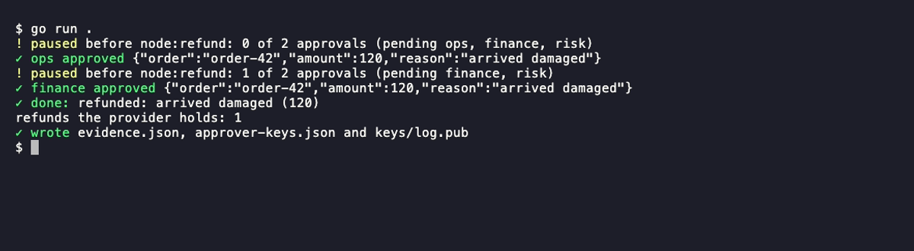

# Getting started

## Prerequisites

- Go 1.27 or newer (the core uses generic methods). If `go version` is older, upgrade or set `GOTOOLCHAIN=go1.27.0`. With the default `GOTOOLCHAIN=auto`, go fetches 1.27 by itself inside a project whose `go.mod` asks for it (`bide init` writes one), and `bide doctor` reports an older Go as a warning; with `GOTOOLCHAIN=local` or a pinned older toolchain it is a failure.
- For examples that call a live model, an API key (any OpenAI-compatible endpoint works via `WithBaseURL`). Several examples run with no key at all (see below).

## See it in 20 seconds

```
brew install bide-ai/tap/bide        # or: go install github.com/bide-ai/bide/cmd/bide@latest
bide demo
```

With Go installed you can skip the install: `go run github.com/bide-ai/bide/cmd/bide@latest demo`.

No API key, no clone, no setup. It first replays the crash without bide, where a naive retry charges the fake provider twice. Then it runs a payment agent in a child process, kills the process after the charge reaches a fake payment provider but before bide journals the result, and restarts the run: bide halts with "outcome unknown" instead of charging again, and tells ops with a signed webhook (`agent.WithNotifier` and the `notify` package) delivered to a local HTTPS receiver that verifies the signature. The demo then confirms the charge with the provider, records it (`agent.ResolveHalt`), finishes the run, verifies the signed audit trail and the 2-of-3 approval signatures, changes one amount in a copy of the journal to show that verification then fails, and opens the run in the [run viewer](guides/run-viewer.md). Pass `-no-browser` to print the viewer's address instead; the demo then serves until you press Ctrl-C. Pass `-fast` in CI: it drops the pauses and exits 0 when the demo is done, without serving or opening a browser (add `-keep` to keep the journal and print the `bide view` command that reopens the run).

## Explore a sample journal

No code needed: `bide sample` writes a journal of 14 runs in every state (completed, halted,
waiting at a 2-of-3 approval gate, approved, aborted, cancelled, agent and plan flow runs), with
evidence and flow configs, and opens the [run viewer](guides/run-viewer.md#explore-a-sample-journal)
on it. Its `README.txt` lists the commands to try on the files: `bide view -config`, `bide check`,
`bide check -diff` and `bide audit verify-evidence`.

```
bide sample
```

## If something fails: `bide doctor`

```
bide doctor
```

`bide doctor` checks what a first run depends on and prints one line per check, with a fix for a failure: the Go version (1.27 or later), `bide` against the latest release (skipped offline), that SQLite works in a temporary directory, a Postgres DSN if `BIDE_POSTGRES_DSN` is set (`-postgres-env` names another variable), which model API key variables are set (names only, never values), that `GOPATH` and the module cache are writable, and, run inside a `bide init` project, that the project builds. It exits 1 if a check failed, 0 otherwise; a warning or a skipped check does not fail it. See the [CLI reference](reference/cli.md#bide-doctor).

## Start a project

```
bide init refund && cd refund
go mod tidy
go run .
```

`bide init` writes a project that runs with no API key: a plan flow (`flow.yaml`) whose model node
proposes a refund on a scripted model, a refund node behind a 2-of-3 approval gate, and a SQLite
journal. `go run .` pauses at the gate, records two signed approvals, refunds once, and writes the
evidence. It starts with a recovery pass (`agent.Recover`), so a run a crash interrupted resumes on
the next start: `BIDE_CRASH=notify go run .` kills it mid-run, and the next `go run .` finishes it
with one refund. On a terminal the story is colored (paused at the gate in amber, each approval and the finished run in green; piped or with `NO_COLOR` set it is plain text):



The project's README is the place to read next: the next steps (`bide view`,
`bide check`, `bide audit`), the crash demo, its "Start over" command, and the marked block in
`model()` that swaps in a real model when `OPENROUTER_API_KEY` or `OPENAI_API_KEY` is set (start
over first: a finished run is read back from the journal, so the new model would not be called).
The real model is sent the refund type's JSON schema as structured output. To gate only refunds over a threshold, see the [refund recipe](recipes/refund-approval.md).

## Install

There are two things to install, for two audiences. The `bide` command (`bide init`, `bide demo`, `bide sample`, `bide view`,
`bide approve`, `bide keygen`, `bide check`, `bide migrate`, `bide audit`; see the [CLI reference](reference/cli.md)) is one program for everyone,
installed as above. An approver whose key is in an HSM or a KMS also builds `bide-hsm` from source ([reference](reference/bide-hsm.md)). To build agents, add the library to a module of your own.

In a module of your own (`go mod init example.com/hello` in a new directory):

```
go get github.com/bide-ai/bide/agent@latest
```

Get the `agent` package, not the module root: `go get github.com/bide-ai/bide@latest` records the module but not the dependencies of its packages, and the first build then stops with `missing go.sum entry`. Equally, write your code first and run `go mod tidy`, which adds every package you import. The core module holds the `agent` package and everything else in the core (the model adapters, `plan`, `audit`). The adapter modules (`store/sqlite`, `store/postgres`, `mcptools` (published as `mcp` up to v0.10.0), `trace`, `codec/gcf`, `govern`, and the `govern/*log` backends) are published from v0.8.0 on, tagged with the same version as the core, so you add the ones you use the same way, for example `go get github.com/bide-ai/bide/store/sqlite@latest`. To build against unreleased code instead, clone the repository and use its `go.work` (see [Building the repository](#building-the-repository)).

## Your first agent

An agent is a model, a durable store, and some tools. The loop runs to a final answer; tool results and model turns are journaled so a crashed run resumes without repeating work.

The core package is `agent`, imported from `github.com/bide-ai/bide/agent` (as the block below shows).

```go
package main

import (
	"context"
	"fmt"
	"log"
	"os"

	"github.com/bide-ai/bide/agent"
	"github.com/bide-ai/bide/model/openai"
)

type WeatherArgs struct {
	City string `json:"city" desc:"city name"`
}

func main() {
	// Any OpenAI-compatible endpoint; get a key at openrouter.ai, or see "No API key?" below.
	model := openai.New(os.Getenv("OPENROUTER_API_KEY"),
		openai.WithBaseURL("https://openrouter.ai/api/v1"),
		openai.WithModel("openai/gpt-4o-mini"),
	)
	weather := agent.MustFunc("get_weather", "Get the weather for a city",
		func(_ context.Context, in WeatherArgs) (string, error) {
			return "72F and clear in " + in.City, nil
		}, agent.WithSafety(agent.Safety{ReadOnly: true}))

	journal, err := agent.NewJournal(agent.NewMemStore())
	if err != nil {
		log.Fatal(err)
	}
	a, err := agent.New(model, journal, agent.WithTools(weather))
	if err != nil {
		log.Fatal(err)
	}
	out, err := a.Run(context.Background(), "run-1", agent.UserText("Weather in SF?"))
	if err != nil {
		log.Fatal(err)
	}
	fmt.Println(out.Message.Text())

	// The same run ID again: the run is finished, so its journaled answer comes back, and the
	// model is not called.
	again, err := a.Run(context.Background(), "run-1", agent.UserText("Weather in SF?"))
	if err != nil {
		log.Fatal(err)
	}
	fmt.Println(again.Message.Text() == out.Message.Text()) // true
}
```

Run it with `OPENROUTER_API_KEY=sk-... go run .`. It prints the model's answer (a sentence such as "It's 72F and clear in SF.", in the model's words), then `true`: the second `Run` of `run-1` read the answer back from the journal instead of calling the model or the tool again. That is how a crashed or repeated run resumes: steps already journaled are not repeated. After a crash, call `Run` again with the same run ID (or `Resume`, which needs no input): the run continues from the journal, and a side-effect tool call it completed is not made again (see the [durable steps guide](guides/durable-steps.md)).

### No API key? Use agenttest

`agent/agenttest` has a scripted model that plays back turns you write, so the same agent runs offline (in tests, too). Swap it in for the OpenAI model: the first turn calls the tool, the second answers.

<!-- docsnip: setup journal *agent.Journal; weather agent.Tool -->
```go
model := agenttest.NewScriptedModel(
	agenttest.ToolTurn("c1", "get_weather", `{"city":"SF"}`),
	agenttest.TextTurn("It's 72F and clear in SF."),
)
a, err := agent.New(model, journal, agent.WithTools(weather))
```

With it the program prints `It's 72F and clear in SF.` and then `true`, with no network access.

`NewMemStore` is in-memory; for durable resume across restarts use the SQLite store (`store/sqlite`) or the Postgres store (`store/postgres`) for high availability (see the [Postgres store guide](guides/postgres.md) for running it without DDL rights). See the [durable steps guide](guides/durable-steps.md) and [debugging and recovery](guides/debugging.md).

## Configuring an agent

`agent.New(model, journal, opts...)` builds an agent from options, and checks them all when the agent is built: a nil model, a duplicate or reserved tool name, a tool name the agent's model refuses (when the model declares its rule, as the bundled adapters do), a tool whose input schema is not a JSON object, an m-of-n approval policy with no `WithApproverVerifiers`, a negative limit and every other configuration problem is an error wrapping `agent.ErrConfig`, returned by `New`, never by the first run.

<!-- docsnip: setup model agent.Model; journal *agent.Journal; weather agent.Tool -->
```go
a, err := agent.New(model, journal,
	agent.WithTools(weather),
	agent.WithSystemPrompt("You are a concise assistant."),
	agent.WithMaxTurns(8),
	agent.WithSampling(agent.Temperature(0)),
)
```

An agent built this way does not change. `a.With(opts...)` returns a configured copy (a stricter budget for one tenant, an extra tool for one route) and leaves `a` as it was, so both can run at once. For any setting the last value given wins; `WithSystemPrompt` and `WithSystemPromptFunc` share one slot, so the later of the two wins. Build a `[]agent.Option` to choose options conditionally.

Some options apply at more than one scope, and each constructor's type says which: `WithMaxTurns`, for one, is an `agent.AgentRunOption`, a setting for an agent and, passed to `Run`, for a single run; `WithSafety` is an `agent.SafetyOption`, which a tool and a `Step` both take; `WithMaxConcurrency` caps an agent's tool calls and `Parallel`'s tasks alike. An option passed where it does not apply does not compile.

## Run an example

The repository ships runnable examples in `examples/`. Some need a live model; several run offline with a small inline model, which is the fastest way to see the durable mechanics. The examples in the core module run from anywhere, without a clone:

```
# needs a key (any OpenAI-compatible endpoint)
OPENROUTER_API_KEY=sk-... go run github.com/bide-ai/bide/examples/smoke@latest

# no key needed: durable mechanics with an inline model
go run github.com/bide-ai/bide/examples/interrupt@latest   # human-in-the-loop pause and resume
go run github.com/bide-ai/bide/examples/signals@latest     # deliver an external event into a waiting run
go run github.com/bide-ai/bide/examples/recover@latest     # durable resume after a simulated crash
```

From a clone (`git clone https://github.com/bide-ai/bide && cd bide`), the same examples run as `go run ./examples/<name>`. A few examples are modules of their own, to keep their dependencies out of the core (`approval`, `govern`, `mcp`, `observability`, `plan`): run them from their own directory in the clone, as [examples/README.md](../examples/README.md) does, for example `cd examples/observability && go run .` (OTel spans printed to stdout, with token-to-cost).

See [examples/README.md](../examples/README.md) for the full list.

## Building the repository

This is a multi-module workspace (`go.work`): the core is one module and adapters such as `trace`, `mcptools`, `store/*`, `govern`, and the `govern/*log` backends are their own modules. To build or test a module with the versions pinned in its `go.mod` rather than the workspace, set `GOWORK=off` in its directory (at the root, `./...` covers only the core module):

```
GOWORK=off go build ./...
GOWORK=off go test ./...
```

See [module structure](reference/module-structure.md) for the layout and [CONTRIBUTING.md](../CONTRIBUTING.md) for the full build and test conventions.

## Where next

- Complete flows to copy and run (a refund with a 2-of-3 approval, invoice approval, ticket triage, a safe record update, an ambient agent, a webhook that tells a person when a run needs them): the [recipes](recipes/index.md).
- The vocabulary: [Concepts](CONCEPTS.md).
- Authoring flows as typed topology instead of plain Go: the [plan flows guide](guides/plan-flows.md) (the optional `plan` builder and declarative config).
- The precise guarantee and its bounds: [Guarantee](GUARANTEE.md), [Known limitations](KNOWN-LIMITATIONS.md).
- The full map: the [docs index](README.md).
