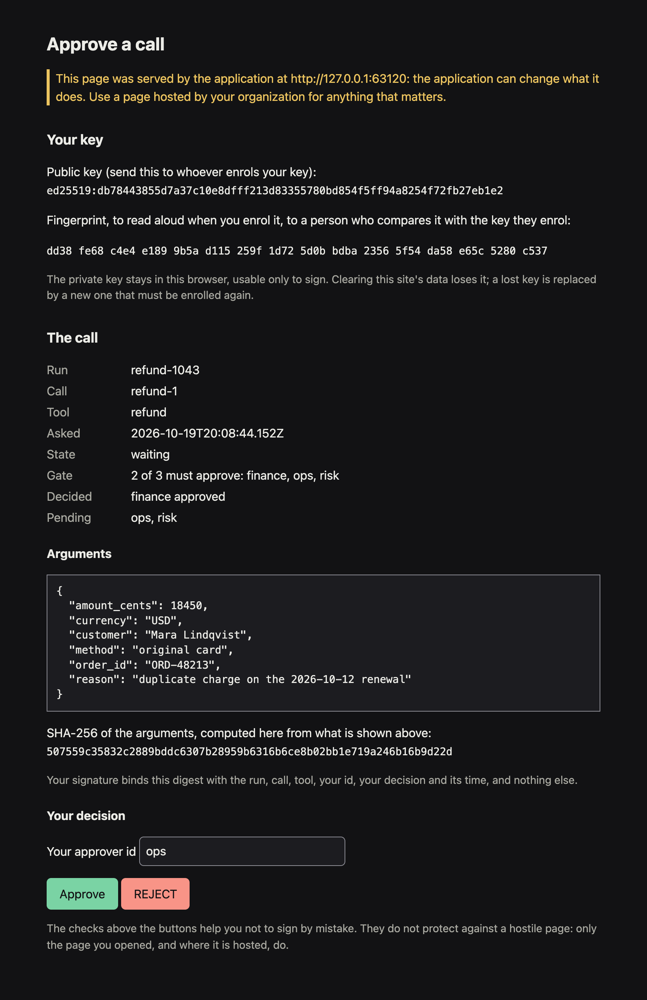
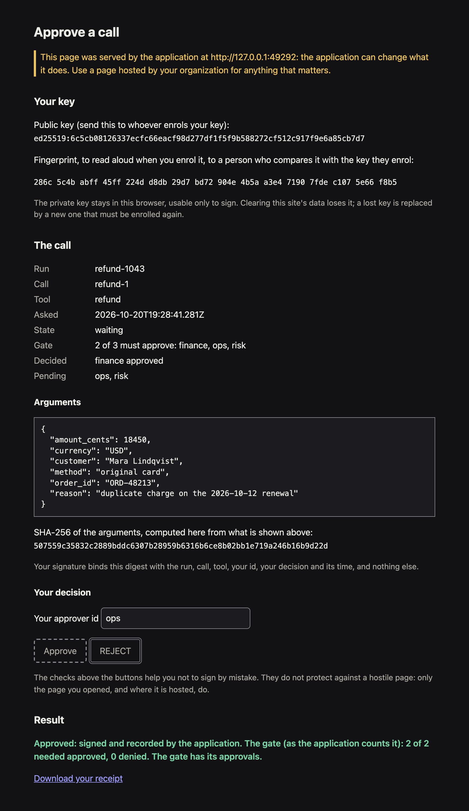

# Human approval (human-in-the-loop)

A tool can require a human decision before it runs. The decision is a journaled step, so it survives
a crash, and the run pauses durably until it lands. There are two forms:

- **1-of-1:** one human approves or denies (`agent.WithApproval(agent.SingleApproval())` + `agent.Approve`).
- **m-of-n:** k distinct, named approvers out of a bounded set of n must sign off
  (`agent.WithApproval(&agent.ApprovalPolicy{...})` + `agent.SubmitDecision`). Each decision is signed over
  the exact call (tool and arguments), and the fact that k approved it before it ran is provable
  offline, from evidence that cannot leave a decision out unnoticed.

The gate is part of the tool's spec (`ToolSpec.Approval`), not of its `Safety`, which only says how
a call may be retried. A `SubAgent` takes `WithApproval` too, so a parent can require approval before
it delegates. Each call's result journals the policy it ran under (`Record.Approval`).

Approvers can decide from a terminal with [`bide approve`](#deciding-from-the-terminal).

For a typed value rather than a yes/no, use `Interrupt`/`AnswerInterrupt` instead (see the
[tour](../tour.md#human-in-the-loop)).

## 1-of-1

<!-- docsnip: setup ctx context.Context; a *agent.Agent; journal *agent.Journal; runID string; input string; type RefundArgs struct{}; doRefund func(context.Context, RefundArgs) (string, error) -->
```go
refund := agent.MustFunc("refund", "refund the order", doRefund, agent.WithApproval(agent.SingleApproval()))

_, err := a.Run(ctx, runID, agent.UserText(input))
if pend, ok := errors.AsType[*agent.ApprovalPending](err); ok {
	// ... get a human decision ...
	agent.Approve(ctx, journal, pend.RunID, pend.ToolUseID, true)
	res, _ := a.Run(ctx, pend.RootRunID, agent.UserText(input))
	var out agent.Message
	if res != nil {
		out = res.Message
	} // resumes past the pause
}
```

The first decision recorded for a tool call wins. The record notes when it was written
(`Record.RecordedAt`, `recorded_at`): the clock of the process that called `Approve` (its
`agent.WithClock`, else the run's clock on `ctx`, else its wall clock), kept from the first call. It
is not signed (a 1-of-1 decision carries no signature), so it is that process's claim, anchored by
the journal's Merkle trail once a signed head covers it, and the gate never reads it. `bide view`
shows it on the timeline and the gate card; a decision an earlier version recorded has none. A denial is fed back to the model as the tool
result `tool call denied by human`, so the model can react rather than the run failing.

A recorded denial is final even if the tool's gate is removed or loosened before the run is driven
again: the call is denied, not run. An approval is not carried over the same way. While a gate is
configured, the call's decision is taken under the gate's current policy, so a gate tightened (from
1-of-1 to m-of-n, say) before the call ran asks again.

## m-of-n

Declare the policy on the tool, and tell the agent how to resolve an approver id to the key that
verifies that approver's signature:

<!-- docsnip: setup model agent.Model; journal *agent.Journal; type RefundArgs struct{}; doRefund func(context.Context, RefundArgs) (string, error); approverKeys map[string]ed25519.PublicKey -->
```go
refund := agent.MustFunc("refund", "refund the order", doRefund,
	agent.WithApproval(&agent.ApprovalPolicy{
		Need:      2,
		Approvers: []string{"ops", "finance", "risk"}, // n = 3
	}))

a, err := agent.New(
	model,
	journal,
	agent.WithTools(refund),
	agent.WithApproverVerifiers(func(id string) (agent.ApproverVerifier, bool) {
			pub, ok := approverKeys[id] // your PKI: id -> public key
			if !ok {
				return nil, false
			}
			return audit.Ed25519Verifier{Pub: pub}, true
		}),
)
if err != nil {
	panic(err)
}
```

Each approver needs a key of their own. A seat is a key, not an id: if two approvers' verifiers
resolve to one key, whoever holds it can sign as both, so the gate refuses that policy with
`ErrConfig` (see [Configuration errors](#configuration-errors)). The gate tells keys apart with
`ApproverVerifier.KeyIDs`, which the `audit` verifiers derive from the public key's bytes; a
verifier of your own must implement it the same way (see [Key identity](#key-identity)).

When the run pauses, each approver signs the paused call's subject with their own key and records
the decision:

<!-- docsnip: setup ctx context.Context; journal *agent.Journal; err error; financeSigner audit.Signer -->
```go
if pend, ok := errors.AsType[*agent.ApprovalPending](err); ok {
	// Show the approver pend.ToolName and pend.Args: that is exactly what they sign.
	decidedAt := time.Now() // when the approver decided, by their clock; signed with the decision
	msg := agent.ApprovalDecisionBytes(pend.Subject(), "finance", true, decidedAt)
	sig, _ := financeSigner.Sign(msg) // any audit.Signer: Ed25519, ML-DSA, or hybrid
	agent.SubmitDecision(ctx, journal, agent.Decision{RunID: pend.RunID, ToolUseID: pend.ToolUseID,
		ApproverID: "finance", Approved: true, DecidedAt: decidedAt, Alg: financeSigner.Alg(), Signature: sig})
}
```

`Decision.DecidedAt` is when the approver decided, by their own clock, and is required: pass the
same time to `ApprovalDecisionBytes` and to `Decision`, since the signature covers it (see [When a
decision was made](#when-a-decision-was-made)). `Decision.Alg` names the scheme the signature is
under (`ed25519`, `ecdsa-p256`, `ml-dsa-65`, `ed25519+ml-dsa-65`) and is required too (`SubmitDecision` refuses an empty one, or a zero `DecidedAt`, with
`agent.ErrConfig`, and so an `ApproverID` that is not printable ASCII, which no policy can name). It is journaled with the decision as `Record.ApproverAlg`, and the
gate counts the decision only if it equals the `Alg()` of the verifier your resolver returns for
that approver: a valid signature journaled under another scheme name, or none, is ignored with
`agent.ReasonAlg`. One key fills one seat (see [Key identity](#key-identity)), and `bide audit
verify-approvals` also refuses an approver-key file that gives two ids one key, compared by key
identity, whether or not both ids are in the policy (exit 4).

Then re-run `pend.RootRunID`. The gate evaluates the recorded decisions:

| Outcome | When | What happens |
|---|---|---|
| **Proceed** | approvals >= `Need` | the tool runs |
| **Deny** | fewer approvers remain who have not validly denied than `Need` | the tool is skipped and the model gets the same `tool call denied by human` result as a 1-of-1 denial |
| **Pause** | otherwise | `Run` returns `*ApprovalPending` with `Quorum` set to the running tally |

<!-- docsnip: setup err error; pend *agent.ApprovalPending -->
```go
if errors.As(err, &pend) && pend.Quorum != nil {
	q := pend.Quorum // Need, Approved, ApprovedBy, Denied, DeniedBy, Pending (who has not validly decided)
	fmt.Printf("%d of %d approved, waiting on %v\n", q.Approved, q.Need, q.Pending)
}
```

With `Agent.Stream`, the `ApprovalRequired` event carries the same tally in its `Quorum` field, so a
UI can show progress as the run pauses, before `Final` returns. It is nil for a 1-of-1 gate.

### What an approver signs

`ApprovalDecisionBytes` binds the run id, the call id, the tool name, a SHA-256 of the call's
arguments, the approver id, the decision, and the time the approver decided, under a version tag
(`bide.approval.v3`), with every field length-prefixed.
A signature therefore approves one exact call: it does not verify for another run, another call, the
same call id with different arguments, or another approver. If a UI showed an approver stale
arguments, their signature does not count for the real call.

The arguments are hashed in a canonical form (keys sorted, no insignificant whitespace, no HTML
escaping, number literals kept verbatim, empty arguments as `{}`), so the same call signs the same
whether its arguments came from a live model stream, the journal, or a re-indented evidence file.
The full layout is documented on `ApprovalDecisionBytes`, so a non-Go verifier can reproduce it:

```
"bide.approval.v3\n"
len32(run id)       run id
len32(call id)      call id
len32(tool name)    tool name
SHA-256(canonical arguments), 32 bytes
len32(approver id)  approver id
1 byte              1 approved, 0 denied
len32(decided_at)   decided_at, 24 bytes, e.g. "2026-10-13T12:14:03.123Z"
```

`len32` is a 4-byte big-endian length. (A certificate-bound approver, once that feature ships, signs
`bide.approval.v4`: the same layout with the SHA-256 of its leaf certificate before `decided_at`. This
version defines and journals that format but counts none; bare-key approvers are unchanged. See the
[design](../design/design-mofn-approval.md#v4-certificate-bound-decisions-format-only).) The version tag is part of the signed bytes, so a decision
signed under an earlier version (`bide.approval.v2`, which had no decision time) does not verify:
the gate and `VerifyApprovals` ignore it with `agent.ReasonNoDecidedAt`. Re-sign such a decision.

The decision time is signed in one form only: RFC 3339 in UTC, to the millisecond, always ending in
`Z` (`agent.FormatTimestamp`, the same form as a run's `started_at`). A verifier parses the
recorded text, formats it again, and refuses the decision (`agent.ReasonDecidedAt`) unless the two
are byte for byte the same, so `+00:00`, another offset, one or nine fractional digits, no fraction,
a lowercase `t` or `z`, and a leap second (`23:59:60`) are all refused. One instant therefore has one
signed spelling. An approver who sends a decision over the wire sends this text, and
`agent.ParseTimestamp` reads it back.

### When a decision was made

Every decision carries two times, kept apart on purpose:

| Time | Whose clock | How it is protected |
|---|---|---|
| `decided_at` (`Record.DecidedAt`) | the approver's, when they signed | inside the signature: it cannot be changed after signing, but it is the approver's claim, and their clock may be wrong |
| `recorded_at` (`Record.RecordedAt`) | the submitter's: the process that called `SubmitDecision`, when it journaled the decision (its `agent.WithClock`, else the run's clock on its context, else its wall clock); an identical resubmission keeps the first time | not signed: it is the submitter's claim. Anchored by the journal's Merkle trail, with the record, once a signed tree head covers it; the audit flags one later than that head (`audit.FlagRecordedAfterHead`) or out of journal order (`audit.FlagRecordedOutOfOrder`) |

Both are for people and auditors. **Neither affects the gate**: `TallyApprovals` checks
`decided_at` only as signed bytes (present, canonical, covered by the signature), never reads its
value or `recorded_at`, and orders decisions by their place in the journal alone. The same
decisions count the same way whatever their times say.

`audit.VerifyApprovals` reports both times for every counted decision (`ApprovalVerdict.Times`),
and when the run asked for approval (`AskedAt`: on a plan flow node, the `recorded_at` of the
gate's request, which the ordering rule counts from; otherwise, or when the request has none, that
of the gate's `approval-pending` record). It flags, without failing the verdict or uncounting
anything:

- `decided_at` more than a tolerance after `recorded_at` (`audit.FlagDecidedAfterRecorded`; 5
  minutes by default, `audit.DefaultDecisionTimeTolerance`, or any other with
  `audit.CheckDecisionTimes`): a decision cannot be recorded before it is made, so the approver's
  clock runs ahead;
- `decided_at` before the run asked (`audit.FlagDecidedBeforeAsked`): the approver's clock runs
  behind, or the decision was signed in advance. The gate never counts a decision by its time: it
  reads only decisions on this exact call, and on a plan flow node only those recorded after the
  gate's request (`SubmitDecision` refuses one recorded before it). So a flagged decision was still
  recorded after the request; the flag says its signed time disagrees;
- no ask time in the evidence (`audit.FlagAskedUnknown`: a run an earlier version recorded, or a
  pause record lost to a crash), so the check above was not made;
- `recorded_at` missing or not a canonical time (`audit.FlagRecordedAtInvalid`): every report
  prints it quoted, as text;
- `recorded_at` more than the tolerance before an earlier decision's, or before the run asked
  (`audit.FlagRecordedOutOfOrder`), or after the signed tree head that covers the record
  (`ApprovalVerdict.HeadAt`, `audit.FlagRecordedAfterHead`): the journal's order, or the head,
  says the submitter's time is wrong.

Times run from the year 0001 to 9999; a decision time outside them has no canonical form.

The gap between the two times is shown, not judged. `bide audit verify-approvals` prints all of it,
with `-decision-time-tolerance` to change the tolerance, and `bide view` shows it on each approver's
card.

A later version may add an RFC 3161 trusted timestamp to each decision, a third time vouched for by
a timestamp authority rather than by the approver or by the submitter. It is not part of this
version.

### What counts

Each distinct decision is its own journal record. Over those records, in journal order, an
approver's decision is their **first valid** one: the approver is in the policy's `Approvers`, the
resolver returns their key, no other approver's verifier reports that key, the record carries a
signed decision time in canonical form, and the signature verifies for this call. So:

- **A bad record never locks an approver out.** A forged signature, a signature with the wrong key,
  or a record written straight into the journal is ignored, and the approver's real decision still
  counts when it arrives.
- **A later decision does not override an earlier valid one.** A change of mind is superseded, the
  same rule as 1-of-1. Resubmitting a decision is a no-op: its journal step is named by the decision
  (call, approver, verdict, scheme and `decided_at`, `agent.DecisionStep`), never by its signature bytes, so a
  randomized scheme such as `ecdsa-p256`, which signs one decision differently each time, still journals it
  once, even when two submissions race. Exactly: an identical resubmission (same signature), including of a
  decision a version that named by signature journaled, is a no-op with or without `WithDecisionCheck`;
  a re-signing under different bytes is found and not rewritten only with `WithDecisionCheck`, which reads
  the signatures (without it the library cannot tell a re-signing from a bad record, and writes the
  second under a signature-derived name, which the counting rule supersedes). A record that is not the
  approver's valid decision never takes the decision's name. `agent.HeldDecisionStep` finds the record
  that holds a decision (signature included) wherever it is; held is not valid, and with the approvers'
  resolver it also says whether the record verifies and, in a flow gate, follows the request (a record
  written before it is held and never verified); `agent.DecisionStep` is only the name
  written first, not a lookup key.
- **Only valid denials can deny.** Invalid records never count toward "k is unreachable", so they
  cannot force a denial either.
- **One key is one seat.** An approver whose verifier shares a key identity with another approver's,
  or reports none, never counts (`agent.ReasonSharedKey`, `agent.ReasonNoKeyID`), and neither does the
  other approver on that key, whichever signed first. The gate refuses such a policy before it
  counts; the counting rule excludes those seats as well, so a resolver that answers differently
  between the check and the count still cannot seat one person twice.
- **The requester never counts under separation of duties.** With `ExcludePrincipal`, an approver
  whose id is a requester of the run fills no seat (`agent.ReasonRequester`); see [Separation of
  duties](#separation-of-duties).
- A `SubmitDecision` decision never satisfies a 1-of-1 gate, and `Approve` never counts toward an m-of-n
  one.

This rule is `agent.TallyApprovals`, a pure function the gate calls at run time and
`audit.VerifyApprovals` calls offline, so the two cannot count differently.

### Feedback at submission

By default `SubmitDecision` records the decision without checking it; the gate checks every record
itself. To tell an approver immediately that their decision will not count, pass
`agent.WithDecisionCheck(resolver)`: it verifies the signature against the recorded call and returns
`agent.ErrInvalidApproval` (no such call, unknown approver, a scheme that is not the approver key's,
or a signature that does not verify) or
`agent.ErrAlreadyDecided` (their earlier valid decision already counts), and records nothing.
Eligibility is not checked there, because the policy lives on the tool.

### What the gate records

Every decision is a journaled step, so decisions survive crashes and can arrive over any span of
time. When the gate reaches a terminal outcome (proceed or deny), it journals the tally as its own
step, `approval-tally:<encoded toolUseID>` (`agent.ApprovalTallyStep`), **before the tool runs**. That record carries the policy it
enforced (`Need`, `Approvers`, and `ExcludePrincipal` with the `Requesters` it excluded), who approved
and denied, who filled no seat (`Excluded`), and the name of every decision record it read
(`Records`). A resumed run reads that record instead of recounting, so the outcome is fixed once
decided even if keys rotate or the policy changes later. A pause records no decision and no tally, so
it stays open for more decisions. It does record that the run waits:
`approval-pending:<encoded toolUseID>` (`agent.ApprovalPendingStep`), an `agent.ApprovalWait` with the
call's ID and tool, the gate's `Need` and `Approvers` (or `Single`), its `ExcludePrincipal` and
`Requesters` when it excludes the requester, and when the run paused
(`RecordedAt`, by the run's clock), so a reader such as `bide view` can list the gate before anyone
decides, and an auditor can see when approvers were asked. The run writes it once, in the drive whose model turn made
the call, and a resume writes nothing. It is informational only: the gate, a resume and recovery never
read it, and a failed write of it is dropped.

When the gate asks again over a recorded tally it does not act on (a tally that predates
`bide.approval.v3`, or one that passed without excluding the requester under a policy that now
excludes it), the drive that pauses at the re-ask also records a re-ask note:
`approval-pending:<encoded toolUseID>:v3` or `:sod` (`agent.ApprovalReaskStep`), an
`agent.ApprovalWait` with the policy the gate asks under, why (`Reask`) and the tally it asks over
(`Supersedes`). It is written only if absent (the first writer wins), by every drive that pauses at
the re-ask, so one lost to a crash is written by the next. The first note keeps the policy of the
first pause; `bide view`, `bide approve`, the intake's note fallback, notifications and evidence read
the newest note (`agent.LatestPauseNote`), so a gate that asks again after a policy change shows as
waiting under the policy it asks under. A notification for a re-ask is an event of its own
(`agent.ApprovalReaskKey`, and `reask` in the webhook payload; a certificate-bound gate's re-asks are described below). Like the first note, the gate never
reads it. The note is insert-once by name, so a journal writer without approver keys could pre-insert
one; readers therefore honor a re-ask note only if the journal holds a recorded tally the gate would ask
again over for that reason, and the note names it (`agent.ValidReaskNote`). A note the journal does not
prove is ignored, and the reader falls back to the first note.

### A run approved under an earlier decision format

A run that an earlier version paused at an m-of-n gate, approved under `bide.approval.v2` (decisions
with no signed time), and stopped before the call ran, journaled a tally that passed on decisions
this version does not accept. Resumed now, the gate does not run the call on that tally: it asks
again. `Run` returns `*ApprovalPending` with `Reason` set to `agent.PendingReapproval` and a fresh
count (`Quorum`, whose `Supersedes` names the old tally), and `bide view` shows the gate as waiting
for approval again. Approvers sign again under `bide.approval.v3` with `SubmitDecision`; once the
gate passes it records the new outcome under `approval-tally:<encoded toolUseID>:v3`
(`agent.ApprovalRetallyStep`), which every later drive, `audit.ApprovalEvidence` and
`audit.VerifyApprovals` read in place of the old tally, and the call runs. A tally an earlier
version recorded as a denial stays final, since it runs nothing, and a call that already ran under
the earlier version is not asked again.

### A gate with a certificate-bound approver: its tally, its holds and its re-asks

A gate with at least one certificate-bound approver (an approver whose verifier is an `audit.CertApprover`;
see the [approver-identity design](../design/approver-identity.md)) records its terminal tally under
`approval-tally:<encoded toolUseID>:ident` (`agent.ApprovalIdentTallyStep(call, 0)`), a denial and an
expiry included, never under the plain name. The identity record of the count
(`approval-identity:<id>:0`) is journaled before it. A gate of bare-key approvers is unchanged.

- **A plain-name tally is superseded.** If the journal holds a plain-name tally that passed
  (`approval-tally:<id>`, or its `:v3` or `:sod` re-tally) on such a gate, it was counted without the
  approvers' certificates, so the call does not run on it. The gate asks again: `Run` returns
  `*ApprovalPending` with `Reason` `agent.PendingIdentReapproval`, approvers decide with their
  certificates, and the new count is recorded under the `:ident` name with `Supersedes` naming the plain
  tally. A plain-name denial stays final, as on any gate.
- **Generations.** A gate has generations. Generation 0 is its first count. An exec hold of generation
  `g` (`approval-exec-hold:<id>:<g>`, `agent.ExecHold`, `agent.ApprovalExecHoldStep`) supersedes the
  generation-`g` tally if that tally passed: the call does not run on it, the gate asks again
  (`agent.PendingExecHoldReapproval`), and the next count is generation `g+1`, recorded under
  `approval-tally:<id>:ident-reask:<g+1>` with its own identity record, its `Supersedes` naming the
  tally it replaces. Decisions are not invalidated by a hold: the new count verifies them again, so one
  whose certificate was revoked since fails there and the others count. A hold counts only over a
  passed tally of its own generation; a hold of another call or generation, one that does not read as a
  hold, one with no tally under it, and one over a denial are ignored. This build reads exec holds. The
  pre-execution status check that writes them is a later step of the approver-identity work, so until it
  lands no run writes one.
- **The outcome** (`agent.RecordedTally`, the one rule every reader goes by) is the newest identity
  tally that is not held. Over a hold there is no outcome until the next generation is counted, and a
  plain-name tally beside an identity tally is never the outcome.
- **Re-ask notes.** The drive that pauses at such a re-ask records `approval-pending:<id>:ident:<n>`
  (`agent.ApprovalIdentReaskStep(call, n)`: `n` is 0 over a plain-name tally and `g+1` after the hold of
  generation `g`), an `agent.ApprovalWait` with the policy the gate asks under, `Reask`, and the tally it
  asks over in `Supersedes`. Readers honor it only if the journal proves it (`agent.ValidReaskNote`): the
  plain tally passed, or the hold of that generation is there over a passed tally. The newest generation's
  note is the one `agent.LatestPauseNote` returns. A notification for it has the key
  `approval:<run>:<call>:reask-ident-<n>` (`agent.ApprovalIdentReaskKey`), ends when the identity tally of
  generation `n` or the call's result is recorded, and carries `reask` as for any re-ask.
- **Evidence** (`audit.ApprovalEvidence`) carries the superseded tallies, the exec holds between them and the
  re-ask notes, in journal order; `audit.VerifyApprovals` reads the outcome by the same rule and reports a
  hold that is not between the tally it holds and the tally that replaces it. Evidence is a selection the
  producer makes: a verifier cannot tell that a hold and the tally that replaced it were left out, which a
  check of the complete journal does.
- **Separation of duties cannot be turned on after the count.** If a certificate-bound gate's recorded tally
  passed without excluding the requester and the policy now excludes it, the gate refuses with `ErrConfig`
  instead of asking again in place (it has no re-tally name for that case); the call does not run.

### A decision written by another process

When approvers record decisions with a tool that writes the database directly (not through the
application), the application's `audit.AuditedStore` did not write them, and no signed tree head
covers them until the application next writes to that run. Run `agent.RecoverLoop` (or `agent.Recover`) over the
`AuditedStore`: each pass re-signs the runs it found waiting on an approval or a halt resolution,
so the decision is under a signed head within one pass of a run that pass drives (see
[the audit guide](audit.md)). Being under a signed head is not being authentic: it means the
database held the record when the head was signed. `bide audit verify-decision-coverage` checks a journal export
against the published heads and fails a decision no head covers within a bound you state, by
journal position (`-max-records`) or by age (`-max-age`, which compares two machines' clocks).

### Inside a sub-agent

An m-of-n tool inside a `SubAgent` pauses the whole tree: the parent's `Run` returns the sub-run's
`*ApprovalPending`. Two details follow from where the gate runs:

- set `WithApproverVerifiers` on the **sub**-agent, since that is the agent whose tool is gated;
- approvers sign `pend.Subject()` and record against `pend.RunID`, the sub-run's id
  (`agent.SubRunID(parentRunID, toolUseID)`, `<parentRunID>><encoded toolUseID>`). A decision signed against the parent's run id does not verify, and
  does not lock the approver out: re-signed correctly, it counts.

### Separation of duties

Set `ExcludePrincipal` and the gate never counts a decision by the run's **requester**, so the
person or service that initiated an action cannot also approve it (maker-checker):

<!-- docsnip: setup type RefundArgs struct{}; doRefund func(context.Context, RefundArgs) (string, error) -->
```go
refund := agent.MustFunc("refund", "refund the order", doRefund,
	agent.WithApproval(&agent.ApprovalPolicy{
		Need:             2,
		Approvers:        []string{"ops", "finance", "risk"},
		ExcludePrincipal: true, // the run's requester may not approve
	}))
```

The requester is the run's principal: the `OnBehalfOf` of the `agent.Identity` the deployment
starts the run with. The deployment sets it from its own authentication (an IdP session, a service
identity), never the model. The run's first drive journals it in a record of its own,
`run:principal` (`agent.RunPrincipal`), before `run:start`, and in `run:start` too. Once journaled it
is fixed: a later drive under another principal is `ErrConfig`, and a drive that passes none runs
under the journaled one.

<!-- docsnip: setup ctx context.Context; a *agent.Agent; runID string -->
```go
_, err := a.Run(ctx, runID, agent.UserText("refund order 42"),
	agent.WithIdentity(agent.Identity{Actor: "refund-agent@1.4.2", OnBehalfOf: "ops"}))
```

A plan flow run takes the same option: `f.Run(ctx, journal, runID, in, agent.WithIdentity(id))`.

**Runs above the run are requesters too.** A run started inside another run's drive (a sub-agent's
run, a delegation through `audit.AttenuatingSubAgent`, a `SubRunFor` run, or a plan flow started
from a tool) records, in its `run:principal` and its `run:start`, the principals of every run above
it, root first (`RunPrincipal.Ancestors`). The gate excludes all of them
(`RunPrincipal.Requesters`): a delegated sub-run acts for the delegating grant's subject, but the
person who started the root run still may not approve the sub-run's call. The tally lists them in
`Requesters`.

- **What counts.** An approver id equal to any requester, ignoring ASCII case (the rule `Validate`
  holds approver ids to), fills no seat: their decisions, approvals and denials alike, are listed
  with `agent.ReasonRequester` and never count, and the tally lists them in `Excluded`. `k` must
  then be met by the other approvers. A requester who is not an approver (a service, a desk)
  excludes no one.
- **It fails closed.** On every evaluation, before it reads a recorded tally, the gate refuses with
  `ErrConfig`:
  - a run with no `run:principal` (no identity, or one with an empty `OnBehalfOf`), or one in which
    the run, or a run above it, records no `OnBehalfOf` (who requested is then not known, so no one
    could be excluded for it);
  - a requester that is not printable ASCII (it cannot be compared with approver ids, and could only
    look like one);
  - a run whose `run:principal` follows the call's request, or disagrees with its `run:start`. A run
    started before this version gets its `run:principal` from the first drive under this version,
    so it names whoever resumed the run; nothing backfills the requester, so such a run cannot pass
    an excluding gate: cancel it and start the work again as a new run;
  - a policy whose `Need` is out of reach once the requesters' seats are taken away (3 of 3 where
    one of the three requested). `Validate` cannot check this, since it depends on who requests; it
    refuses `ExcludePrincipal` on `SingleApproval()`, whose decision names no approver.
- **A tally recorded before the exclusion does not decide.** When the policy comes to exclude the
  requester (a redeploy) after the gate recorded a passing tally under a policy that did not, and the
  call has not run, the gate asks again (`agent.PendingSoDReapproval`), counts without the
  requesters, and records the new outcome under `approval-tally:<id>:sod`
  (`agent.ApprovalSoDRetallyStep`, whose `Supersedes` names the old tally); every reader, and the
  evidence, goes by it. A recorded denial stays final. A tally that excluded other requesters than
  the run's `run:principal` names is refused (`ErrConfig`). Drain the processes still on the old
  policy before relying on the exclusion: while both run, an old process may run a call that a new
  one re-tallies, and the audit then reports the re-tally (see
  [Known limitations](../KNOWN-LIMITATIONS.md)).
- **Offline.** The `run:principal` record is the evidence of who requested, and it holds nothing
  else: not the run's input. `ApprovalEvidence` discloses it for a gate that excluded the requester,
  and `VerifyApprovals` recounts with the same exclusion (see [Proving the gate
  held](#proving-the-gate-held)).

It compares ids, not people. The gate cannot see that the requester also holds another approver's
key; issuing one key per person, and naming the requester and the approvers in one id namespace, is
the deployment's part. The acting agent instance (`Identity.Actor`) is not the requester.

### Configuration errors

A malformed policy is refused when the tool is built: `agent.WithApproval` (on `Func`,
`CompensatedFunc`, `SubAgent` and the other constructors that take tool options) panics with
`ErrConfig`, and `New` refuses one a tool's own `Spec` returns (every run fails with `ErrConfig`
before any model call). A policy is malformed when it has no approvers (only
`agent.SingleApproval()` asks for the one-decision gate; a policy literal such as `{Need: 1}` with an
empty approver list is refused, never taken for it), an empty or duplicate approver id, an id that
is not printable ASCII, or `Need` outside `1..len(Approvers)` (see `ApprovalPolicy.Validate`), or when it
is a `SingleApproval()` whose fields were changed or that sets `ExcludePrincipal`. A policy that excludes
the requester is also refused at the gate for a run it cannot apply to (see [Separation of
duties](#separation-of-duties)).

Verifiers are needed only for an m-of-n gate: the gate fails with `ErrConfig` (rather than counting
zero decisions) when a tool has an m-of-n policy but no `WithApproverVerifiers` resolver is set, or
when an eligible approver's verifier has an empty `PublicKey()` (see above). A `SingleApproval()`
gate needs none.

Approver ids are printable ASCII: bytes 0x21 to 0x7E, so letters, digits and punctuation (an email
address such as `ops@example.com` or a URI is a valid id), and no space, control character or
character outside ASCII. An id outside that set could look like another one, a Cyrillic `о` in
place of a Latin `o`, a fullwidth or an accented spelling, and let one approver fill two seats, so
it is refused with `ErrConfig` naming it. Ids are compared as exact bytes, but a policy may not list
two that differ only by case (`alice` and `Alice`): a reader of the policy, or a key lookup that
folds case, would take them for one approver, so such a policy is refused naming both ids. Map
names in other scripts to ASCII ids in your directory (an employee number, an email address).

Distinct ids are not enough: the gate also refuses, with `ErrConfig` naming both approvers and the
key, a policy two of whose approvers' verifiers report a common key identity, and a policy with an
approver whose verifier reports no key identity (an empty `KeyIDs`, or an empty entry in it). The
holder of a shared key could otherwise sign as each approver it serves and meet the quorum alone.
An approver the resolver does not know is not refused: their decisions cannot verify, so they fill
no seat. The gate runs this check on every evaluation, before it reads a recorded tally, so a
resolver changed between one resume and the next is checked again. The check guards the tallies
this version counts and records. A terminal tally already in the journal is reused, not recounted
(see [What the gate records](#what-the-gate-records)), so a tally recorded by an earlier version,
which did not compare keys, stands as recorded even if it counted two approvers on one key. Finish
or audit such runs before relying on this check for them (see the CHANGELOG's upgrade note).
`ApprovalPolicy.ValidateKeys(resolver)` runs the same check (with `Validate`), so a deployment can
refuse a bad pairing of policy and keys at startup, before any call pauses.

### Key identity

`ApproverVerifier` has two methods: `Verify`, and `KeyIDs() []string`, the identities of the keys
behind `Verify`. An identity names a key, not an approver: derive it from the public key's bytes,
never from a configured name, so that two verifiers built over one key report the same identity. The
`audit` verifiers report the scheme and the hex SHA-256 of the public key's encoding
(`audit.KeyID`, for example `ed25519:3b6a27bc...`):

- `audit.Ed25519Verifier`, `audit.ECDSAP256Verifier` and `audit.MLDSAVerifier` report one identity (for
  ECDSA P-256, the SHA-256 of the 65-byte uncompressed point; a key that is not on the curve verifies
  nothing and reports none). ECDSA P-256 signs with fresh randomness, so an approver who signs the same
  decision twice produces two different signatures and so two records; the gate counts an approver once
  (their first acceptable record), as it does for any resubmission. The ML-DSA label names the
  key's parameter set (`ml-dsa-44`, `ml-dsa-65` or `ml-dsa-87`). A key that verifies nothing (a nil
  ML-DSA key, or a weak Ed25519 key) reports none, so the gate refuses it rather than seating it.
- A weak Ed25519 key is one `audit.CheckEd25519PublicKey` refuses: the wrong length, not the
  canonical encoding of a curve point, or outside the prime-order subgroup. `crypto/ed25519` accepts
  all of them. Under a small-order key anyone can forge a signature; a mixed-order key `A + T` is a
  second public key for `A`'s secret, and a non-canonical encoding is a second spelling of a key, so
  either would give one secret two identities and two seats. `Ed25519Verifier` (and so a hybrid's
  Ed25519 component) verifies nothing under a weak key and reports no identity for it. The subgroup
  check costs 1 to 4 ms of CPU per key (against about 45 microseconds for a signature check); results
  are kept in a small LRU cache, so a resolver that returns the same few keys pays it once per key.
  If your resolver takes keys from untrusted input, each new key that decodes to a curve point costs
  a check: bound or rate-limit those lookups.
- `audit.HybridVerifier` reports both component keys. A hybrid signature is meant to hold while either
  scheme holds, so if one scheme breaks, the other component's key alone signs: two approvers sharing
  either component are one seat.
- A verifier of your own that accepts a signature by any of several keys (a rotation window) reports
  every one of them, so that two approvers whose key sets overlap are refused.

Two identities are the same key only when the strings are equal. The gate cannot tell that one person
holds two different keys; see [Scope](#scope).

**Trust boundary.** A verifier is trusted code, like the resolver that returns it. The gate takes
`KeyIDs` on faith: it cannot check that the identities name the keys `Verify` really accepts, so a
verifier that under-reports its keys, or reports identities not derived from them, defeats the check.
Use the `audit` verifiers, or derive identities the same way.

**It fails closed.** Enrolling one approver's public key under a second approver (a copy-paste in
the key directory, say) makes the gate refuse the whole policy with `ErrConfig`, not just the second
approver: no call under that policy runs, and paused calls stay paused, until the keys are corrected.
A resolver that returns a typed nil verifier (a nil pointer in a non-nil interface) is refused the
same way, and so is a key a verifier cannot use (it reports no identity). If `TallyApprovals` is
handed such a resolver directly, the approvers it cannot seat are listed in the tally's `Excluded`,
never count, and are not waited on: when too few seats remain to reach `Need`, the gate denies.

### Deadlines

A gate can have a deadline: give the policy a `Timeout` (a whole number of milliseconds; zero, the
default, is no deadline).

<!-- docsnip: setup type RefundArgs struct{}; doRefund func(context.Context, RefundArgs) (string, error) -->
```go
refund := agent.MustFunc("refund", "refund an order", doRefund,
	agent.WithApproval(&agent.ApprovalPolicy{Need: 2, Approvers: []string{"ops", "finance", "risk"}, Timeout: 48 * time.Hour}))
```

`SingleApproval()` takes one too (`p := agent.SingleApproval(); p.Timeout = time.Hour`).

- **Measured from the request, fixed once.** The first time the gate waits it records
  `approval-deadline:<call>` (`agent.ApprovalDeadline`): when the request was recorded (the
  `approval-pending` note's time, or a plan flow node's `approval-request`) and that plus the
  timeout. From then on the gate reads the deadline from that record: a redeploy that changes the
  timeout does not move a gate already waiting.
- **The expiry is the gate's outcome.** A drive that finds the deadline passed with no terminal
  count records the expiry where the outcome goes (the tally, `expired: true`; or a one-decision
  gate's decision record), insert-once, so an expiry and a passing tally cannot both be recorded:
  the first one written is the outcome. The call never runs: the model reads
  `agent.ExpiredResult` as the call's result, a plan flow returns `plan.ErrApprovalExpired`, and
  a late approval never reopens it.
- **Late decisions do not count.** A decision recorded after the deadline is not counted
  (`agent.ReasonLate`), even before a drive records the expiry. `SubmitDecision`, `Approve`, the
  approvals endpoint and `bide approve` refuse a decision on a gate past its deadline, or whose
  expiry is recorded whatever their own clock says (`agent.ErrApprovalExpired`), and record nothing. The outcome is whichever is recorded first: the
  gate reads the clock, then the journal, and records a pass if the approvals it read suffice, so
  approvals already written by the deadline win when the run is driven later. A decision whose
  write lands after the expiry does not count, even if it was stamped on time; readers label it
  "not counted: written after the gate expired" (`agent.ReasonAfterExpiry`).
- **Seen by readers.** `bide view` shows a waiting gate's deadline and the time left, an expired gate as
  `expired` with the deadline, and a late decision as not counted; its Needs attention list puts gates
  with a deadline first, nearest first, and flags one due within the hour
  ([Run viewer](run-viewer.md#needs-attention)); `bide approve -list` shows the deadline too, and
  offers no command for a gate past it. `agent.EvaluateGate` reports `Expired` and the `Deadline`; the approvals
  endpoint's `GET /pending` gives `expires_at` and the state `expired`; the notifier sends
  `approval_expired` and closes the pending approval with the reason `expired`
  ([Notifications](notifications.md)).
- **Clocks.** The deadline is read with the run's clock (`WithClock`) and a decision's time is the
  deciding process's; skew between them moves the edge by the skew.

### On a plan flow node

A [plan flow](plan-flows.md#approval-gates-on-nodes) node takes the same gate: `plan.Approval(policy)` in
Go, a config `approval: {need, approvers}` block (with `exclude_principal: true` for [separation of
duties](#separation-of-duties)), or the gate of the agent tool the node wraps, with
the approvers' verifiers bound by `Builder.WithApproverVerifiers` (or `plan.WithLoadedApproverVerifiers`).
The flow pauses before the node with the same `*agent.ApprovalPending`; its `ToolUseID` is the node's
key (`node:<name>`, or `node:iter:<n>:<name>` in a loop body, where each iteration is approved on its
own) and its `Args` the node's input, so approvers sign `pend.Subject()` and record decisions with
`SubmitDecision` (or `Approve` for `SingleApproval`) exactly as above. The gate records the node and
its input under `approval-request:<node key>` before the first pause, in place of the model turn
that requests a tool call, and its terminal tally before the node runs. Only decisions recorded
after that request count, and `Approve` and `SubmitDecision` refuse a node key that has none yet
(`ErrConfig`), since node keys, unlike tool-use IDs, can be guessed before the run gets there. A
decision recorded before the request anyway (written directly) never counts, and the approver's
identical decision afterwards returns `ErrConfig`: see [Plan flows](plan-flows.md#approval-gates-on-nodes) for
what that means for the gate. A denial stops the flow with
`plan.ErrApprovalDenied`. Evidence and `bide audit verify-approvals` take the node's key as the call.

## Deciding from the terminal

An approver who does not write Go decides with `bide approve`, on a journal the gated agent runs
against (a SQLite file, or Postgres by the name of the environment variable that holds its DSN):

```
bide keygen -out ops.key -as ops               # once: a key pair; prints the public key to enrol
bide approve -db run.db -list                  # the calls that wait, each with its command
bide approve -db run.db -run refund-1049 -call c2 -as ops -key ops.key \
    -approver-keys approver-keys.json
```


The recording is a real run on a refund that ops requested: `ExcludePrincipal` is set (see
[separation of duties](#separation-of-duties)), so `bide approve` refuses ops before it records
anything, finance's decision counts as 1 of 2, and risk's makes 2.

`bide approve` reads the call from the journal, never from a flag or a notification, and shows what it
is about to sign: the run, the tool, the call's arguments (indented JSON; long ones are cut, and
`-full` shows all), the gate (k of n, who has decided, who is pending) and the SHA-256 of the arguments
the signature binds. That digest is read out of the very bytes that are signed
(`agent.ApprovalDecisionBytes`), so it is the digest of the call as the journal holds it. Text in the
arguments that could repaint a terminal or reorder what you read (escape sequences, bidirectional
overrides) is shown escaped. It then asks you to type your approver id (or `y`); `-yes` skips the
question for scripts. The decision is signed with your key (Ed25519, ECDSA P-256, ML-DSA-65 or hybrid), checked against the call by
`agent.WithDecisionCheck` with the public key derived from your private key, and recorded with
`agent.SubmitDecision`, stamped with your clock in the canonical form. A single-approver gate
(`agent.Approve`) has no approver id and no signature: `bide approve` records it as `agent.Approve`
does, takes neither `-as` nor `-key`, and says the decision is unsigned.

`-reject` records a rejection: the same checks and the same signature, over a denial. It is a flag of
`bide approve`, not a second command, so the checks live in one place and the prompt says `REJECT`.

If the arguments are longer than the view (40 lines, 200 characters a line), `bide approve` will not
sign, because the signature binds all of them and what is hidden could be the field that matters;
rerun with `-full`. It records nothing, and says why, when the call has no gate, the run is not waiting on it (it ended, or
the call has a result), the gate already has its approvals or can no longer pass, you are not one of its
approvers, you already decided the other way (it names what you decided and when), or your key file can be read by
others (it checks again after you confirm, in case the gate was decided or the run ended while you
read). Deciding again what your counted decision already says (approve after approve, reject after
reject) is not a refusal: `bide approve` prints `already recorded: your approve at <decided_at> counts;
nothing to do`, points to the receipt written when you signed, signs and writes nothing, and exits 0, so
a retry after a lost response is safe under every scheme (a randomized one such as `ecdsa-p256` would
otherwise sign the same decision to different bytes and add a second record). This needs
`-approver-keys`, because only a verified decision is known to count; with `-unverified` a repeat is
still refused. Refusals on the gate's standing or on your earlier decision use only decisions it has verified
with `-approver-keys`; a junk record in the journal that the gate ignores never locks you out, and
`-list` without `-approver-keys` labels its counts unverified and calls no gate settled. A call whose
`approval-pending` note was lost (the note is the journal's only record of the gate's policy) is refused
with a message that says so: the approvers and the count must come from the journal, never from a
flag, so decide from the application. If you and another terminal decide as one approver at once, both
decisions are recorded, the first valid one counts, and the other command exits 1
("another decision of yours counts"). A store cannot refuse the second record itself without making a
bad record able to take an approver's place; the counting rule is the constraint. Also: on Unix a private key with any group or other permission bit is refused, as `ssh` refuses one.

A key file is one line of hex: the Ed25519 seed (64 characters, the form `bide demo` writes its log key
in), `ecdsa-p256:` and the 32-byte ECDSA P-256 private scalar (the scheme most HSMs and cloud KMS sign; its public key is 130 hex characters, `ecdsa-p256:04...`), `ml-dsa-65:` and the ML-DSA-65 seed, or `ed25519+ml-dsa-65:` and both seeds for a hybrid, for
buyers who require post-quantum or hybrid signatures (`bide keygen -alg`). `bide approve` holds the key
only as an `audit.Signer`: it signs the decision bytes, names the scheme and derives the public key
through that interface, so a signer in an HSM or a KMS takes the file's place without changing the flow:
see [Keys in an HSM or a KMS](#keys-in-an-hsm-or-a-kms). `bide keygen` writes the file with mode 0600, never overwrites a file, never
prints it, and prints the public key in the text policies and verifiers read (`<scheme>:<hex>`, see
`audit.ParsePublicKey`; an ML-DSA public key is nearly 4000 hex characters, so the command names it by
its key ID where it shows one). The file is not encrypted: keep it on your own machine. ML-DSA needs a
Go build with `crypto/mldsa`, which the FIPS 140-3 module v1.0.0 lacks. A passkey signer is a different
`Alg` (see the [roadmap](../ROADMAP.md#notifications-and-approvals)).

**Which key counts.** The journal records approver ids, not keys: the application's verifiers
(`agent.WithApproverVerifiers`) hold those. A key that is not the one enrolled for you produces a
decision that is recorded and never counts (`agent.ReasonBadSig`), and does not take your place. So an
m-of-n decision requires `-approver-keys`, the file of enrolled public keys that `bide view
-approver-keys` reads (`bide keygen -as <id>` prints an entry for it): `bide approve` refuses a key that
is not the one enrolled for `-as`, before anything is recorded, and verifies the tally it prints with the
counting rule the gate runs (`agent.TallyApprovals`). `-unverified` decides without the file: the
warning is printed prominently and the tally is labelled unverified, since it counts the decisions
recorded and the gate checks every signature when the run resumes. A single-approver gate is unsigned and
takes neither flag.

**Audit log and receipts.** `bide approve` writes the decision through the journal's plain store, so it is in the journal at once. It cannot tell whether the application audits the journal (`audit.AuditedStore` is configured in the application, with its own signer and anchor), so it says the same thing either way: the decision is signed into the audit log at the app's next write to this run, or when a `RecoverLoop` or `Recover` pass finds the run still waiting and re-signs it ([A decision written by another process](#a-decision-written-by-another-process)), because the first signed tree head published after the decision covers it. That anchoring is best-effort even inside the application: a failed publish never fails the write, `OnError` reports it, and `Reanchor` retries it (see [continuous anchoring](audit.md#continuous-anchoring-auditedstore--the-anchor-port)). Until a head covers the decision, nothing signed contradicts a journal from which it was deleted. So an m-of-n decision also leaves a **receipt** next to your key (`-receipt` names another file; mode 0600; never overwritten): the signed decision with the call's arguments, the journal record's name and position, and when it was recorded, and no key material. `bide approve -verify-receipt <file> -approver-keys <keys>` checks it on its own (the signature over the exact call it states). Keep your receipts: `bide audit verify-receipts` checks them against the journal and the signed heads, and reports a decision the journal does not show where the receipt says as `receipt not matched by the journal (the approver's claim)`; once a signed head commits to the decision, `verify-receipts -update` stores an anchoring proof in the receipt, and only then does a later head that omits it prove `decision deleted after signing` ([audit guide](audit.md#decision-receipts-noticing-a-decision-deleted-before-it-was-anchored)). A receipt holds the call's arguments, as signed, so keep it where you keep the journal.

After the decision is recorded, re-run the pause's `RootRunID` (or let `RecoverLoop` pick it up): the
gate counts the decisions and the call runs or is denied. `bide approve` never runs the call.

`bide approve -list` shows the calls that wait for a decision, each with the command that decides it
(`-json` for scripts; `-approver-keys` makes its counts the gate's own). A run or call id that holds a
control, bidirectional or invisible character, a combining mark, or a space other than the ASCII space
gets no command line (`approveline.Unsafe`), and the command shows such text escaped; write accented text
precomposed (NFC). The commands never carry a secret: a Postgres journal is named by
`-postgres-env VAR`, not by its DSN, and the key by its file (`bide-hsm approve -list` suggests the same
command with `-key '<key-ref>'`, a reference to a key that holds no PIN). `internal/approveline` builds the same
line, for a notification to carry.

### Keys in an HSM or a KMS

An approver whose key is in an HSM, on a smart card or token, in AWS KMS, in Google Cloud KMS or in Azure Key Vault decides with `bide-hsm approve`,
a companion program that is `bide approve` with `-key` naming the key by reference (an RFC 7512 `pkcs11:`
URI, or `awskms:<key ARN>`) instead of a file. It is a separate program because the PKCS#11 library needs
cgo and the `bide` binary is pure Go; the display, the confirmation, the signature, the record and the
receipt are the same code, so everything above applies. `bide-hsm pubkey -as <id> -key <ref>` prints the
`-approver-keys` entry that enrols the key. The PIN is read from a file, an environment variable or a prompt on the terminal, and is
never part of the reference, a PKCS#11 key the token does not mark non-extractable is refused, and the
program is built from source. See [Key custody](key-custody.md#deciding-from-the-terminal-bide-hsm) for the
reference forms and what this does and does not protect, and the [bide-hsm reference](../reference/bide-hsm.md).

Deciding on a click in a chat message is out of scope on purpose. A button handled by a server must sign
with a key the server holds, and one server holding the keys of k approvers collapses k-of-n
independence: whoever controls the server decides alone. See the [roadmap](../ROADMAP.md#notifications-and-approvals) for approvals
in the viewer, with keys held in the browser, and with passkeys.

## Proving the gate held

`audit.ApprovalEvidence` builds the complete evidence for a gated call under one signed tree head, in
journal order: for a gate that excluded the requester, the run's `run:principal` record (a `step`
item: it names the requesters and nothing else); the model turn that requested the
call (its tool and arguments), the gate's
`approval-pending` record when the journal holds one (a `step` item: it says when approvers were
asked), every decision record the gate read, valid or not, the gate's recorded tally (and, for a
re-approval tally, the tallies it supersedes, which `VerifyApprovals` proves too), and the call's
result.

<!-- docsnip: setup ctx context.Context; journal *agent.Journal; runID string; toolUseID string; logSigner audit.Signer -->
```go
th, _ := audit.NewTreeHead(ctx, journal, runID, time.Now().UnixNano())
sth, _ := audit.SignTreeHead(th, logSigner)
actions, _ := audit.ApprovalEvidence(ctx, journal, runID, toolUseID, sth)
```

The result appends onto an `EvidencePackage`'s `Actions`; drop the trailing result entry if the
package already carries the call.

An auditor checks it offline with `audit.VerifyApprovals`, holding only the evidence, the policy they
expect, the approvers' public keys (the same resolver shape the gate uses), and the log key:

<!-- docsnip: setup pkg audit.EvidencePackage; toolUseID string; policy agent.ApprovalPolicy; approverVerifiers agent.ApproverVerifierFor; logKey audit.Verifier -->
```go
v, err := audit.VerifyApprovals(pkg.Actions, toolUseID, policy, approverVerifiers, logKey)
// err == nil (and v.OK): the evidence is consistent and at least Need approved.
// errors.Is(err, audit.ErrNotVerified): the gate did not hold, or the evidence does not.
// v.ToolName, v.Args: the exact call that was approved.
// v.Counted, v.DeniedBy: who. v.Ignored: every other decision, with the reason.
// v.Times, v.AskedAt: when each counted decision was made and recorded, and sanity flags.
// v.Requesters: the requesters the recount excluded, when the policy excludes the requester.
// v.Problems: every inconsistency found (any problem fails the verdict).
```

It verifies the request, tally, and result proofs under one tree head and in that order, then
recounts the disclosed decisions with `agent.TallyApprovals` against the proven call. It reports a
problem when:

- the evidence **omits** a decision the gate read (the tally names every one), so an earlier valid
  denial cannot be hidden to make a later approval count;
- the recount **disagrees** with the gate's recorded tally, for example because the auditor's keys do
  not reproduce the gate's count;
- the gate **enforced a different policy** than the auditor expects, for example `Need: 1` where
  `Need: 2` was required;
- the request, decisions, tally, and result are out of order;
- under separation of duties, the gate's exclusion of the requester differs from the expected
  policy's, the tally names other requesters than the run's `run:principal`, or the evidence does not
  prove that record under the same head and run, before the request (the recount then counts no
  one).

Tampering with the request, the tally, or the result breaks their proofs, and `VerifyApprovals`
returns an error wrapping `audit.ErrNotVerified` without a recount. A denied gate yields consistent
evidence whose verdict is not OK (again with `ErrNotVerified`) and names who denied. An invalid
expected policy, or a resolver under which two of the policy's approvers share a key, is
`agent.ErrConfig`; a proof or record that cannot be read is `audit.ErrFormat` or
`audit.ErrMalformed`.

That certifies exactly one claim: **these named approvers approved this exact call, and it did not
execute until k of them had, under the expected policy, from evidence that leaves nothing out.** It
does not certify that their judgment was right. `audit.ProveApproval` proves a single decision by its
record name.

### From the command line

For an auditor who does not write Go, `bide audit verify-approvals` runs the same check from the files
alone, with approver keys as a JSON object of id to key text (`<alg>:<hex>`, as
`audit.FormatPublicKey` writes it, or bare ed25519 hex):

```
bide audit verify-approvals -evidence evidence.json -pubkey <log key> -call refund-1 \
    -need 2 -approvers ops,finance,risk -approver-keys approver-keys.json
```

Add `-exclude-principal` when the expected policy excludes the requester: the output then names the
requesters from the proven `run:principal`, and lists their decisions as ignored.

It prints the approved call, each approver who counted, every ignored decision with its reason, when
approval was asked and each counted decision's `decided_at` and `recorded_at` with the gap (and a
`note:` line for each flag, which never changes the exit status), and every problem. It exits 0 only when the gate held: 1 when it did not, 4 when an input cannot be read
or used (including a key file that gives two of the policy's approvers one key), and 2 on a usage error (see the audit guide's
[exit status](audit.md#exit-status); only 0 means verified). `bide audit verify-evidence` checks the proofs only,
so it cannot detect an omitted decision; use `verify-approvals` for the approval claim. Every proof in the package must verify for `verify-approvals` to pass as well, so a package that carries
a run certificate needs its allowlist: `-approved <digest>` (repeatable) or `-approved-file <file>`, as for
`verify-evidence`.

Evidence files commit to the exact recorded bytes. Keep them byte-exact: a tool that re-orders JSON
object keys inside a recorded message breaks that record's proof.

## Taking decisions over HTTP

Package `approvals` is an `http.Handler` an application mounts so that approvers can decide on a
call without direct access to the database. The application stays the only writer of its journal and
the only signer of its audit log: a decision that arrives is verified, then recorded through the
application's own `*agent.Journal`, so an `audit.AuditedStore` signs a head over it as it is written.
That closes the gap [a decision written by another process](#a-decision-written-by-another-process)
leaves, and it lets the log key stay in the application's HSM.

<!-- docsnip: setup journal *agent.Journal; verifierFor agent.ApproverVerifierFor; mux *http.ServeMux; resume func(context.Context, string); policies map[string]*agent.ApprovalPolicy -->
```go
h, err := approvals.New(journal, verifierFor,
	approvals.WithGatePolicy(func(tool string) (*agent.ApprovalPolicy, bool) { p, ok := policies[tool]; return p, ok }),
	approvals.OnRecorded(func(ctx context.Context, r approvals.Recorded) {
		if r.Decided {
			resume(ctx, r.RootRunID) // the application's policy: re-run now, or leave it to RecoverLoop
		}
	}))
if err != nil {
	panic(err)
}
mux.Handle("/approvals/", http.StripPrefix("/approvals", h))
```

`GET /pending?run=<id>&call=<tool-use id>` returns the call as the journal records it: the tool, the
arguments, `args_sha256` (the digest a signature binds), the gate (k of n, who decided, who is
pending, counted as the gate counts, separation of duties included) and its state (`waiting`, `decided`, `ended`; a gate whose recorded tally passed on decisions of an earlier format, or without excluding a requester the policy now excludes, is `waiting` again, with a `reason`). A client shows
this to the approver before they sign. `POST /decisions` takes one JSON object, `run`, `call`,
`approver`, `approved`, `decided_at`, `alg` and `signature` (base64), where the signature is over
`agent.ApprovalDecisionBytes` of the call the client was shown. A client that signs the arguments it
displayed, and finds the digest it computes from them equal to `args_sha256`, signs what it showed;
if the endpoint showed other arguments than the journal holds, the signature does not verify against
the recorded call and nothing is recorded.

**The signature is the authorization.** The handler needs no authentication to be correct: it
records a decision only if the call exists and waits, the approver is one the gate names, and the
signature verifies under the key `verifierFor` enrolls for them (`agent.WithDecisionCheck`), and the
gate re-verifies every record when the run resumes. A replay of a recorded decision is a no-op
(`recorded: false`, the same place in the journal); a second, different decision by an approver who
already has one that counts is refused (409). Of identical requests that race, one writes
(`recorded: true`) and the others read it back (`recorded: false`); `OnRecorded` runs for the writer
only. Two different decisions of one approver sent at once (an approve and a reject) can both be
recorded, and the first in journal order counts: each response carries `counted` (and a `reason`
when false; once the gate has settled, the standing and `counted` come from its recorded tally, not a
recount, so a replay shows what the gate enforced even after a key rotation), and a client that reports success must check it, as `bide approve -to` does.

**What the handler adds around that.** Requests are read strictly (`application/json` only, one
object, no unknown or duplicate fields, no trailing data) and bounded (`WithMaxBodyBytes`, 64 KiB by
default). A POST is authorized from its headers and the connection alone before its body is read
(`WithAuth` is called first with `Access.Phase` `PhaseIdentity` and no ids, so it can only authenticate, then again
with `PhaseRequest` and the run, call and approver once the body is parsed, where a hook binding an approver to a
client certificate enforces the binding; it must be idempotent), so a client that fails it is refused without a stalled read; the body is then read in
a pool of its own (`WithMaxReaders`: 32 overall, 4 per client, each under `WithReadTimeout`, 10 s), and
only afterwards does the request take a slot for work on the journal. A client that stalls costs one
reader for that long and starves nothing that is working. Set `http.Server.ReadHeaderTimeout`
too: it bounds the headers, before the handler runs. Rate limits apply before anything is read: per client (2 a second, burst 10, `WithRateLimit`) and over all
clients (50 a second, burst 100, `WithGlobalRateLimit`; a rate of 0 turns either off), with the client the host of `RemoteAddr` (an IPv6 address standing for its /64) unless `WithClientKey`
names one (**behind a reverse proxy or load balancer set it**: otherwise every client is the proxy
and shares one bucket; read only the header the proxy overwrites); past `WithMaxClients` new clients
share one bucket, so a flood of sources is limited as one. At most `WithMaxInFlight` (16) requests
work on the journal at once; more get 503 with `Retry-After`. Errors are `{"error":{"code","message"}}`
with stable codes, and a store error is reported to `WithOnError`, never to the caller. A request for
a run or call that is not there and one for a call with no gate read the same.

**Who may reach it, and who may read.** `GET /pending` shows a call's arguments to any caller the
handler lets through, and anyone who can reach `POST /decisions` can make the application do a
signature check and, for a valid decision, a journal write. If the arguments are confidential, or the
endpoint is not on a private network, set `WithAuth`: a hook that runs after the rate limit and before
the journal is touched, given the method, run, call and (for a POST) approver, and returns nil,
`approvals.ErrUnauthenticated` (401) or `approvals.ErrForbidden` (403). It is where a deployment
checks a client certificate (`r.TLS.PeerCertificates`) and ties an approver id to it. Terminating TLS
is the server's job (`http.Server.TLSConfig`).

**Deciding through it from the terminal.** `bide approve -to <url> -run <id> -call <id> -as <approver>
-key <key-file> -approver-keys <file>` is the display-then-sign flow of `bide approve` with the endpoint in
place of the database: it fetches the pending call, shows it, asks for confirmation, signs, and posts the
decision. It computes the SHA-256 of the arguments it displays, refuses an endpoint whose own `args_sha256`
differs, and signs the digest it computed, so what is signed is what is shown; an endpoint that shows other
arguments than its journal holds gets a signature its journal refuses, and nothing is recorded. The URL must
be `https` (`http` only to a loopback address) and a redirect is not followed; `-tls-ca`, `-client-cert` with
`-client-key`, and `-token-env` (a bearer token read from the named environment variable, never from the
command line) cover a private CA, mutual TLS and a token. The gate is fetched again after the
confirmation, and the command refuses, signing nothing, on any difference in the tool, the arguments or
the gate; what it signs is the subject captured when it displayed the call. If the endpoint says the
decision does not count (another decision of yours does), the command exits 1 as the local flow does.
The receipt it writes is the one the endpoint returns, checked against the decision signed and against
the approver's key, and refused if it carries an anchoring proof (only your own `verify-receipts -update`
adds one), or names a record that does not have the shape of a decision record of that approver on that
call (`agent.IsDecisionStepName`: the call's approval prefix, the approver and 64 lowercase hex). After a
retry of a randomized scheme's decision (`ecdsa-p256`) the endpoint answers from the decision journaled
first, whose signature differs from the one just sent; the receipt then holds the recorded signature,
which must verify under your key, and the command prints one line saying so. The scheme's verifiers
refuse a high-S signature, so an endpoint cannot return the malleable twin `(r, n-s)` of a signature
(every P-256 signer here, software, KMS, Azure Key Vault, Cloud KMS and PKCS#11, emits low-S). A request
whose bytes equal a record that verifies under no current key and that the gate does not count is
refused as an invalid approval, not answered as a replay, and a replay answered from the recorded tally
after a key rotation carries no `receipt`; its record, position and leaf
hash are the application's word until a signed head covers them (`bide audit verify-receipts -update`).
If the request fails with no answer, run the command again: the decision may have been recorded, and one
of yours that counts is refused as already decided.

**The live policy is required.** `approvals.WithGatePolicy`, a lookup by tool name of the policy the agent's
tools are built with, is not optional: `approvals.New` returns an error without it. A gate's policy is also in
its pause note, written once when the run first pauses, so a policy changed after the pause (`ExcludePrincipal`
turned on) is in the gate but not the note, and a gate whose tally passed under the old policy asks again
while a handler that read the note would show it decided and refuse the approvals it needs, so the run would
wait for ever. A tool the function does not know (`ok` false) falls back to the newest pause note, which
holds the policy the gate asks under once a drive has re-asked (`agent.ApprovalReaskStep`); before any
drive re-asks, the journal does not know about a redeploy, which is why the live policy is required. The handler evaluates the gate with `agent.EvaluateGate`, the
function the agent's own gate evaluates with, so the two agree: a gate the gate would refuse (an invalid
policy, approvers on one key, a requester the run does not record) is state `error` on `GET /pending` and `409
gate_misconfigured` on `POST /decisions`; a one-decision gate is state `single`; a live policy that changed
after the pause (the shape, the approvers, `ExcludePrincipal`) is the one counted.

**What it does not serve.** A single-approver gate (`agent.Approve`) has no signature to check, so it
is refused (422 `single_gate`); a plan flow node's gate (a call id starting `node:`) is refused (422
`unsupported`); a decision for a gate that already settled, or a run that ended, is 409 `not_waiting`.
`OnRecorded` is an accelerator: a run waiting on a decision is also re-driven by `agent.RecoverLoop`,
and a hook is dropped (and reported) when `WithMaxInFlight` hooks are already running.

**Shutdown.** The `OnRecorded` hooks run after a decision is recorded and may outlive the request. To stop
gracefully, stop the `http.Server` first and then call `h.Wait()`, which returns once the hooks running now
have returned.

### Evaluating a gate yourself

A service that tells approvers whether a call still waits (a queue, a dashboard, a bot) should not count
decisions on its own: `agent.EvaluateGate` reads the journal's records, the policy the tool is built with now
and the approver verifiers exactly as the agent's gate and the intake do, and records nothing. It returns
an `agent.GateStanding` whose `Status` is `GateWaiting`, `GateDecided`, `GateSingle`, `GateUngated` or
`GateMisconfigured`, with the tally, how each decision was classified and `Reason`, why a waiting gate asks
again. A plan flow node's gate is evaluated with `agent.EvaluateGateAfter`.

<!-- docsnip: setup ctx context.Context; journal *agent.Journal; verifierFor agent.ApproverVerifierFor; policy *agent.ApprovalPolicy; sub agent.ApprovalSubject; returns error -->
```go
recs, err := journal.History(ctx, sub.RunID)
if err != nil {
	return err
}
st := agent.EvaluateGate(recs, sub, policy, verifierFor)
switch st.Status {
case agent.GateWaiting:
	fmt.Printf("%d of %d approvals; asks again: %q\n", st.Tally.Approved, st.Tally.Need, st.Reason)
case agent.GateDecided:
	fmt.Println("decided")
case agent.GateMisconfigured:
	fmt.Println("the gate cannot be enforced:", st.Err)
}
```

`agent.GateReask(tally, excludePrincipal)` is the rule for the `Reason`: it returns why a gate asks again
instead of acting on a recorded tally (`agent.PendingReapproval` when the tally predates the decision format,
`agent.PendingSoDReapproval` when it passed without excluding a requester the policy now excludes), or
`""`. Use it when you have a recorded tally and only the fact that the gate excludes the requester, not a
policy object. A decision record's name is `agent.DecisionStep(d)`; `agent.HeldDecisionStep` finds the
record that holds a decision whatever its signature bytes, and `agent.IsDecisionStepName` says whether a
name has the shape of one.

## Approving in the browser

For an approver with no `bide` binary, the intake has a browser page: an approver opens a link from a
notification, sees the call, and signs in the browser. The page holds an Ed25519 key in WebCrypto
(not extractable, in IndexedDB), computes the SHA-256 of the canonical arguments itself from the
arguments it displays (it does not sign the server's digest, so what is signed is what is shown),
fetches the call again after the confirmation and signs nothing if the tool, arguments or gate
differ, posts the decision, and checks the receipt that comes back (the decision it signed, no
anchoring proof, a signature that verifies under its own key). The decision flow is the same as
`bide approve -to`; the page is the same checks in a browser.





Both are screenshots of the page served by an application (`approvals.WithPage()`), so the page's
own warning about that mode is visible.

**Who serves the page matters more than anything else about it.** A signature is only as good as the
code that asks for it. A page the application serves lets the application serve a script that shows one
call and signs another, with the approver's real key, and the endpoint cannot tell. So there are two
modes, and the page says which one it is in:

- **Hosted by the approver's organization (the design).** Write the bundle with
  `go run github.com/bide-ai/bide/approvals/cmd/approvepage -out ./site` (deterministic: the same release
  gives the same bytes, with a `SHA256SUMS` you check with `sha256sum -c` against the signed
  `approve-page.SHA256SUMS` every release publishes; see [Verifying releases](../trust/verify-releases.md#verify-the-approve-page-bundle)), put it on **a dedicated origin that serves nothing else** (the key lives in that origin's
  IndexedDB, so every script on the origin can use it), and add `config.json` next to it,
  `{"intake": "https://app.example.com/approvals"}`. From Go, `approvals.PageFiles()` returns the files and
  `approvals.PageSHA256()` their SHA-256 sums (what `approvepage` writes and a release publishes), for a
  server that embeds the bundle and checks it at start-up. Serve it with the policy `approvals.PageCSP(intakeOrigin)`
  returns. Subresource Integrity in `index.html` pins the script and the stylesheet, but cannot pin the
  entry document itself: pin that by the published hash, checked when you deploy, and review an update
  before you deploy it. On the application, `approvals.WithCORS("https://approve.example.com")` lets that
  origin call the intake: it answers the preflight (`OPTIONS`) before any authentication, since a browser
  sends the preflight without credentials, and allows no cookies cross-origin, so authenticate with mutual
  TLS, which the browser presents on its own.
- **Served by the application (`approvals.WithPage()`, development and low assurance).** The page is
  at `<mount>/page/#run=<id>&call=<id>`. The application can change what it does, and the page
  carries a banner that says so. Not for a bank.

Both options require `WithAuth` (`approvals.New` returns an error without it): the page reads a call's
arguments through `GET /pending`, so the endpoint must know who is asking, and a link in a notification
is forwarded and logged. Tie the caller to an approver on the gate in the hook.

**Credentials and `config.json`.** The page's requests carry the credentials of the page's own origin
(`same-origin`: cookies, HTTP authentication, a TLS client certificate), so an application that serves the page
authenticates it the way it authenticates anything else. A page hosted on another origin names the intake in
`config.json` (`{"intake": "https://app.example.com/approvals"}`) and, to send a cookie or a client
certificate cross-origin, `"credentials": "include"`, which the intake must allow with
`approvals.WithCORSCredentials()` (credentials are then allowed to the one origin `WithCORS` names, never to a
wildcard). **`config.json` is protected content**: it says where the approver's signed decisions are sent, and
it is outside the bundle's published hashes, so the host serves it from the same place, under the same access
control and review, as the bundle. The browser enforces the host's Content-Security-Policy: an intake origin that
is not in its `connect-src` (a `config.json` that was changed to name another one) is blocked, and the page
says so. Set `connect-src` to the one intake (`approvals.PageCSP(intakeOrigin)`).

**What has been verified in a browser.** The page was driven in real Chrome for the page served by the
application: creating and enrolling a key, signing an Approve, a counted decision recorded by the
application, and a cookie-authenticated same-origin page (the cookie reached both the page and `GET /pending`).
Mutual TLS was verified in Chrome 154 on Linux by a CI job (`Page mTLS (Chrome)`, `approvals/page_mtls_test.go`): a
test CA, a server certificate for 127.0.0.1 and a client certificate imported into the profile's NSS
database, Chrome's managed policy `AutoSelectCertificateForUrls` choosing it (headless Chrome cannot show a
prompt), and an intake over TLS that requires a client certificate the CA issued, whose `WithAuth` hook reads
`req.TLS.PeerCertificates`. Same-origin (the page from `WithPage`, fetch credentials `same-origin`): Chrome
presented the certificate for the page's document, script and stylesheet, for both `GET /pending` calls and
for `POST /decisions`, the hook saw it on each, and the page signed an Approve that the gate counted.
Cross-origin (the page on its own TLS server that asks for no client certificate, `config.json` with
`"credentials": "include"`, `WithCORS` and `WithCORSCredentials`): Chrome sent the certificate on the
preflight, both `GET /pending` calls and the `POST`, the hook saw it on each, and the Approve was counted. With
`include` but without `WithCORSCredentials` the request was authenticated by the certificate and Chrome then
refused the page the answer (the page says "Failed to fetch"). Chrome also presented the certificate for a
cross-origin page whose `config.json` did not ask for `include`; the Fetch standard treats a client
certificate as a credential, so do not rely on that: other browsers were not tried, and the page asks for
`include`. What this does not show: macOS and Windows certificate stores (hardware tokens, smart cards),
Firefox and Safari, a certificate that needs a prompt, or a server that asks for the certificate only on some
paths. A deployment that authenticates with client certificates should still check the page in its own
browsers: open the page, and confirm that `GET /pending` succeeds (the endpoint's `WithAuth` hook sees the
certificate) and that a decision is accepted.

**The page shows every argument.** The signature binds all of the call's arguments, so none is cut from
what the approver reads (a long value scrolls in its box); the CLI refuses to sign what it had to clip, and
the page never clips. The page also shows the gate's `reason` when it asks again, and offers no decision on a
gate the endpoint reports as `error` (the gate would refuse to evaluate), `single` or `decided`.

**Enrolling the key.** The page shows the public key and its fingerprint (`audit.KeyID`) when it creates the
key. The approver reads the fingerprint to whoever enrols keys, **out of band** (a call, in person, a ticket
in an authenticated system), who compares it with the fingerprint of the key they enrol. An enrolment that
skipped the comparison is not an enrolment of that person. A new browser, a cleared store (and, in Safari,
seven days without a visit) is a rotation: a new key under the same approver id, with a second person's
sign-off, and the old public key kept, because decisions made under it still verify. One browser per
approver id; a second device is a rotation, or a second approver id on the gate.

**What the page does not protect against.** The typed approver id, the Approve and Reject buttons, and
the scroll-to-the-end requirement for long arguments are aids against a hurried approver, not controls: a
script on the page can do each of them. A script that runs on the page's origin can ask the key to sign,
extractable or not. The defence is the origin (above) and the pinned bundle; the stronger one is a
passkey (WebAuthn), which asks for a gesture for each signature and keeps the key in hardware. That needs a
new signature scheme in the gate and the auditor, and is its own design (see
[the design note](../design/approve-page.md)). **A gate for a high-value action should wait for passkeys**:
a key a script can use is not a per-signature human gesture. See also
[KNOWN-LIMITATIONS](../KNOWN-LIMITATIONS.md).

## Scope

- The core does not authenticate who holds a key. Binding an approver id to a person is your identity
  provider's job; the core verifies signatures against whatever keys your resolver returns. It refuses
  two approvers on one key, but it cannot see that one person holds two different keys: issuing each
  person one key is the identity provider's job too.
- The approver set is bounded and fixed per policy. There are no weighted votes, role predicates
  ("at least one from risk"), or delegated approval. A gate that never reaches k waits until its
  deadline, when it has one ([Deadlines](#deadlines)), and until the run is cancelled otherwise.
- Separation of duties excludes requesters by id: the run's and those of the runs above it. It does
  not exclude someone who holds an approver's key and also requests under another id.
- The tally does not record which key verified each approver (each decision does record its scheme,
  `Record.ApproverAlg`). An auditor needs the keys that were
  valid when the gate decided; after a rotation, keep the old public keys to verify old evidence.

## Runnable example

`examples/approval` runs the whole flow across separate processes on a SQLite journal: the run pauses
and exits, approvers record signed decisions from their own processes, an ineligible approver and a
forged signature are ignored without locking anyone out, `-check` refuses a bad decision at
submission, the refund runs exactly once at 2 of 3, and an auditor verifies the exported evidence
with public keys only (`cd examples/approval && go run .`). Its test drives every actor as a separate
process and checks the evidence with `bide audit verify-evidence` and `verify-approvals`, including a
tampered file and one with a decision left out. `examples/approval/flow` does the same for a gated
plan flow node loaded from a config (`go run ./flow`), and `examples/approval/makerchecker` shows
separation of duties: the requester's own approval is recorded but never counts, and the audit
proves who requested without the run's input (`go run ./makerchecker`).

`examples/intake` (`go run ./examples/intake`, no API key) mounts the intake as above: `WithGatePolicy`,
`WithAuth` (a bearer token bound to the approver a decision names), `WithPage` and `OnRecorded`, over a
journal an `audit.AuditedStore` signs. Three approvers sign through it with their own keys, the requester's
decision is recorded and not counted, a token that decides for another approver is refused, the refund runs
once, and the receipt the intake returned is checked against the signed heads. Its test checks each of those.

The design and its tradeoffs are in [docs/design/design-mofn-approval.md](../design/design-mofn-approval.md).
