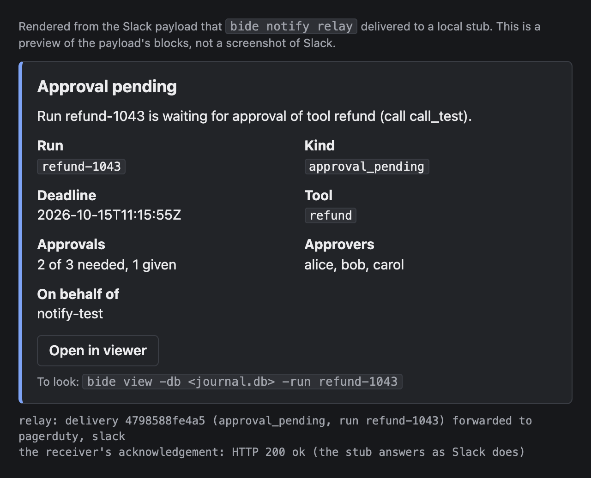
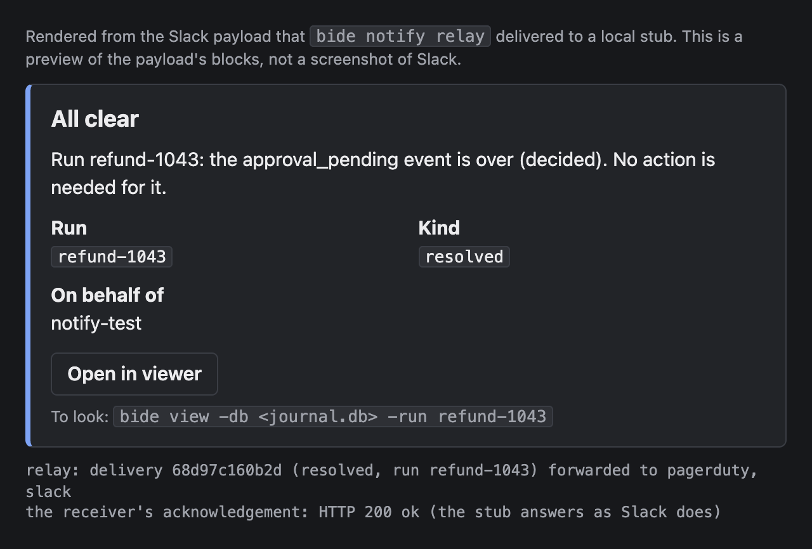
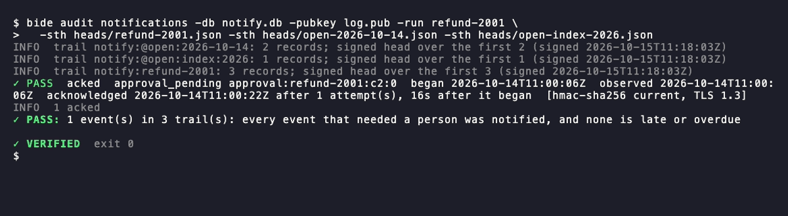
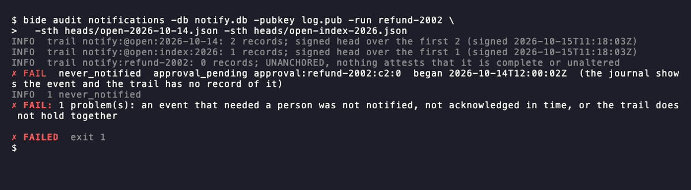

# Notifications: tell a person when a run needs them

A run that halts on an unknown outcome or waits at an approval gate stops until a person acts. The
notifier tells that person. `agent.WithNotifier` raises the event and keeps the delivery record in an
audited trail (see the [design note](../design/notifier.md) for the guarantee); this page is about the
shipped delivery, package `notify`: a signed HTTPS POST of a small JSON document, and the one-call
check for the receiver. [Set up, test and relay](#set-up-test-and-relay) covers the `bide notify` commands that
test a receiver and forward to Slack and PagerDuty.

```go
import "github.com/bide-ai/bide/notify"
```

The package is stdlib only.

## Wire a webhook

<!-- docsnip: setup journal *agent.Journal; model agent.Model; store audit.EventStore; returns error -->
```go
hook, err := notify.NewWebhook(os.Getenv("BIDE_WEBHOOK_URL"),
	notify.WithSecrets(os.Getenv("BIDE_WEBHOOK_SECRET"), os.Getenv("BIDE_WEBHOOK_SECRET_PREVIOUS")),
	notify.WithTimeout(10*time.Second), // per request; this is the default
	notify.WithViewURL("https://bide.example.com/runs"), // optional: puts a view link in the payload
	notify.WithViewDB("/var/lib/orders/run.db"),         // optional: the journal the view command opens
)
if err != nil {
	return err
}

a, err := agent.New(model, journal, agent.WithNotifier(hook, audit.NewNotifyTrail(store)))
```

`NewWebhook` returns `agent.ErrConfig` for a URL that is not `https` (`http` is allowed only for
`localhost`, `127.0.0.1` and `[::1]`, for development) and for a missing secret. Secrets are
arguments, read from your configuration or environment. They are never written to the journal, the
trail or a payload, and never appear in an error.

The same option goes to `agent.RecoverLoop`, which is what catches an event whose process died before
the first record of it.

## The request

`POST <url>` with `Content-Type: application/json` and three headers:

| Header | Value |
|---|---|
| `Bide-Delivery` | The notification ID, the same on every attempt of an event, and equal to the payload's `id`. The signature covers the body, not headers, so `Verify` requires this header to be present and equal to the signed `id`. Dedupe on the verified body `id`. |
| `Bide-Timestamp` | Unix seconds when this request was sent. |
| `Bide-Signature` | `v1=<hex>`, where hex is HMAC-SHA256 of `Bide-Timestamp + "." + body` under a secret. One `v1=` entry per secret, separated by spaces. |

The signature covers the timestamp, so a captured request cannot be replayed with a fresh one. It is
always on, over every transport.

Delivery is at least once. The notifier core runs up to 3 calls per round with its own backoff, and each
`Notify` call makes one request with a per-request timeout (10 s by default) that also honors the
deadline the core gives the call. A 429 or 5xx with `Retry-After` is waited out (capped at 60 s, never
past that deadline) before the call returns, so the next call does not arrive early. A caller that uses
the webhook without the core can set `notify.WithRequestsPerCall(3)` for 1 s then 2 s of backoff between
requests in one call. Network errors, timeouts, 429 and 5xx are retried; any other 4xx is an error
wrapping `agent.ErrNotifyPermanent`, which ends the round (the core still tries again in a later round,
since a receiver's configuration can change). Redirects are never followed: a signed body does not go
anywhere you did not name. A response is accepted only when it is 2xx, so answer quickly and do the
work after replying.

TLS is 1.2 at the minimum and 1.3 when the receiver offers it. Each delivery opens its own connection,
so a rotated client certificate is used by the next delivery.

The environment's proxy settings (`HTTPS_PROXY`, `NO_PROXY`) apply, except when `WithServerCA` or
`WithServerPin` is set: then the webhook connects directly unless you give `notify.WithProxy`. A proxy
only tunnels the TLS session; certificates, pins and the client certificate are still checked against
the receiver, but the proxy sees the receiver's address and timing.

## Verify in your receiver

`notify.Verify` checks a request in one call:

<!-- docsnip: setup secrets []string; handle func(notify.Payload) -->
```go
http.HandleFunc("/bide", func(w http.ResponseWriter, r *http.Request) {
	if err := notify.Verify(r, secrets, 0); err != nil { // 0 means the 5 minute default tolerance
		http.Error(w, "unauthorized", http.StatusUnauthorized)
		return
	}
	var p notify.Payload
	if err := json.NewDecoder(r.Body).Decode(&p); err != nil { // Verify leaves the body readable
		http.Error(w, "bad request", http.StatusBadRequest)
		return
	}
	handle(p) // dedupe on p.ID, the signed delivery ID, first
	w.WriteHeader(http.StatusNoContent)
})
```

`Verify` reads the body (up to 1 MiB), recomputes the signature over the raw bytes, compares in
constant time, and rejects a timestamp more than the tolerance from your clock, in either direction, and a `Bide-Delivery` header that is missing or is not the signed body's `id` (`ErrDeliveryID`). It computes one MAC per secret and looks at no more than 8 entries of the signature header, so a forged request costs the same however many entries it carries. If the body is larger than the limit it returns `ErrBodyTooLarge`, and `r.Body` still yields every byte.
It returns one of `ErrNoSignature`, `ErrBadTimestamp`, `ErrStale`, `ErrBadSignature`, `ErrDeliveryID`,
`ErrNoSecrets` or `ErrBodyTooLarge`; answer all of them with the same 4xx so a sender learns nothing about which check
failed. A receiver in another language needs only the construction in the table above.

To check a stored delivery later, as evidence, use `notify.VerifyBody` with the stored headers and body
and a tolerance wide enough for the delivery's age.

### Rotating the secret

While you rotate, the webhook signs with two secrets and a receiver that has either one verifies:

1. Deploy the sender with `WithSecrets(new, old)`. Requests now carry two signatures.
2. Update the receiver's secret list to `[new, old]`, then to `[new]` once step 1 is everywhere.
3. Drop `old` from the sender.

## What is in the payload, and what is not

Schema `bide.notification.v1`:

```json
{
  "schema": "bide.notification.v1",
  "id": "9f2c...e1",
  "key": "approval:orders-1042:call_01:0",
  "kind": "approval_pending",
  "run_id": "orders-1042",
  "event_at": "2026-10-13T09:14:05Z",
  "observed_at": "2026-10-13T09:14:07Z",
  "deadline_at": "2026-10-13T09:19:07Z",
  "attempt": 1,
  "summary": "Run orders-1042 is waiting for approval of tool refund (call call_01).",
  "step": { "op_kind": "tool", "op_id": "call_01", "tool": "refund" },
  "halt": null,
  "principal": { "on_behalf_of": "desk-7", "authority_ref": "" },
  "approval": {
    "tool_use_id": "call_01",
    "tool": "refund",
    "policy": { "need": 2, "of": 3 },
    "approvers": ["alice", "bob", "carol"],
    "approved": 0
  },
  "abort": null,
  "failing": null,
  "clears": null,
  "view": { "command": "bide view -db /var/lib/orders/run.db -run orders-1042", "url": null }
}
```

`kind` is `outcome_unknown`, `approval_pending`, `run_aborted`, `recovery_failing`,
`notification_overdue`, `resolved` or `escalated`. At most one of `halt`, `approval`, `abort`,
`failing` and `clears` is set, as the kind says; an `escalated` notification carries the detail of the
event it escalates and sets `escalates` (see [Routing and escalation](#routing-and-escalation)), and
every payload names its `receiver`. `summary` is generated from the structured fields, so a chat
message can post it as it is. `notification_overdue`, `resolved` and `escalated` also carry a `reason`.
New fields are additive within `v1` (`clears` and `escalates` are two; each is `null` on every other
kind); ignore the ones you do
not know.

### The all-clear

When an event you were told of stops being current, a second notification closes it: `kind` is
`resolved` (`agent.NotificationResolved`; `agent.Notification.Clears` for an in-process notifier),
and `clears` names the event.

```json
{
  "schema": "bide.notification.v1",
  "id": "41b7...c0",
  "key": "resolved:approval:orders-1042:call_01:0",
  "kind": "resolved",
  "run_id": "orders-1042",
  "event_at": "2026-10-13T09:31:40Z",
  "observed_at": "2026-10-13T09:31:41Z",
  "deadline_at": null,
  "attempt": 1,
  "summary": "Run orders-1042: the approval_pending event is over (decided). No action is needed for it.",
  "step": null,
  "halt": null,
  "principal": { "on_behalf_of": "desk-7", "authority_ref": "" },
  "approval": null,
  "abort": null,
  "failing": null,
  "clears": { "id": "9f2c...e1", "key": "approval:orders-1042:call_01:0", "kind": "approval_pending" },
  "reason": "decided",
  "view": { "command": "bide view -db /var/lib/orders/run.db -run orders-1042", "url": null }
}
```

`reason` is `resolved` (a halt was resolved), `decided` (a gate was decided), `ended` (the run
ended) or `recovered` (recovery works again). `event_at` is when bide found the event no longer
current, which is no earlier than when it ended; there is no `deadline_at`. The all-clear has an `id`
of its own, delivered at least once and signed like any other, so dedupe on it as usual.

**Matching it to the event.** `clears.id` and `clears.key` are the `id` and `key` your receiver got
for the event. Event keys are never reused and an event that stopped does not start again, so the
`clears.id` is final: treat every delivery of that ID, before or after the all-clear, as superseded.
Do not rely on the order of arrival. The all-clear can come first when the event's own delivery had
failed, or its reply was lost, before the event stopped (the request may have landed, so the
all-clear is sent). A receiver that keys incidents on the ID (PagerDuty's `dedup_key`) needs nothing
more; a stateless relay may drop an all-clear for an ID it has never seen.

**What does not get one.** `run_aborted`, which is a fact and not a state; an event that stopped
before bide tried to deliver it (nobody was told); and `notification_overdue` and `resolved`
themselves. An all-clear is never overdue: it has no deadline and no overdue notice, because a
missing one leaves an incident open, which fails safe. It is retried for as long as the process
runs, and reported to `WithNotifyErrors` as failing like any delivery. A receiver that treated every
POST as a new alert should switch on `kind`.

`view.command` is a `bide view` command, and `bide view` needs a store. With `WithViewDB` the command
names your SQLite journal file, as above, and runs where that path is readable. Without it the webhook
cannot know the store, so the command is a marked template, `bide view -db <journal.db> -run
orders-1042`, to fill in; it fails with a usage error if pasted as it is. A Postgres DSN is a
credential and never goes in a payload: an adapter that reads from Postgres replaces the `-db
<journal.db>` part with `-postgres "$DSN"` itself.

**In it:** kind, run ID, the step and tool name, the gate's approver IDs and its policy (k of n), the
run's principal, the times, and a view pointer. For a gate with separation of duties
(`ExcludePrincipal`), `approval.excluded` lists the approvers who are requesters of the run: their
decisions never count, so a router should not ask them. When the gate asks again over a recorded tally it does not act on
(a redeploy turned on `ExcludePrincipal`, or the tally predates the decision format),
`approval.reask` says why: it is a notification of its own, since approvers must decide again. Its
event key is `approval:<run>:<call>:reask-sod` or `:reask-v3` (`agent.ApprovalReaskKey`); it is routed by
the approvers of the policy the gate asks under (`WithNotifyApproverRoute`), is escalated like the first
ask, and gets its all-clear when the gate's re-tally or the call's result is recorded, not when the
tally it asks over (which the gate does not act on) is. `audit.VerifyNotifications` owes it a
notification like any other event.

**Deliberately not in it:**

- Error text, tool arguments, tool results and model output. Error text can embed arguments, card or
  account numbers and personal data, and a webhook reaches a wider audience than the journal.
- An approve or resolve link. The notification carries a view pointer only (a `bide view` command,
  and a URL when you set `WithViewURL`). A link that decides on a click is a phishing target, and it
  would bypass the point of the gate, where a decision is signed with the approver's key. Acting from
  a notification is a non-goal; the approver runs `bide approve` ([guide](hitl-approval.md#deciding-from-the-terminal)),
  which reads the call from the journal, not from the message.
- Any decision about who may approve. The approver list is for routing and is advisory; the gate
  counts a decision only from a listed approver with a verifying signature. The principal is the party
  the run acts for; under separation of duties the gate itself excludes it (and the principals of the
  runs above it), and `approval.excluded` names the approvers that rules out. Without
  `ExcludePrincipal`, route away from the principal as one input and keep your own rule for who the
  requester is.

Anything more is an explicit allowlist, named field by field:

```go
notify.WithFields(notify.ErrorText, notify.Args("refund"))
```

`ErrorText` adds `error` (bounded to 4 KiB). `Args("refund")` adds `approval.args` for approval
notifications of the tools named, and of no other tool. A deployment under PCI-style rules leaves both
out and puts detail behind the viewer, where access control applies.

## Routing and escalation

One notifier can serve several receivers: the approvers' channel, the on-call pager, a manager. Each
is a `Notifier` of its own (usually a webhook with its own URL and secret, and its own
adapter, see [Slack](#slack) and [PagerDuty](#pagerduty)), named with `WithNotifyReceiver`. The notifier given to `WithNotifier`
is the receiver `default`.

<!-- docsnip: setup journal *agent.Journal; model agent.Model; store audit.EventStore; approvers, oncall, lead, ops *notify.Webhook; returns error -->
```go
a, err := agent.New(model, journal, agent.WithNotifier(ops, audit.NewNotifyTrail(store),
	agent.WithNotifyReceiver("approvers", approvers),
	agent.WithNotifyReceiver("oncall", oncall),
	agent.WithNotifyReceiver("lead", lead),

	// Where an event goes: by kind, and for an approval optionally by approver.
	agent.WithNotifyRoute(agent.NotificationApprovalPending, "approvers"),
	agent.WithNotifyRoute(agent.NotificationOutcomeUnknown, "oncall"),
	agent.WithNotifyRoute(agent.NotificationRecoveryFailing, "oncall"),

	// Who is told next, when an event is not acknowledged (an approval: not decided) in time.
	agent.WithNotifyDeadline(5*time.Minute),
	agent.WithNotifyEscalation(agent.NotificationOutcomeUnknown,
		agent.EscalationStep{Receiver: "lead", Deadline: 15 * time.Minute},
		agent.EscalationStep{Receiver: "default", Deadline: 30 * time.Minute}),
	agent.WithNotifyEscalation(agent.NotificationApprovalPending,
		agent.EscalationStep{Receiver: "lead", Deadline: time.Hour}),
))
```

A halt now pages `oncall`. If `oncall`'s endpoint has not acknowledged it five minutes after bide
observed the event, `lead` is told, in an `escalated` notification that carries the halt's own
detail and names it (`escalates.id`). `lead` has 15 minutes of its own; if it does not acknowledge
either, the last step, `default` (here, the operations channel), is told. The chain ends there: it is
at most four steps, and bide does not repeat it. An approval is different, because being told is not
the point: if the approval is still undecided when the five minutes are up (even though the approvers'
channel acknowledged the message), `lead` is told, and the chain continues while the gate stands.

**Routing.** A route sends the events of one kind to one receiver. The kinds are `outcome_unknown`,
`approval_pending`, `run_aborted` and `recovery_failing`; an event with no route goes to `default`.
The all-clear of an event goes to the receiver the event went to, so that the incident it closes is
the one that was opened; an overdue notice does too, unless `WithOverdueNotifier` names another.
For an approval you may also route by approver:

<!-- docsnip: skip an excerpt: two options of the call above -->
```go
agent.WithNotifyApproverRoute("alice", "risk"),
agent.WithNotifyApproverRoute("bob", "finance"),
```

A gate whose approvers are `alice` and `bob` is then delivered to both `risk` and
`finance`, as two deliveries: each has its own key (`to:<receiver>:<key>`), its own ID, its own claim
and acknowledgement in the trail, and its own retries. One receiver acknowledging does not stand for
the other, and one being down does not hold the other back. An approver with no route is reached through the route of the kind
(the default receiver if there is none): if `carol` could also decide that gate, the route of the kind
would be a third delivery, so that nobody who can decide is left out. A 1-of-1 gate (which names no
approvers) and a gate with none of its approvers routed go to the route of the kind alone.

**What the trail shows.** All of a run's deliveries are in the one trail, `notify:<run>`, and each
receiver's are told apart by the `receiver` field of the event's `observed` record (empty for
`default`): `agent.FoldNotify(records).ByReceiver()` groups the event keys by receiver, and for each
the fold has its `observed`, `claimed` and `acked` records. An auditor asks, per receiver, whether
every event was delivered: every key of that receiver has an `acked` or a `cleared`. An escalation is
an event like any other (key `escalated:<step>:<key>`, with its `receiver`, its `level`, its own
`deadline_at` of the step's length, and its own claims and acknowledgement), so the escalation, who it
went to and when they acknowledged it are evidence in the same log. The routing configuration is not
in the trail: it is code. Keep it in version control, and read the trail for what happened.

**Stopping.** An escalation stops, and the chain with it, when the event stops being current (the
halt is resolved, the gate decided, the run ended, recovery recovered) and, for an event that is not an
approval, when the event or a step has been acknowledged: someone has it. A receiver already told of a
step gets its all-clear, like any receiver. The original event keeps being delivered to its own
receiver whatever happens to the escalation.

**What the receiver sees.** `kind` is `escalated`, `escalates` is `{ "id", "key", "kind", "level" }`
(null on every other kind) and `receiver` is the name. `halt`, `approval` and `step` are those of the
event, so a page can say what is wrong. `reason` is `deadline` (not acknowledged in time) or `undecided`
(an approval, not decided in time). Dedupe on `id` as usual: the ID of a step is its own.

**Different relays.** Each receiver is a `Notifier`, so each can point at its own relay: the
approvers' webhook at a Slack adapter, the on-call one at a PagerDuty adapter, the escalation at a
third. Their secrets, mutual TLS and pins are independent.

**It needs a process that is alive at the deadline.** The deadline is checked by the notifier of a
process that is running: a long-lived `Agent`, a `RecoverLoop` or a periodic `NotifyPending`. A pass
that finds an event in the trail picks up the chain where the trail says it is, so a restart or a
second process neither repeats a step nor skips one; but a deployment with nothing running at the
deadline escalates at the next pass. An escalation made after a restart rebuilds the event from the trail and the journal: it
carries the gate's tool, policy and approvers and the halted call's tool name, but not a halt's cause
(the original's notification has it).

## Mutual TLS, a private CA and a key pin

All three are optional, and none replaces the signature. Mutual TLS answers who may connect; the
signature answers who sent this body. TLS ends at proxies and gateways, so the application often never
sees the client identity, while the signature travels with the payload; and a signature can be checked
later over the stored body, where a handshake leaves nothing to check. Most receivers (Slack,
PagerDuty) accept no client certificates at all, so the signature is the check that works everywhere.

<!-- docsnip: setup secret string -->
```go
hook, err := notify.NewWebhook("https://approvals.internal.example/bide",
	notify.WithSecrets(secret, ""),
	notify.WithClientCert("/etc/bide/client.crt", "/etc/bide/client.key"), // or WithClientCertPEM
	notify.WithServerCA("/etc/bide/receiver-ca.pem"),                        // replaces the system roots
	notify.WithServerPin("1f0e...c9a4", "77ab...02de"),                      // SPKI SHA-256, up to two
	notify.WithOnError(func(err error) { log.Println("notify:", err) }),
)
```

- **Client certificate.** Re-read when the files change: the files' modification time, size and a hash
  of their contents are checked at most once a minute, and again after a failed request and before a retry, so a rotated or short-lived
  certificate (cert-manager, SPIFFE) is picked up without a restart. A read that fails keeps the last
  good pair and reports the error to `WithOnError`; give it the function you pass to
  `agent.WithNotifyErrors`.
- **Server CA.** `WithServerCA` verifies the receiver against your bundle in place of the system roots,
  it does not add to them, so a public CA cannot vouch for your private receiver.
- **Server pin.** The SHA-256 of the receiver certificate's SubjectPublicKeyInfo (64 hex characters or
  base64; `notify.SPKIHash(cert)` computes it). The handshake fails unless a certificate in the
  verified chain matches, so a CA key pins the whole chain. Pass two while the receiver rotates its
  key. Pinning is in addition to normal verification, never instead of it.
- Revocation checking is the receiver's side.

Each accepted delivery records how it was authenticated in the `auth` field of the trail's `acked`
record: the signature scheme and which secret slot signed (`current`, or `current+previous` during a
rotation), never a secret; whether a client certificate was presented and its SPKI hash; whether the
receiver was pinned or checked against a custom CA; and the negotiated TLS version. An audit policy can
then require that approval notifications were sent with mTLS.

## Set up, test and relay

Three commands in `bide notify` take you from nothing to a working notification, and none of them
needs your application to run. They use the same package `notify` code as the real notifier, so a
setup that passes them passes in production.

| Command | What it does |
|---|---|
| `bide notify test` | Sends one signed sample notification to your receiver and reports the TLS handshake, the HTTP status, whether the receiver acknowledged, and the timing. |
| `bide notify listen` | A local HTTPS receiver with a self-signed certificate that verifies each request and prints the event. |
| `bide notify relay` | A receiver that verifies bide's webhooks and forwards them to Slack and PagerDuty. |

The signing secret is read from an environment variable (`BIDE_WEBHOOK_SECRET`, or the name given to
`-secret-env`) or a file (`-secret-file`), never from a flag value, and no command prints or logs it.
Use the same secret your application passes to `notify.WithSecrets`. During a rotation the previous
secret is `BIDE_WEBHOOK_SECRET_PREVIOUS` (or `-previous-secret-env`, `-previous-secret-file`).

### Test your receiver

Start with the whole path on one machine. In one terminal:

```sh
export BIDE_WEBHOOK_SECRET=$(openssl rand -hex 32)
bide notify listen
```

It makes a self-signed certificate, writes it to a file, and prints that file (the CA to trust), the
certificate's pin, and the command to try. In a second terminal, with the same secret:

```sh
bide notify test -url https://127.0.0.1:8443/ -ca /tmp/bide-notify-ca-123.pem
```

```text
bide notify test: approval_pending to https://127.0.0.1:8443 (event 3f9a1c0d7be2...)
  tls       ok: TLS 1.3 in 3 ms; private CA
  delivery  HTTP 204, acknowledged (1 request, 9 ms in all)
  signature hmac-sha256 signed with the current secret
the receiver acknowledged the test notification
```

and the first terminal prints the verified event. Then point `-url` at your own receiver. A failure
says which stage failed and what to try, and exits 1:

| You see | Meaning |
|---|---|
| `tls failed: ... unknown authority` | The receiver's certificate is not signed by a CA this machine trusts. Pass `-ca <file>` with the CA that signed it. |
| `tls failed: ... matches no configured pin` | The receiver's key is not the one in `-pin`. |
| `HTTP 401, refused` | The receiver rejected the signature: its secret differs from the sender's, or the clock is off by more than 5 minutes. |
| `HTTP 404` | Nothing at that path. |
| `HTTP 502` or `503` | The receiver failed or is busy. bide retries these. |
| `no response ... connection refused` | Nothing is listening at that address. |

`-kind` picks the sample's kind (`approval_pending` by default; `outcome_unknown`, `run_aborted`,
`recovery_failing`, `notification_overdue` and `resolved` too). To watch a relay open and close a
PagerDuty incident, send `-kind approval_pending -run notify-test-demo`, then `-kind resolved -run
notify-test-demo`: the `resolved` is the all-clear of that approval. `-ca`, `-pin`, `-client-cert` and `-client-key`
are the receiver-side checks of the [mutual TLS](#mutual-tls-a-private-ca-and-a-key-pin) section;
`-view-url` and `-view-db` shape the payload's view pointer as `WithViewURL` and `WithViewDB` do.
What the relay sends Slack for a waiting approval, and its all-clear once the approval is decided, as a local stub received them (drawn from the Block Kit payloads the relay delivered; these are previews of the payloads, not screenshots of Slack):





Each test is a new event, so a receiver that drops redeliveries does not drop the second test. The
sample is for a run called `notify-test-<hex>`, which does not exist: a relay forwards it like any other
event, so a test against a relay posts a real message to Slack and opens a real PagerDuty incident.
Use a test channel and a test service, and resolve the incident.

`bide notify listen -client-ca <file>` requires a client certificate, to try the `-client-cert` path;
`-cert` and `-key` serve a certificate of your own instead of the generated one.

### Slack and PagerDuty through the relay

Slack's incoming webhooks cannot check a signature, and PagerDuty wants its own event format, so
neither can be the notifier's URL. `bide notify relay` is the small receiver between them:

```sh
export BIDE_WEBHOOK_SECRET=...                                   # the secret bide signs with
export SLACK_WEBHOOK_URL=https://hooks.slack.com/services/...    # a Slack incoming webhook
export PAGERDUTY_ROUTING_KEY=...                                 # an Events API v2 integration key
bide notify relay -addr :8443 -cert relay.crt -key relay.key -view-url https://bide.example.com/runs
```

and in your application, `notify.NewWebhook("https://relay.example.com:8443/", notify.WithSecrets(...))`.
A destination is on when its variable is set (or its `-slack-url-file`, `-pagerduty-key-file` is
named); the Slack URL and the routing key are credentials, read from the environment or a file, and
never printed or logged. `bide` requires `https` for a receiver that is not on localhost, so give the
relay `-cert` and `-key`, or terminate TLS in front of it.

For each request the relay verifies the signature, the timestamp and the signed delivery ID with
`notify.Verify`, and answers `401` to anything else, for every kind of failure alike. Then:

- **Slack** gets a Block Kit message: a header naming what happened, the generated summary, the
  run, kind, deadline, the tool and who may approve, and an "Open in viewer" button when there is a
  link (the payload's `view.url` from `WithViewURL`, else `-view-url` plus the run ID). Everything that
  came from the run is escaped, so a run ID cannot open an `@channel` mention.
- **The all-clear** (`resolved`, see [The all-clear](#the-all-clear)) posts an "All clear" message to Slack
  and a `resolve` to PagerDuty with the `dedup_key` of the event it ends. If the clear reaches the relay
  first, the relay remembers the cleared ID and drops the event's trigger when it arrives.
- **PagerDuty** gets an Events API v2 `trigger` whose `dedup_key` is the event's notification ID (the
  `id` of the payload, the SHA-256 of the event key). It is the same on every delivery of the event,
  so PagerDuty folds repeats into one incident; a resolve names the same key. Severity follows the
  kind: `outcome_unknown` and `notification_overdue` are `critical`, `run_aborted` and
  `recovery_failing` are `error`, and `approval_pending` is `warning`. `-pagerduty-url` points at the
  EU endpoint.
- Error text and tool arguments are never forwarded, even if the sender allowed them with
  `WithFields`: a message in a chat room or on a pager has left the access control the viewer applies.

**At least once, and what the relay does about it.** A relay that answered `204` before it had
forwarded would lose the notification when Slack was down; so it answers `204` only after every
destination took the event, and `502` when one did not, which makes bide retry the same event with the
same ID. The retry can arrive when the first attempt had in fact succeeded (a lost reply), or when only
one of two destinations failed, so the relay keeps the delivery IDs it has forwarded in a bounded
memory cache (`-dedupe`, 10000 by default) and, per ID, which destinations took it. A repeat is
acknowledged without forwarding again, and after a partial failure only the destination that failed
is tried again. A duplicate that arrives while the first is still being forwarded gets `503`, so bide
retries rather than being told something that is not yet true. Forwarding keeps going if bide gives up
waiting, so its retry finds the work done. Outbound calls have a 3 s timeout, up to 3 requests with a
short backoff, and a total budget (`-forward-timeout`, 8 s) under bide's own 10 s request timeout.

A clear can reach the relay before the event it ends (the event was cleared while its request was failing, or its reply was lost). The relay remembers the IDs it has seen cleared, as many as `-dedupe`, and acknowledges a later notification of such an event without forwarding it, logging "dropped: already cleared"; otherwise that trigger would reopen an incident that is over.

By default the caches live in the process, and a restart empties them. Then a late redelivery is
forwarded again, and so is a trigger that arrives after a clear: one that reached the relay before the
restart reopens the PagerDuty incident its clear closed. The same happens when more than `-dedupe`
other events came in between. That is a rare duplicate or stale message, never a lost one. PagerDuty
absorbs a repeated trigger by its `dedup_key`; Slack shows a repeat twice.

`-state <file>` keeps both caches across restarts. The relay reads the file when it starts (a missing
file is a first start; one it cannot parse is an error, so the memory is never silently empty) and
rewrites it atomically (temporary file, fsync, rename, then an fsync of the directory on Unix; Windows
cannot sync a directory, and the file's contents are synced before the rename), bounded by `-dedupe` like the caches.
The whole file is rewritten, so a write costs more the larger `-dedupe` is: about 18 ms at 10000
entries on a laptop SSD (`BenchmarkStateSave`), mostly the sync. So writes are coalesced: a change to the
forwarded-delivery set is written within `-state-flush` (1 s by default) together with whatever else
changed by then, and `Close` writes what is pending. A clear is the exception, written at once, since a
trigger after a crash is the failure the file prevents. A crash, as opposed to a clean stop, can
therefore lose the forwarded-delivery entries of the last second: a redelivery of one of those events
is forwarded once more, a repeat and never a lost notification. A negative `-state-flush` writes every change. It holds delivery IDs,
cleared IDs and sink names, no payload and no secret. If a write fails the relay logs it and keeps
forwarding, with its memory in the process as without the file. One file belongs to one relay: the
relay holds an exclusive operating-system lock (`<file>.lock`, `flock` on Unix, `LockFileEx` on
Windows) for as long as it runs, and a second relay on the same file refuses to start, naming it. The
lock belongs to the process, so a relay that crashes or is killed releases it and the next one starts;
there is no stale lock to delete. A save that is killed part way leaves the previous state file
intact, and the next start removes the half-written temporary file. Two relays behind a load balancer
still need a file each, and still have separate memories, so run one.

When Slack or PagerDuty refuses a forward, the relay's log names the sink, the HTTP status and, if the
reply carries one, a short error token such as `no_service` or `invalid event` (Slack's or PagerDuty's
`error` or `status` field, or a plain one-token body). It never logs the rest of the reply, which can
echo the request.

Routes can point at different relays. A deployment that sends approvals to a Slack channel and
halts to a pager runs two relays (or one per environment), each with its own secret, and gives each
its own `notify.NewWebhook` URL as a receiver (see [Routing and escalation](#routing-and-escalation));
the relay needs nothing from the routing, and the `escalated` kind it forwards is a critical
PagerDuty incident of its own (dedup key: the step's ID) that its all-clear closes.

### Embed the relay

The CLI is a thin wrapper over package `notify/relay`, for a receiver you already run:

<!-- docsnip: setup secrets []string; slackURL, routingKey string; returns error -->
```go
slack, err := relay.NewSlack(relay.SlackConfig{WebhookURL: slackURL, ViewURL: "https://bide.example.com/runs"})
if err != nil {
	return err
}
pd, err := relay.NewPagerDuty(relay.PagerDutyConfig{RoutingKey: routingKey})
if err != nil {
	return err
}
h, err := relay.New(relay.Config{Secrets: secrets, Sinks: []relay.Sink{slack, pd}})
if err != nil {
	return err
}
http.Handle("/bide", h) // verifies, dedupes by delivery ID, forwards, answers 204, 401 or 502
```

A `relay.Sink` is `Name() string` and `Send(ctx, notify.Payload) error`, so another destination (a
different chat, an email gateway) is one type. `relay.SlackMessage` and `relay.PagerDutyTrigger`
build the bodies without sending them. The PagerDuty sink resolves the incident of a `resolved`
notification: `relay.DefaultResolveTarget` takes the `clears.id` of the payload, which is the
`dedup_key` the event's trigger used, and `PagerDutyConfig.ResolveTarget` replaces it. A `resolved`
payload with no `clears` names no incident and is ignored, not turned into a trigger.

## The open trail, and upgrading a fleet

Besides a trail per run (`notify:<run>`), the notifier keeps one trail that belongs to no run, the **open
trail** (`notify:@open`). It lists the events whose all-clear may still be owed: a record before an
`outcome_unknown`, `approval_pending` or `recovery_failing` event is observed, and another when nothing more is
owed for it. A sweep or a recovery pass reads it to find the runs that need a scan, including a run that has
finished since, without reading every finished run. It is kept in one segment per UTC day
(`notify:@open:<date>`) with a yearly index (`notify:@open:index:<year>`), so a read is bounded by what is
listed now and not by history, and `bide audit notifications` checks that every delivered event of those kinds
is listed on it. You do not configure it; with a signed trail (see [Auditing](#auditing-were-the-people-told))
it is signed and anchored like the others.

A rolling upgrade is the one time that check can be wrong for a while. A process of the previous version
delivers events without listing them on the open trail. A new-version scan of an unfinished run lists such an
event at once; the backfill's second pass, no earlier than `agent.WithNotifyUpgradeWindow` (24 hours by
default) after the first, lists what no scan reached (a run such a process saw through to its end).
Set the window to the time your upgrade takes to reach every process, a week for a staged rollout across
regions; it must be positive:

<!-- docsnip: setup journal *agent.Journal; model agent.Model; trail agent.NotifyTrail; sink agent.Notifier; returns error -->
```go
a, err := agent.New(model, journal, agent.WithNotifier(sink, trail,
	agent.WithNotifyUpgradeWindow(7*24*time.Hour), // a staged rollout across regions
))
```

An event that a previous-version process delivers after the second pass, in a run that ends before a
new-version scan reaches it, stays unlisted, and `bide audit notifications` reports it. Until the window
has passed, an audit during the upgrade may report an event as unlisted that the second pass will list; run
it again after.

## Where to look

A notification carries a view pointer, and the person who gets it opens the run viewer. `bide view
-db <journal.db>` opens on the run list, whose headline links to the **Needs attention** list: every
run that is waiting for approval, halted with an unknown outcome or aborted, newest first, with the
approval's gate (who approved, who is pending, how long it has waited) or the halt's `ResolveHalt`
call. Because the viewer reads the notification trail from the same database, each item also says
whether it was notified and whether the sink acknowledged it, and a run whose recovery keeps failing
is listed from the trail. That answers "did anyone hear about this?" in one place, and shows an item
no notifier ever saw (*no notification recorded*) next to the ones that were delivered. See
[Needs attention](run-viewer.md#needs-attention).

## Runnable example

`examples/notify-routing` (`go run ./examples/notify-routing`, no API key) builds the notifier of the routing
section above over a refund waiting at a 2-of-2 gate and a charge halted on an unknown outcome, with the trail
wrapped in `audit.NewAuditedEventStore`. In the first story every receiver answers: the approvals go to the
risk and finance channels, the halt to on-call, the halt's resolution sends an all-clear, and
`audit.VerifyNotifications` passes against the trail, the signed heads, the journals and `agent.RoutingOf`;
then a copy of the trail with one record removed fails. In the second, on-call's endpoint is down: the lead is
told after the step's deadline, and the audit reports that on-call's acknowledgement was late. Its test checks
each of these.

## What an acknowledgement means

The sink answering 2xx means your endpoint accepted the request, not that a person read it. The times
in the trail are the notifying process's clock; anchor the trail's tree head with a timestamp to bound
them from above.

## Auditing: were the people told?

The trail is evidence, and `bide audit notifications` checks it offline against the run journals:
that every event that needed a person (an unknown-outcome halt, an approval gate, an aborted run, a
recovery failure, an overdue notice, an all-clear) was observed, delivered and acknowledged, and
when. It fails (exit 1) on an event that was never notified, was acknowledged after its deadline (or
after a bound you set with `-max-ack`), or is still overdue, and on a trail that was reordered,
had a record deleted, or is not a history a notifier writes.

```
bide audit notifications -db run.db -sth notify-r1.sth.json -pubkey keys/log.pub
bide audit notifications -db run.db -pubkey keys/log.pub -max-unattested 10m $(for f in anchor/notify-r1-*.json; do echo -sth $f; done)
bide audit notifications -postgres-env BIDE_POSTGRES_DSN -unanchored -max-ack 10m
```

Run against a journal where one refund's waiting approval was delivered, acknowledged and covered by
signed heads, it passes (exit 0):



Against a run whose approval waits and which no notifier saw, it fails (exit 1) with `never_notified`:



Two things to set up on your side:

- **Sign and anchor the trail.** Wrap the event store the trail lives in with an
  `audit.AuditedEventStore`, and the notifier's trail is signed and anchored as it is written, with the
  same `audit.Signer` and `audit.Anchor` as a journal (`audit.NewAuditedStore`), so an HSM or KMS signer
  and an external transparency log work unchanged:

  <!-- docsnip: setup evStore audit.EventStore; signer audit.Signer; anchor audit.Anchor; sink agent.Notifier -->
  ```go
  audited, _ := audit.NewAuditedEventStore(evStore, signer, anchor)
  audited.OnError(func(trail string, err error) { log.Printf("anchoring %s: %v", trail, err) })
  trail := audit.NewNotifyTrail(audited)
  opt := agent.WithNotifier(sink, trail) // the trail is signed as it is written
  ```

  Each growth of a run's trail (`notify:<run>`) publishes a signed tree head (kind `events`, run ID the
  trail's name, the head `audit.SignNotifyTrail` signs) from a background publisher, so the anchor,
  the signer and the clock are never on the delivery path: a slow or hung anchor cannot lengthen a
  round, and a failure to publish never fails or delays a delivery (it goes to `OnError`). One attempt
  is abandoned after `WithTimeout` (default 3 seconds) even if the anchor ignores its context, and
  after a failure the store pauses for `WithCooldown` (default 30 seconds) and then probes, so an
  outage costs one timeout per cooldown. What an outage or a crash left unsigned is signed again by
  `NotifyPending`, `RecoverLoop`, `Recover` and `FlushNotifications`, for the runs they look at and
  for any trail an earlier attempt failed, and `Reanchor`, `ReanchorPending` and `Flush` do it on
  demand. The window left open is therefore the publisher's delay when the anchor is healthy, and the
  outage plus the time to the next sweep when it is not. The wrapper signs every trail written
  through it, so the trails that belong to no run are covered as well: the digest's, the open trail's
  daily segments (`notify:@open:<date>`) and its yearly index (`notify:@open:index:<year>`); a sweep
  and, once a minute, a recovery pass sign again the digest, the index, today's segment and the newest
  three. Call `Flush` (or `FlushNotifications`) before
  the process exits.

  A trail with no head is reported `UNANCHORED`, and whoever can write the event store could have
  changed it undetected; with heads, a deleted, reordered or changed record is found. Give the
  verifier every head the anchor holds for a trail (`-sth`, once per head): each must verify and match
  a prefix of the trail, and the largest is the newest. Records after the newest head are read but
  not attested; the report says how many there are and how long the oldest has gone unattested, and
  `-max-unattested` fails a gap older than the bound you set, which is how you check the anchoring is
  keeping up. An event whose ack, clearing or observation is only in that tail is `unattested` and
  fails; a nonzero `-max-unattested` accepts it when its tail records are that recent, without a
  signature, so their content and times are trusted (default 0: strict). Add `-routing routing.json`
  (from `agent.RoutingOf` with the notifier's options) to require a delivery to each receiver an
  event routes to and to each due escalation step; without it that is not checked. `audit.SignNotifyTrail` remains for signing a head by hand. The head attests the trail,
  not who may sign: keep the signing key where the application cannot use it freely (an HSM or KMS
  signer), or an attacker who controls the process can sign a rewritten trail.
- **Give it the journals.** The check of the trail alone cannot find a halt or a gate that no
  notifier ever saw; the cross-check against the journals can. `-db` and `-postgres-env` read both
  from the store, read-only (the Postgres DSN is read from the named environment variable, never
  given on the command line). From exported files, pass `-trail` and `-journal` for each run.

With routing, every verdict names the receiver (and the level of an escalation step), `-json`
carries them, and the text report adds a line per receiver: whether each receiver was told is its own
`acked`. The checks include the escalation chain: a step is valid only if it is after its deadline, in
order, and for an event not yet acknowledged or cleared. The audit cannot see the configuration, so
it cannot say that an event *should* have been routed or escalated; see
[known limitations](../KNOWN-LIMITATIONS.md#notifications).

The report gives each event its times (when the run entered the state, when the notifier saw it,
when the sink acknowledged it), the attempts, and how the delivery was authenticated. See
[Audit: notification evidence](audit.md#notification-evidence-were-the-people-told) for the checks,
the statuses and what the check cannot see. It proves the sink accepted the request, not that a person read it.
