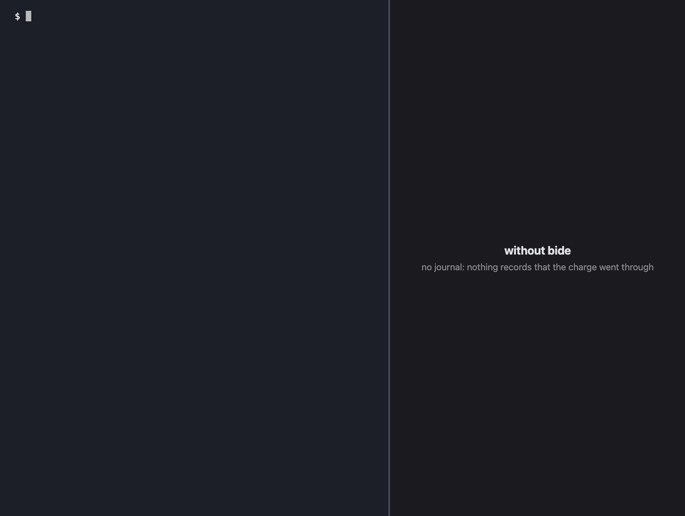
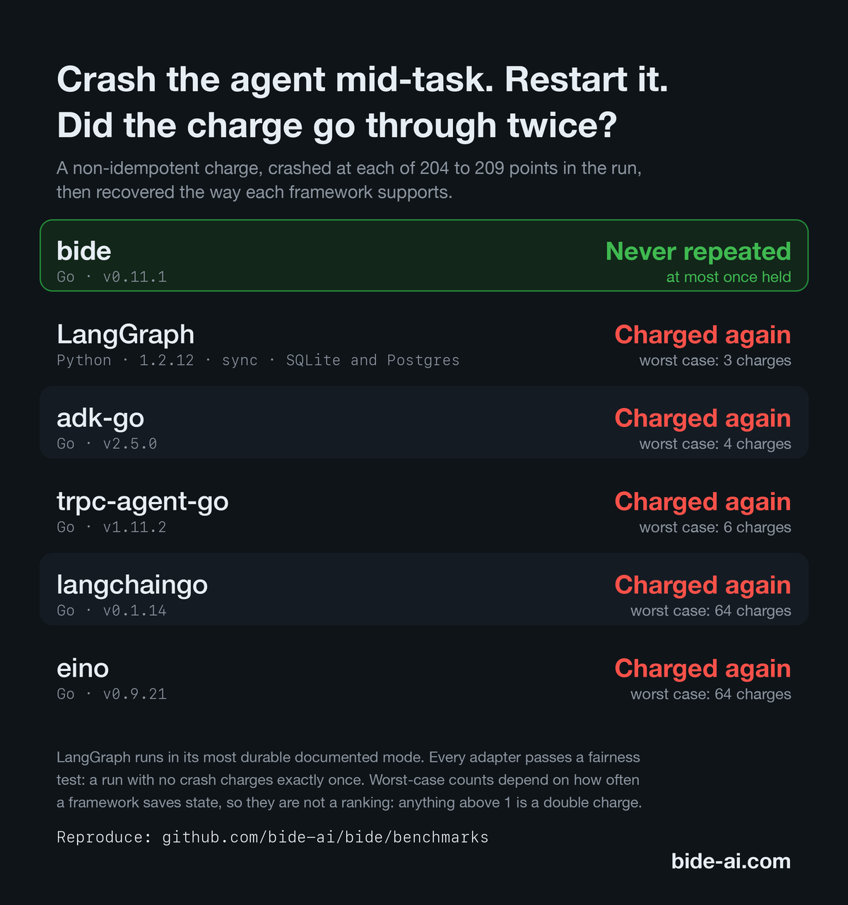
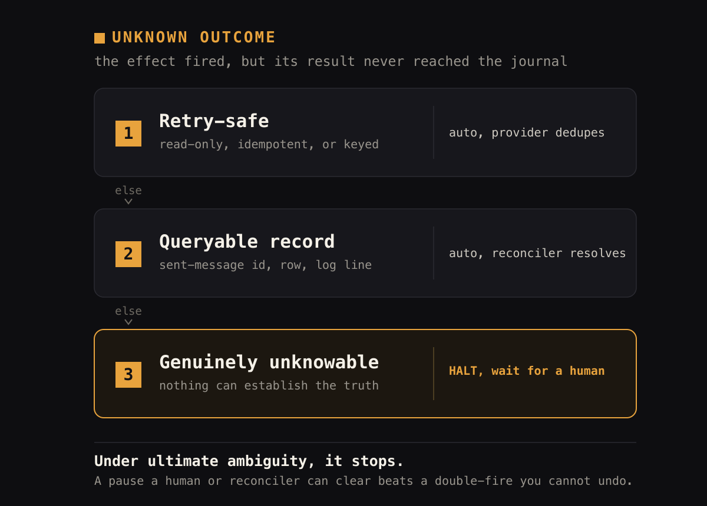
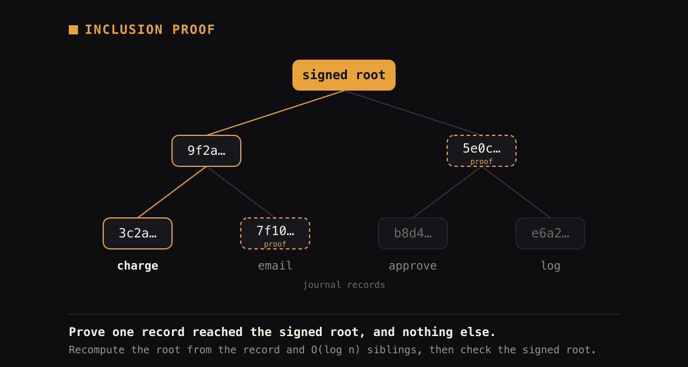

[English](../../README.md) · [简体中文](README.zh-CN.md) · **Русский** · [हिन्दी](README.hi.md) · [العربية](README.ar.md) &nbsp; [](https://codecov.io/gh/bide-ai/bide)

<p align="center">
  
</p>

<p align="center">
  <strong>Надёжные, подотчётные AI-агенты на Go для агентов, которые двигают деньги, изменяют записи или действуют под аудитом.</strong>
  <br>
  Фреймворк на Go для AI-агентов, которые двигают деньги: рискованные вызовы одобряются, каждое действие записывается и проверяемо.
</p>

<p align="center"></p>
<p align="center">
  &nbsp;&nbsp;<em>Пауза, которую можно снять, лучше двойного срабатывания, которое нельзя отменить.</em>&nbsp;&nbsp;
</p>

```sh
# Установка (или: go install github.com/bide-ai/bide/cmd/bide@latest)
brew install bide-ai/tap/bide
# Что-то не работает? bide doctor проверит Go, SQLite, кэш модулей и ваш проект и подскажет, как исправить
# 1. посмотреть: агента убивают посреди платежа, второго списания нет (без API-ключа)
bide demo
# 2. собрать: plan-поток со шлюзом одобрения 2 из 3, на SQLite, без API-ключа
bide init refund && cd refund && go mod tidy && go run .
# 3. изучить: запуски на локальной странице только для чтения (список запусков, затем каждый запуск; печатает адрес, который нужно открыть)
bide view -db run.db
#    По желанию, без кода: изучить образец журнала из 14 запусков во всех состояниях
bide sample
#    Вызов ждёт на шлюзе одобрения? Покажите его и подпишите решение из терминала
bide approve -db run.db -list
# 4. доказать: проверить доказательства запуска офлайн
bide audit verify-evidence -evidence evidence.json -pubkey keys/log.pub
# 5. оповестить: остановка или ожидание одобрения оповещает человека; офлайн проверить, что его оповестили
bide audit notifications -db run.db -pubkey keys/log.pub -sth notify-run.sth.json
```

Один журнал, работающий только на добавление, в обычной библиотеке на Go, даёт пять гарантий: побочные эффекты срабатывают не более одного раза, даже при сбое, поэтому им не нужно быть идемпотентными; тысячи параллельных надёжных прогонов в одном процессе (это библиотека, кластер запускать не нужно); криптографически проверяемый аудиторский след (доказательства Меркла по RFC 6962, проверяемые без доверия к поставщику); доказуемо сходящееся разделяемое состояние, условия сходимости которого проверены машинно; и контроль за людьми: подписанные одобрения k из n с исключением инициатора (разделение обязанностей), ключи подписи в HSM или облачном KMS и уведомитель, который сообщает человеку и записывает, что сообщил.

Bide строится в расчёте на то, что банк требует от программ, двигающих деньги: ключи вне приложения, разделение обязанностей, след, в котором подделка видна, явные режимы отказа. Он не сертифицирован ни по какому стандарту и не заявляет соответствия ни одному; [хранение ключей](../../docs/guides/key-custody.md) и [модель угроз](../../docs/trust/threat-model.md) говорят, что охвачено, а что нет.

**Фоновые агенты (ambient agents).** Фоновый агент работает без присмотра: он спит до тех пор, пока триггер (расписание или событие) его не разбудит, работает часами или сутками и приостанавливается, чтобы спросить человека, только когда нужно суждение, при том что за каждым шагом никто не следит. Такой агент обязан быть безопасным при сбое, безопасным при повторном срабатывании и доказуемым постфактум. Bide предоставляет для этого надёжный жизненный цикл: надёжные таймеры `Sleep`/`WaitUntil`, подключаемый `Waker` для пробуждения по времени или событию и надёжные `Interrupt`/`AnswerInterrupt` для типизированного участия человека в цикле (human-in-the-loop) – всё на одном журнале. Вы приносите источник триггеров и UI надзора; среда выполнения удерживает каждый прогон корректным сквозь сны, сбои и передачи между узлами.

Статус: рабочая v0, проверена сквозным путём вживую. Требуется Go 1.27.

<p align="center">
  
  
</p>

**Риск потока виден до релиза.** `bide view -config flow.yaml` окрашивает каждый узел по тому, что с ним делает сбой (побочный эффект останавливается и спрашивает; шаг только для чтения перезапускается), и проверяет по графу политику `assert:` потока, например `every path to charge passes approval >= 2 of 3`. Нарушение показывается с кратчайшим путём-контрпримером, красным. `bide check flow.yaml` выполняет те же проверки в CI и завершается с кодом 1. См. [руководство по просмотрщику запусков](../../docs/guides/run-viewer.md#check-a-flow-config).

**Решайте из терминала и докажите, что людей известили.** `bide approve` показывает вызов, прочитанный из журнала, его аргументы и SHA-256, к которому привязана ваша подпись, отказывает инициатору, чьё решение не будет засчитано, и оставляет квитанцию; позже `bide audit verify-receipts` сверяет её с подписанными заголовками и замечает решение, удалённое после того, как заголовок его зафиксировал. `bide audit notifications` офлайн сверяет журналы прогонов и подписанный след: каждая остановка и каждое ожидающее одобрение были доставлены и подтверждены вовремя; при событии, о котором никого не известили, проверка завершается неудачей. См. [руководство по одобрению](../../docs/guides/hitl-approval.md#deciding-from-the-terminal), [руководство по аудиту](../../docs/guides/audit.md#decision-receipts-noticing-a-decision-deleted-before-it-was-anchored) и [руководство по уведомлениям](../../docs/guides/notifications.md#auditing-were-the-people-told).

**Личность утверждающего (утверждающие, привязанные к сертификату).** `bide view` и `bide approve -list` показывают для такого шлюза идентификатор, уровень, основание и время статуса так, как их записал шлюз; зелёным что-либо становится только по результату аудита, а предварительный подсчёт всегда заметно отличается. `bide approve -verify-receipt` и `bide audit verify-receipts` с `-identity-policy` проверяют цепочку и личность (не отзыв). См. [руководство по просмотрщику](../../docs/guides/run-viewer.md).

## Один журнал, пять гарантий

Агентный цикл занимает около 40 строк. Пять гарантий берутся из надёжного журнала под ним, работающего только на добавление.

### 1 · Не более одного раза (измерено)

Temporal, DBOS, trpc-agent-go, ADK и eino возобновляются через повторный прогон: активности или шаги обязаны быть идемпотентными, поэтому неидемпотентный побочный эффект (списание, письмо, отгрузка) может сработать дважды при сбое. Бенчмарк с инъекцией сбоев ([`chaos/`](../../chaos), кросс-SDK результаты в [`benchmarks/`](../../benchmarks/README.md)) прогоняет неидемпотентный `charge` сквозь каждую точку сбоя:

<p align="center"></p>

`maxFired` означает наибольшее число раз, которое один побочный эффект действительно выполнился. **1 правильно; больше означает двойное списание.** Каждый адаптер конкурента проходит тест на справедливость (доказывающий, что его возобновление работает). Чего нет ни у одного из измеренных фреймворков: надёжного маркера попытки (attempt marker), записываемого перед неидемпотентной записью, и остановки при неизвестном исходе (halt-on-unknown-outcome) при возобновлении: если результат записи так и не попал в журнал, прогон останавливается для решения человеком.

### Когда исход неизвестен, прогон останавливается

Трудный случай: побочный эффект, вызов которого покинул процесс, но результат которого так и не дошёл до журнала. Маркер попытки позволяет возобновлённому прогону отличить «не начинался» от «начался, исход неизвестен», а неизвестный случай разрешается в фиксированном порядке:

<p align="center">
  
</p>

На какую ступень попадает инструмент, определяется его объявленным `Safety`: пометьте его как только-для-чтения или идемпотентный, и неизвестный исход повторится автоматически; не объявите ничего из этого, и прогон остановится. Безопасность повтора включается явно; без неё по умолчанию действует пауза.

Большинство неизвестных исходов до человека не доходят: ключ идемпотентности позволяет поставщику устранить дубликат безопасного повтора, а для систем без такого ключа (почта, внутренние сервисы) реконсилятор разрешает шаг по оставленной им записи (`agent.ResolveHalt`). Человека спрашивают, только когда не подходит ни то, ни другое.

> [!IMPORTANT]
> Когда действие двигает деньги, изменяет запись или происходит под аудитом, а его исход узнать нельзя,
> прогон останавливается. Паузу может снять человек или реконсилятор; двойное списание отменить
> нельзя.

### 2 · Надёжное выполнение как библиотека

Temporal обеспечивает надёжное выполнение с помощью сервера и флота воркеров. Здесь оно берётся из адаптера хранилища, который вы уже эксплуатируете (SQLite локально, Postgres в продакшене). Hello-world импортирует только стандартную библиотеку: никаких зависимостей от Temporal, gRPC или векторной БД (обеспечивается `architecture_test.go`).

Один процесс может держать в полёте много надёжных прогонов одновременно. Работа агента ограничена вводом-выводом (ожидание вызовов модели и инструментов), что горутины впитывают без кластера. Стенд [`cmd/bench`](../../cmd/bench/README.md) это измеряет: 20 000 прогонов, по 5000 в полёте одновременно, каждый из которых блокируется на ~100 мс на модели, завершаются примерно за полсекунды (~470 мс) по настенным часам на 10-ядерном Mac на Apple silicon (измерено на v0.7.0) и примерно за секунду на стандартном CI-раннере с 4 vCPU на нескольких тысячах горутин и десятках МБ (`go run ./cmd/bench -runs 20000 -concurrency 5000 -latency 50ms`). Это измеряет пропускную способность; задержка каждого вызова принадлежит поставщику. При большом веере предел задаёт пропускная способность записи надёжного хранилища. Каждый параллельный прогон идёт на том же журнале, поэтому сохраняет перечисленные гарантии. Для надёжности под нагрузкой есть тайм-ауты на каждую попытку, повтор с откатом, классифицирующий временные и терминальные ошибки, хеджированные вызовы модели (гонка с резервным, берётся первый, ради хвостовой задержки и переключения между поставщиками) и ограничитель частоты (rate limiter) для вызовов модели и инструментов ([middleware](../../middleware), [docs/guides/reliability.md](../../docs/guides/reliability.md)).

Для высокой доступности любой узел возобновляет любой прогон из разделяемого хранилища, а конкурирующие драйверы координируются через аренду (lease) на каждый прогон (`agent.Lease`): обычно в каждый момент прогон ведёт один процесс, а аренда сбойного держателя истекает, так что его перенимает `agent.RecoverLoop` другого узла. Держатель, застывший дольше срока аренды, может очнуться, всё ещё ведя прогон, но не может выполнить побочный эффект второй раз: «не более одного раза» держится на заявке попытки (attempt claim), а не на аренде. Тесты покрывают взаимное исключение параллельных воркеров, сбой-и-перехват и «не более одного раза» при параллельных драйверах на хранилище в памяти (`agent/ha_e2e_test.go`), а также межпроцессное «не более одного раза» на Postgres, где два экземпляра хранилища делят одну базу данных (`TestPostgres_HAAtMostOnceAcrossInstances` в `store/postgres/postgres_test.go`; бэкенд Postgres реализует аренду через upsert по часам БД).

### 3 · Проверяемый аудиторский след из того же журнала

<p align="center"></p>

Журнал, который делает возобновление безопасным, также является аудиторской записью и фиксируется криптографией, которую использует Certificate Transparency ([RFC 6962](https://datatracker.ietf.org/doc/html/rfc6962), сверено с опубликованными эталонными векторами). Третья сторона проверяет доказательство без доверия к вам, вашей базе данных или вашим логам:

- **Доказательство включения (inclusion proof)**: доказать, что одно конкретное действие произошло (это списание, это одобрение), за O(log n), не раскрывая других записей (только её позицию и размер прогона). Избирательное раскрытие для аудитора.
- **Доказательство согласованности (consistency proof)**: доказать, что история только дополнялась, никогда не переписывалась и не переупорядочивалась.
- **Подписанная верхушка дерева (signed tree head) + непрерывное закрепление**: `AuditedStore` подписывает обязательство на каждый шаг и публикует его вне полосы во внешний лог прозрачности, так что подделку можно доказать.
- **Кто действовал и по какому полномочию**: тот же лист может обязываться к действующей личности (актор, от чьего имени, по какому подписанному гранту) и обеспечивать делегированное полномочие как управляемый инвариант, так что доказательство показывает, кто был уполномочен на то, что произошло. Приносите свой собственный IdP; это делает уполномоченное действие доказуемым, оно не заменяет аутентификацию.

Произведите переносимый `ProofBundle` для одного действия (`audit.ProveToolCall`) или целопрогонный `EvidencePackage` (`audit.Evidence`), собирающий доказательство каждого существенного действия в один файл, и вручите его аудитору, который проверит его офлайн через `bide audit verify` / `verify-evidence` или через верификатор только на стандартной библиотеке, никогда не импортирующий SDK. Тот же хребет несёт и остальную часть слоя подотчётности, всю проверяемую офлайн: прогоны, несущие доказательство (один `RunCertificate`, удостоверяющий соответствие политикам всего прогона), подписанные гранты возможностей с затухающим делегированием, полномочие, заслуженное чистым аудиторским следом, и управляемый кворум k-из-n. → [docs/guides/audit.md](../../docs/guides/audit.md)

### 4 · Доказуемо сходящееся разделяемое состояние (gsm)

Множество агентов может конкурентно изменять разделяемое состояние, даже событиями, которые конфликтуют и нарушают инварианты, и каждая реплика сходится к одному и тому же валидному состоянию. Идея – **сходимость через компенсацию (convergence by compensation)**: восстановление всегда завершается и коммутирует с событиями, поэтому порядок, в котором воспроизводятся события, не может изменить результат. Теория, [normalization confluence](https://github.com/blackwell-systems/normalization-confluence), – это точная карта режимов управляемого конкурентного состояния: в каждом режиме машинно-проверенное точное условие, результат о трудности, показывающий, что эффективного условия нет, или открыто названный пробел. Доказательства свободны от аксиом и проверяются CI на Coq 8.18, 8.20 и Rocq 9.3 ([](https://github.com/blackwell-systems/normalization-confluence/actions/workflows/verify.yml)).

- **Проверяется во время сборки.** Опишите разделяемое состояние как реестр переменных, инвариантов и событий; `Build` в gsm проверяет условия сходимости либо отказывается собираться и показывает конкретный контрпример.
- **Перепроверяется самим доказательством.** Каждая машина реестра, которую возвращает gsm, повторно сертифицируется внутри процесса проверщиком, сгенерированным из доказательства на Rocq; если она не сертифицируется, машины нет.
- **И федерации тоже.** Для реестров, связанных между командами или организациями, восстановление компонуется в единственную нормальную форму, а порядок событий между реестрами делают безопасным две локальные проверки на ребро (C1 и C2), которые gsm выполняет во время сборки.
- **Проверено на масштабе.** 10 000 000 управляемых агентов прогоняются сквозь случайные, нарушающие инварианты порядки, и все сходятся к одному и тому же валидному состоянию, каждый с аудиторским доказательством, проверяемым офлайн (тест уровня фреймворка: модель-заглушка, хранилище в памяти; см. [docs/testing/testing.md](../../docs/testing/testing.md)).

Утверждение точно: независимая от порядка сходимость воспроизведения для машины, выполняющей условия, на дискретном детерминированном состоянии, а не «агенты всегда согласны». Подробности – в [руководстве по управлению](../../docs/guides/governance.md); точные границы (причинная доставка и пары `Independent`, обязательства доставки, какие проверки сгенерированы из доказательства, а какие написаны на Go, и история версий gsm) – в [известных ограничениях](../../docs/KNOWN-LIMITATIONS.md#governed-state-gsm).

### 5 · Люди сохраняют контроль

Когда агент собирается двигать деньги, решает человек, и то, что он решил, остаётся в записи. Шлюз и уведомление записываются в тот же аудируемый след, что и всё остальное, а ключи подписывают его.

- **Подписанные одобрения k из n.** Инструмент, созданный с `WithApproval`, останавливает прогон до выполнения, пока k из n названных одобряющих не подпишут решение по точному вызову (`bide.approval.v3`; время решения входит в подпись). Аудитор проверяет офлайн, что k названных одобряющих одобрили действие до его выполнения. Одобряющие решают из терминала командой `bide approve`: по журналу или, с `-to`, через приём одобрений, который поднимает ваше приложение, так что приложение записывает решение через свой аудируемый журнал. См. [руководство по одобрению](../../docs/guides/hitl-approval.md).
- **Разделение обязанностей.** С `ExcludePrincipal` шлюз никогда не учитывает решение инициатора прогона (или инициатора любого прогона выше); исключённое решение остаётся в записи с пометкой. Bide сравнивает идентификаторы и не видит, что у одного человека их два.
- **Сроки.** С `Timeout` шлюз, не получивший одобрения вовремя, истекает: истечение записывается как исход шлюза, вызов никогда не выполняется, запоздавшее решение не засчитывается, и уведомитель сообщает об этом (`approval_expired`). См. [Сроки](../../docs/guides/hitl-approval.md#deadlines).
- **Ключи вне приложения.** Ключи подписи журнала аудита и одобряющих могут храниться в PKCS#11 HSM, AWS KMS, Google Cloud KMS или Azure Key Vault за одним интерфейсом `audit.Signer`, в Ed25519 или ECDSA P-256. У проверяющих только открытый ключ. Это хранение ключей, а не сертификация соответствия: [хранение ключей](../../docs/guides/key-custody.md) перечисляет, с чем протестирован каждый подписыватель (SoftHSM2 и эмуляторы, но не живое облако), и что он не проверяет.
- **Уведомление с записью.** Прогон, который остановился или ждёт одобрения, поднимает уведомление (подписанный HTTPS-вебхук, `notify.NewWebhook`), а аудируемый след фиксирует каждую попытку и то, подтвердил ли получатель. Подтверждение означает, что ваша конечная точка ответила 2xx, а не что человек прочитал сообщение. Уведомления можно направлять по виду или по одобряющему и эскалировать, если никто не подтвердил их к сроку; когда событие перестаёт быть актуальным, приходит отбой `resolved`. След можно подписывать и закреплять теми же подписывающими, что и журнал (по выбору; публикация по возможности и никогда не задерживает доставку). Одобряющий может также открыть ссылку из уведомления и подписать на странице в браузере неизвлекаемым ключом (страницу размещает ваша организация; нужен `WithAuth`). См. [уведомления](../../docs/guides/notifications.md).
- **[Удаление персональных данных](../../docs/guides/retention.md#erasing-personal-data)**: `bide journal redact` после пробного прогона заменяет выбранные записи завершённого запуска надгробиями, которые сохраняют их место в подписанных заголовках, и записывает каждое удаление в подписанный журнал, который проверяет `bide audit redactions`. Команда не затрагивает копии вне журнала (выгрузки, резервные копии, хранилище событий, поставщика модели); руководство перечисляет, чего она не может.

Границы описаны в [известных ограничениях](../../docs/KNOWN-LIMITATIONS.md#approval-and-quorum): одобряющие образуют фиксированный именованный набор; связать ключ с человеком должен ваш провайдер идентификации; время решения есть заявление самого одобряющего.

### против сред надёжного выполнения и агентных сред выполнения

| | **Bide** | Temporal / DBOS | ADK · eino · trpc · langchaingo |
|---|---|---|---|
| Неидемпотентный побочный эффект при сбое | **Не более одного раза (останавливается при неизвестном исходе)** | Хотя бы один раз; активности/шаги обязаны быть идемпотентными | Хотя бы один раз; повторные прогоны (**измерено 4–64×**) |
| Развёртывание | **Библиотека + БД, которую вы уже эксплуатируете** | Сервер + флот воркеров | Библиотека |
| Аудит с обнаружением подделки | **Хребет Меркла по RFC 6962 (тот же журнал)** | Не встроено | Нет |
| Сходящееся разделяемое состояние | **Доказуемо (gsm)**[^gsm] | Н/Д | Нет |

[^gsm]: Теорема сходимости проверена машинно. `Build` в gsm проверяет каждую машину по её условиям и возвращает её, только после того как табличный оракул на Go, сгенерированный из доказательства, перепроверит её внутри процесса; для комбинаторных правил внутри его фрагмента и в пределах лимита стоимости оракул правил перепроверяет её ещё и прямо из правил. Собственные условия федерации, включая проверки порядка событий C1 и C2, проверяет Go-код gsm. bide требует gsm v0.14.0; в v0.13.0 добавлены проверки C1 и C2 (в v0.12.0 не было ни одной из них), а v0.12.0 исправила пробел `Build` из v0.11.0 для охранных условий и эффектов, читающих переменные, которые пишет другое событие. Точные границы: [известные ограничения](https://github.com/bide-ai/bide/blob/main/docs/KNOWN-LIMITATIONS.md#governed-state-gsm).

### Другие детали

- **Граф необязателен.** Пишите обычный Go (`if`, `for`, функции); `RenderMermaid` и `Topology` выводят граф. Если вы предпочитаете писать топологию сами, это делает конструктор `plan`, и он работает на той же среде выполнения. См. [Graphs](tour.ru.md#graphs).
- **Расширенное мышление Claude работает с инструментами.** Подписи мышления сохраняются между ходами, чего API требует, когда мышление сочетается с использованием инструментов.
- **Схемы инструментов для каждого поставщика.** Схема инструмента генерируется один раз из его Go-типа и выдаётся на диалекте каждого поставщика, включая строгий режим OpenAI и подмножество Gemini.
- **Адаптеры моделей.** Нативные Claude и Gemini, а также любая OpenAI-совместимая конечная точка (OpenAI, Ollama, DeepSeek, Groq, OpenRouter, vLLM, Azure, xAI) через `WithBaseURL`.
- **Переключение при отказе между узлами.** С Postgres любой узел может возобновить любой прогон. Аренда на каждый прогон не даёт двум узлам вести один и тот же прогон, а `agent.RecoverLoop` подхватывает прогоны упавшего узла, когда истекает его аренда.

**Разработчики** добавляют библиотеку в свой модуль: `go get github.com/bide-ai/bide/agent`. Затем прочитайте [обзор](tour.ru.md) API.

## Руководства

Впервые здесь? Начните с **[Начала работы](../../docs/getting-started.md)**, используйте **[индекс документации](../../docs/README.md)** для полной карты и смотрите **[Понятия](../../docs/CONCEPTS.md)** ради словаря (journal, at-most-once, lease, Waker, gsm, ProofBundle). Точная гарантия надёжности изложена в **[гарантии](../../docs/GUARANTEE.md)**, а её границы в **[известных ограничениях](../../docs/KNOWN-LIMITATIONS.md)**.

Документы о доверии (для проверяющих безопасность и риски): [модель угроз](../../docs/trust/threat-model.md), [стабильность и поддержка](../../docs/trust/stability.md), [сравнение](../../docs/trust/comparison.md), [руководство по эксплуатации](../../docs/trust/operations.md), [проверка релизов](../../docs/trust/verify-releases.md) (на английском).

**Написание**

- **[Рецепты](../../docs/recipes/index.md)**: шесть готовых потоков, которые можно скопировать и запустить без ключа API: возврат с одобрением 2 из 3, одобрение счёта, сортировка обращений, безопасное обновление записи клиента, фоновый агент, который засыпает и просыпается, и вебхук, сообщающий человеку, что запуску нужна помощь.
- **[Потоки](../../docs/guides/plan-flows.md)**: типизированный конструктор потоков `plan`. Пишите топологию (`Step`/`Tool`/`Model`/`Switch`/`Join`/`LoopBack`), которая опускается на тот же журнал, а затем доказывайте, что прогон ей последовал (`Conform`). Запускается в `examples/plan`.
- **[Надёжные шаги](../../docs/guides/durable-steps.md)**: компонуйте собственную надёжную работу: `Step`, сходящийся веер `Parallel`/`Task`, саги (`WithSaga`) и надёжные таймеры (`Sleep`/`WaitUntil`). Запускается в `examples/parallel`.
- **[Устойчивость](../../docs/guides/reliability.md)**: тайм-ауты на попытку, классифицированный повтор, хеджированные вызовы модели, ограничение частоты и учёт стоимости, а также то, как они компонуются. Запускается в `examples/hedge`.
- **[Сигналы и фоновые прогоны](../../docs/guides/signals.md)**: внешние события в прогоне: надёжные таймеры и `Waker`, участие человека в цикле (`Interrupt`/`AnswerInterrupt`) и надёжные сигналы (доставка хотя бы один раз, применение ровно один раз). Запускается в `examples/signals`, `examples/interrupt`.
- **[Модели](../../docs/guides/models.md)**: адаптеры Anthropic, OpenAI-совместимый и Gemini: `WithBaseURL`, сэмплирование, кэширование промпта, типизированные ошибки и мультимодальный ввод изображений.
- **[MCP](../../docs/guides/mcp.md)**: подключите MCP-сервер как источник инструментов времени выполнения, с безопасным для побочных эффектов возобновлением; аннотации инструментов доверенного сервера могут помечать инструменты как безопасные для повторного запуска.
- **[Наблюдаемость](../../docs/guides/observability.md)**: OTel gen_ai span'ы в одну строку (`trace.Instrument`): таксономия span'ов, вложение суб-агентов, токены в стоимость и приватное умолчание захвата содержимого. Запускается в `examples/observability`.
- **[Обмен сообщениями](../../docs/guides/messaging.md)**: управляйте агентом из входящего webhook (Slack, Telegram, SMS, Discord) безопасно при повторной доставке: повторённый webhook переигрывается, а не срабатывает дважды. Запускается в `examples/webhook`.
- **[Отладка и восстановление](../../docs/guides/debugging.md)**: детерминированное переигрывание (`Replay`), реконструкция событий (`ReplayEvents`), Mermaid-диаграммы прогонов и восстановление после сбоя (`Recover`), которое заново ведёт прерванные прогоны.
- **[Редактор потоков](../../docs/guides/flow-editor.md)**: `bide edit`, локальная страница для правки конфигурации потока: граф, структура, формы для шлюза одобрения, безопасности и блока каждого узла, строки `assert` как шесть шаблонов с вердиктом на лету, баннер, который нельзя закрыть, когда правка ослабляет поток относительно закоммиченной политики, diff перед сохранением и атомарное сохранение.
- **[Просмотр прогонов](../../docs/guides/run-viewer.md)**: `bide view`, локальная страница только для чтения для прогонов журнала (список прогонов с фильтром по состоянию, виду и ID и список «Требует внимания»: каждый прогон, ждущий человека, ближайший срок одобрения первым, с пометкой, были ли уведомлены и получено ли подтверждение) и для одного прогона (хронология, путь потока, остановки, шлюзы одобрения и вердикт аудита, с отслеживанием прогона в процессе); `bide view -config` для конфигурации потока (карта риска с поведением каждого узла при сбое и проверки политики вроде `every path to charge passes approval >= 2 of 3`, нарушение рисуется как путь-контрпример); и `bide check` для проверки его проблем и утверждений в CI в виде текста, с `-diff` для сравнения двух версий потока и пометки ослабленного шлюза одобрения (включая снятый `exclude_principal` и убранный или удлинённый `timeout`), узла, до которого раньше все пути шли через шлюз, а теперь какой-то путь идёт в обход него, или пониженного `safety`.

**Подотчётность и управление**

- **[Аудит](../../docs/guides/audit.md)**: прогоны, несущие доказательство. Прогон отгружает один переносимый `RunCertificate`, проверяемый офлайн через `bide audit verify-run`. Запускается в `examples/govern/proof-carrying-run`.
- **[Делегирование](../../docs/guides/delegation.md)**: подписанные гранты возможностей, которые суб-агент может только сузить (`Grant`/`SignGrant`), проверяемые офлайн (`VerifyDelegationChain`), плюс полномочие, заслуженное чистым следом. Запускается в `examples/govern/delegation`, `examples/govern/authority`.
- **[Модель безопасности](../../docs/guides/security-model.md)**: точная область криптографических гарантий (целостность, аутентичность, обнаружение подделки, неотказуемость, избирательное раскрытие) и то, что вне области (конфиденциальность). Прочтите, прежде чем полагаться на след.
- **[Хранение ключей](../../docs/guides/key-custody.md)**: ключи подписи журнала аудита и подтверждающих лиц в HSM по PKCS#11 (SoftHSM2 для тестов), в AWS KMS, в Google Cloud KMS или в Azure Key Vault (ECDSA P-256), за интерфейсом `audit.Signer`. Подтверждающие принимают решение из терминала с ключом в HSM, AWS KMS, Google Cloud KMS или Azure Key Vault через `bide-hsm approve` (собирается из исходников). Запускаемый пример: `examples/hsm-signing`.
- **[Управление](../../docs/guides/governance.md)**: подложка управляемого состояния Tier-2 (gsm). Опишите разделяемое состояние как реестр, и `Build()` проверяет, что всякое чередование сходится, либо возвращает контрпример. Запускается в `examples/govern/mesh`, `examples/govern/compose`.
- **[Уведомления](../../docs/guides/notifications.md)**: сообщить человеку, что запуск остановился или ждёт одобрения, и что событие закончилось (all-clear): подписанный HTTPS-вебхук (`notify.NewWebhook`), проверка на стороне получателя одним вызовом (`notify.Verify`), необязательные взаимный TLS и закрепление ключа, маршрутизация событий к разным получателям по виду события и по утверждающему и ограниченная цепочка эскалации для того, что никто не подтвердил или не решил. `bide notify test` проверяет вашего получателя, `bide notify listen` это локальный получатель, а `bide notify relay` пересылает в Slack и PagerDuty. `bide audit notifications` офлайн проверяет, что о каждом событии, требовавшем человека, сообщили и что получение подтвердили вовремя.
- **[Одобрение](../../docs/guides/hitl-approval.md)**: надёжное одобрение человеком перед запуском инструмента, от 1-из-1 до подписанного m-из-n (`ApprovalPolicy`, `SubmitDecision`), по желанию с разделением обязанностей (инициатор запуска никогда не засчитывается, `ExcludePrincipal`), с офлайн-доказательством того, что k именованных одобряющих одобрили действие до его выполнения (`audit.ApprovalEvidence`, `audit.VerifyApprovals`). Запускается в `examples/approval`. Решить можно из терминала командой `bide approve` (она показывает вызов из журнала, затем подписывает), ключ создаёт `bide keygen`. Приложение может принимать подписанные решения по HTTP, подключив `approvals.Handler`, а одобряющий отправляет их командой `bide approve -to <url>`; тем, у кого нет `bide`, доступна страница в браузере (её размещает организация на отдельном origin).
- **[Возврат в тестовом режиме Stripe](../../examples/stripe-refund/README.md)**: завершите агента посреди возврата; после перезапуска он останавливается, а не возвращает деньги дважды, затем сверщик закрывает шаг по собственной записи Stripe. Запускается в `examples/stripe-refund`.
- **[Кворум](../../docs/guides/quorum.md)**: управляемое согласие моделей k-из-n (`govern.Quorum`), с подсчётом, закреплённым в журнале и перепроверяемым офлайн (`bide audit verify-quorum`). Запускается в `examples/govern/quorum`.

**Справочник и внутреннее устройство**

- **[Справочник CLI](../../docs/reference/cli.md)**: каждая команда `bide`, флаг и код завершения.
- **[Справочник SDK API](../../docs/reference/api/index.md)**: каждый экспортируемый символ каждого опубликованного пакета с объявлением, первым предложением его документации и меткой стабильности, сгенерированный из исходников Go.
- **[Структура модулей](../../docs/reference/module-structure.md)**: многомодульная раскладка.
- **[Точки расширения](../../docs/reference/extension-points.md)**: порты и адаптеры (`Model`, `Store`, `Tool`, `Compensator`, `Retriever`, `Anchor`, `EventStore`), с разбором реализации собственного хранилища.
- **[Как проверяется bide](../../docs/testing/verification.md)**: никаких исправлений без падающего теста, мутационные проверки, прогоны сбоев и отмен, принудительные чередования, наборы тестов соответствия, проверка моделей протоколов координации на TLA+ и то, что обеспечивает CI.
- **[Формальная верификация](../../docs/formal-verification.md)**: модели TLA+ протоколов координации bide, проверяемые TLC в каждом pull request и Apalache еженощно (индуктивный инвариант доказывает правило «не более одного раза» протокола заявок на любой глубине для двух исполнителей при ограниченном числе попыток и идентификаторов заявок), что гарантирует каждая модель и какой код она покрывает, все ошибки, найденные или подтверждённые моделями, и то, что модели не покрывают.
- **[Тестирование и свидетельства](../../docs/testing/testing.md)**: что тестируется и как, бенчмарк хаотической инъекции сбоев, дифференциальные оракулы, соответствие RFC 6962 и граница между доказуемым и статистическим в пакете `eval`.
- **[Уплотнение журнала](../../docs/design/compaction.md)** (проектная заметка): уплотнение неограниченного журнала без поломки доказательств включения и согласованности хребта аудита.

## Контакты

Вопросы, отзывы или интерес к использованию bide: **dayna@blackwell-systems.com**. О проблемах безопасности сообщайте через [SECURITY.md](../../SECURITY.md) (закрытое сообщение).
