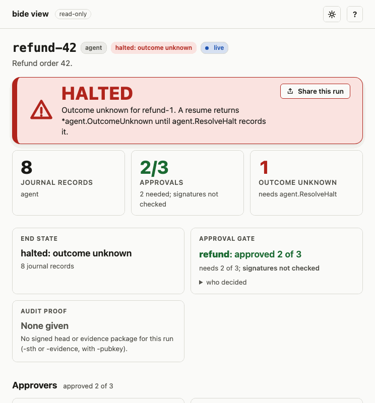
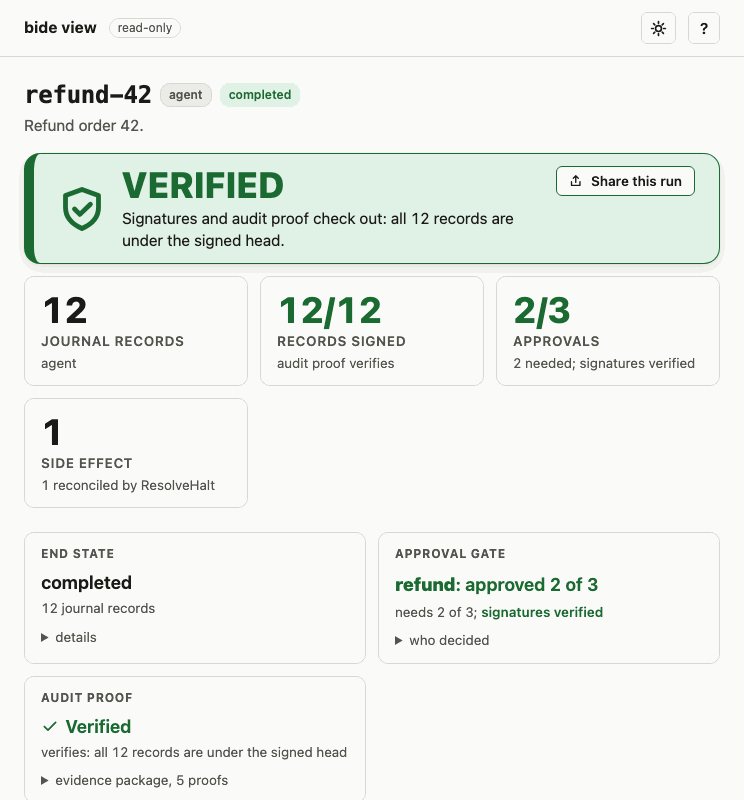

# bide 导览

逐节介绍 API：图、环境式运行、智能体循环、流式输出、类型化输出、会话、审计轨迹、人工审批、错误、中间件与治理。每一节都链接到完整介绍它的指南。

## Graphs（图）

在图优先的框架中，图既是你手写的东西，也是被执行的东西，带有节点、边、一个状态对象，有时上面还有一个可视化构建器。在 bide 中，同样的手写表面都存在，直至一个可视化构建器，它们是一条纯 Go 日志之上的可选层。

图不增添任何表达力。图能计算的任何东西，普通控制流都能计算：一个计算图就是一个控制流图，而顺序、选择和迭代足以表达其中任意一个。不存在哪种智能体行为你能用节点-边的图搭出来、却不能用 `if`、`for` 和函数写出来。图增添的是一份对流程的一等表示，你可以检视它、可视化它、静态校验它，并在代码之外去手写它。那是一个工具层，且构建智能体并不需要它。

所以这里的底座是纯 Go，而各项保证（持久性、至多一次、可验证的轨迹）来自日志。图作为一个派生视图存在：`RenderMermaid` 从实际运行过的内容中把它重建出来。

要手写一个图，就用 `plan` 包：一个受约束、经类型检查的流程构建器，它编译到这个运行时，并继承至多一次和审计轨迹。你把类型化的节点（`Step`、`Tool`、`Model`、`Switch`、扇入的 `Join`、有界的 `LoopBack`）接入一个 `Flow`，或者把同一份拓扑写成声明式配置（`plan.Load`），供更高的一层（例如一个可视化构建器）来发出。节点可以带一个 m-of-n 审批关卡（`plan.Approval`，或配置中的 `approval: {need, approvers}`）：流程在该节点之前暂停，直到 k 位批准人签署了它的确切输入，所用的日志化关卡和离线证据与智能体的工具调用相同。

一份手写的图是一张示意图；一份派生的图是从日志中重建的，因此它恰恰是运行过的东西。`plan` 层把两者系在一起：`Topology()` 和 `RenderMermaid()` 暴露所声明的形状，而 `Conform()` 以密码学方式核验一次运行是否遵循了它所声明的拓扑。让任何这样的层都无法分叉运行时的规则是：一个新表面可以增添一种手写方式，绝不增添一种执行方式；每一层都下沉到那一个由日志支撑的运行时。见 [docs/guides/plan-flows.md](../../docs/guides/plan-flows.md)。

### 三种方式手写同一个流程

同一个订单分拣流程，三种写法。纯 Go 是默认方式：写普通的控制流，并为日志必须保证崩溃安全的那些步骤命名。

<!-- docsnip: setup ctx context.Context; journal *agent.Journal; order Order; type Order struct{}; type Receipt struct{}; type Assessment struct{ Rush bool }; type Reservation struct{}; func classify(Order) (Assessment, error); func reserve(Assessment) (Reservation, error); func finalize(Reservation) (Receipt, error); func decline(Assessment) (Receipt, error) -->
```go
// classify, then branch: rush orders reserve-then-finalize, the rest decline.
assess, _ := journal.Step(ctx, "order-42", "classify",
    func(ctx context.Context) (Assessment, error) { return classify(order) },
    agent.WithSafety(agent.Safety{ReadOnly: true})) // safe to re-run after a crash

var receipt Receipt
if assess.Rush {
    res, _ := journal.Step(ctx, "order-42", "reserve", // a side effect: at most once
        func(ctx context.Context) (Reservation, error) { return reserve(assess) })
    receipt, _ = journal.Step(ctx, "order-42", "finalize",
        func(ctx context.Context) (Receipt, error) { return finalize(res) })
} else {
    receipt, _ = journal.Step(ctx, "order-42", "decline",
        func(ctx context.Context) (Receipt, error) { return decline(assess) })
}
```

要把那个流程变成一件可检视的工件，`plan` 构建器把类型化的节点接入一个下沉到同一运行时的 `Flow`：

<!-- docsnip: setup type Order struct{}; type Receipt struct{}; type Assessment struct{ Rush bool }; type Reservation struct{} -->
```go
b := plan.New[Order, Receipt]("order-triage")
classify := b.Step("classify", func(ctx context.Context, o Order) (Assessment, error) { ... })
reserve  := b.Step("reserve",  func(ctx context.Context, a Assessment) (Reservation, error) { ... }) // non-idempotent
finalize := b.Step("finalize", func(ctx context.Context, r Reservation) (Receipt, error) { ... })
decline  := b.Step("decline",  func(ctx context.Context, a Assessment) (Receipt, error) { ... })

b.Switch(classify,
    plan.When(func(a Assessment) bool { return a.Rush }, reserve).Named("rush"),
    plan.Else(decline),
)
b.Edge(reserve, finalize)

flow, err := b.Build() // inherits at-most-once and the audit trail
```

或者把同一份拓扑写成声明式配置，供更高的一层（一个可视化构建器）发出，并用 `plan.Load` 加载：

```json
{
  "version": 1,
  "flow": "order-triage",
  "entry": "classify",
  "nodes": [
    {"name": "classify", "block": "classify"}, {"name": "reserve", "block": "reserve"},
    {"name": "finalize", "block": "finalize"}, {"name": "decline", "block": "decline"}
  ],
  "wiring": [
    {"switch": "classify", "when": [{"pred": "rush", "to": "reserve"}], "else": "decline"},
    {"edge": ["reserve", "finalize"]}
  ]
}
```

<!-- docsnip: setup type Order struct{}; type Receipt struct{}; configBytes []byte; reg *plan.Registry -->
```go
flow, err := plan.Load[Order, Receipt](configBytes, reg) // same topology, same Digest()
```

三者都下沉到那一个由日志支撑的运行时，因此无论你选哪一种，至多一次、高可用恢复和可验证的轨迹都适用。

## 环境运行：持久化的休眠、唤醒与中断

一次环境运行并不待在一个同步的聊天循环里。它休眠，在某个触发下唤醒，为一个人类暂停，而其中每一次转换都是日志上一个持久化、至多一次的步骤，因此运行能在它们之间幸免于崩溃和节点交接。

- **休眠至某个截止时刻。** `Sleep`/`WaitUntil` 暂停一次运行并把它的唤醒时间记入日志，从而暂停能挺过一次重启。在唤醒时刻重新调用会恰好一次地恢复。
- **按时间或事件唤醒。** 一个可插拔的 `Waker`（默认是进程内的 `MemWaker`）重新调用一个到期的运行；触发源是你的（一个进程内循环、一个 cron、一个队列、一个入站 webhook），因此同一底座既驱动计划型、也驱动事件驱动型的智能体。
- **为一个人类持久化地中断。** `Interrupt[T]`/`AnswerInterrupt` 在任意点暂停一次运行以请求一个类型化的决定，并以人类的回答作为一个记入日志的步骤来恢复（见 [Human-in-the-loop（人在回路）](#人在回路human-in-the-loop)）。批准/拒绝是那个布尔的特例。

你提供触发源和监督表面；运行时保证运行在每一次休眠、唤醒、中断、崩溃和交接之间始终正确。可在 `examples/signals`（把一个事件投递进一个等待中的运行）、`examples/interrupt`（人在回路的暂停/恢复）和 `examples/recover`（持久化恢复）中运行。见[信号与环境指南](../../docs/guides/signals.md)。

## 至多一次，在代码里

<!-- docsnip: setup ctx context.Context; a *agent.Agent; runID string; input string; type ChargeArgs struct{}; type Receipt struct{} -->
```go
// A tool that moves money is a write: not ReadOnly, not Idempotent.
charge := agent.MustFunc("charge_card", "Charge the customer", func(ctx context.Context, in ChargeArgs) (Receipt, error) { /* ... */ })

// If the process crashes after the charge fires but before its result is journaled,
// resume does NOT run it again: it returns *OutcomeUnknown so you confirm, not double-charge:
_, err := a.Run(ctx, runID, agent.UserText(input))
if halt, ok := errors.AsType[*agent.OutcomeUnknown](err); ok {
	// halt.Op.ToolName == "charge_card": outcome unknown, a human decides, no double side effect.
}
```

## 快速上手

需要 Go 1.27（核心用到了泛型方法）。如果 `go version` 更旧，请升级或设置 `GOTOOLCHAIN=go1.27.0`。

核心包是 `agent`，从 `github.com/bide-ai/bide/agent` 导入（如下面的代码块所示）。在你自己的模块中，用 `go get github.com/bide-ai/bide/agent@latest github.com/bide-ai/bide/store/sqlite@latest` 安装它和 SQLite 存储（或先写代码再运行 `go mod tidy`）。没有 API 密钥？[入门指南](../getting-started.md#no-api-key-use-agenttest) 用脚本化模型离线运行同一个智能体。

```go
package main

import (
	"context"
	"fmt"
	"log"
	"os"

	"github.com/bide-ai/bide/agent"
	"github.com/bide-ai/bide/model/openai"
	"github.com/bide-ai/bide/store/sqlite"
)

type WeatherArgs struct {
	City string `json:"city" desc:"city name"`
}
type Weather struct {
	TempF int    `json:"temp_f"`
	Sky   string `json:"sky"`
}

func main() {
	// Any OpenAI-compatible endpoint (here OpenRouter); swap the base URL for Ollama, etc.
	model := openai.New(os.Getenv("OPENROUTER_API_KEY"),
		openai.WithBaseURL("https://openrouter.ai/api/v1"),
		openai.WithModel("openai/gpt-4o-mini"))

	// A tool is a typed Go function; its schema is derived automatically.
	weather := agent.MustFunc("get_weather", "Current weather for a city",
		func(_ context.Context, in WeatherArgs) (Weather, error) {
			return Weather{TempF: 68, Sky: "sunny"}, nil
		}, agent.WithSafety(agent.Safety{ReadOnly: true}))

	// Durable on-disk store: a crash mid-run resumes from here.
	store, err := sqlite.Open("agent.db")
	if err != nil {
		log.Fatal(err)
	}
	defer store.Close()
	j, err := agent.NewJournal(store)
	if err != nil {
		log.Fatal(err)
	}

	a, err := agent.New(
		model,
		j,
		agent.WithTools(weather),
		agent.WithSystemPrompt("You are a concise weather assistant."),
	)
	if err != nil {
		log.Fatal(err)
	}
	out, err := a.Run(context.Background(), "run-1", agent.UserText("Weather in SF? Use the tool."))
	if err != nil {
		log.Fatal(err)
	}
	fmt.Println(out.Message.Text())
}
```

运行实地冒烟示例：`OPENROUTER_API_KEY=sk-... go run github.com/bide-ai/bide/examples/smoke@latest`

`Run` 接受一个 `Message` 输入（文本，或文本加图像）和每次运行的选项，并返回一个 `Result`：最终消息、整次运行的 token 用量（含缓存与子智能体）、模型轮次计数和墙钟时长。`Turns` 只计本次调用的模型轮次，因此恢复的运行，或再次驱动的已完成运行，显示的轮次可能少于整次运行的轮次（`Usage` 和 `Spend` 是整次运行的）。只要运行 ID 有效，`Result` 在任何错误时都不为 nil：暂停、停机、失败、saga 中止、取消：

<!-- docsnip: setup ctx context.Context; a *agent.Agent; runID string; input string -->
```go
res, err := a.Run(ctx, runID, agent.UserText(input),
	agent.WithTokenBudget(50_000), agent.WithSystemPrompt("You are terse."))
// res.Message, res.Usage, res.Spend, res.Turns, res.Duration, res.RunID
_ = err
```

运行的首次驱动把它的输入和选项记入 `run:start`，之后的每次驱动（包括恢复）都在其下运行：不同的限额（`WithMaxTurns`、`WithTokenBudget`）作为修订 `run:limits:<n>` 记入日志，其他任何不同的设置都是 `ErrConfig`。`agent.Cancel` 取消一次运行（saga 会先回滚），`agent.Status` 从日志读取它的状态。

## 流式（Streaming）

`Run` 会阻塞并返回最终答案。要观察智能体工作（token 增量、轮次边界、工具开始/结束），请用 `Stream`。它驱动的是**同一个循环**（`Stream(...).Result()` 返回的就是 `Run` 返回的），所以持久性、恢复和副作用安全性是完全一致的：

<!-- docsnip: setup ctx context.Context; a *agent.Agent; runID string; input string -->
```go
stream := a.Stream(ctx, runID, agent.UserText(input))
for ev := range stream.Events() {
	switch e := ev.(type) {
	case agent.ModelEvent: // live token/reasoning/tool-call deltas
		if d, ok := e.Event.(agent.TextDelta); ok {
			fmt.Print(d.Text)
		}
	case agent.ToolStarted:
		fmt.Printf("\n[calling %s]\n", e.Name)
	case agent.ToolCompleted:
		fmt.Printf("[%s done]\n", e.Name)
	}
}
res, err := stream.Result() // what Run returns: the Result and an error (incl. a pause: *ApprovalPending, *OutcomeUnknown, ...)
```

事件：`TurnStarted`、`ModelEvent`（token 流）、`AssistantTurn`、`ToolStarted` / `ToolCompleted`、`ApprovalRequired`、`Finished`。为 UI 而 range `Events()` 然后调用 `Result()`，或者单独调用 `Result()` 以表现得与 `Run` 完全一样（它会替你把事件排空）。

有两件事值得知道，两者都是持久性的后果：
- **token 增量在中间件链之下抵达**（Retry / Cost 仍然看到整条组装好的消息），而且**只在一次全新的模型调用上**出现。
- **恢复时，记入日志的记录（transcript）会被重新发出**，作为 `AssistantTurn{Replayed: true}` + `ToolCompleted`，在实时进度之前，因此一个全新的 UI 能在一次崩溃之后重建整个故事，而一个被重放的轮次不产生 token 增量（它已经被决定了）。

`Stream` 接受与 `Run` 相同的选项（saga 用 `WithSaga()`），它的 `RunStream.Result()` 返回 `Run` 会返回的内容。

## 类型化输出

`RunTyped[T]` 返回一个类型化的 `T`，而非一条自由格式的消息。它注入一个合成的 `final_answer` 工具，其 JSON schema 由 `T` 派生而来（经由 `schema` 包），并引导模型在其工作完成后调用它一次，从而一个使用工具的智能体可以先做它的工作、然后给出类型化的回答。它与提供商无关：它使用原生工具调用，而非某个提供商的 JSON 模式。

<!-- docsnip: setup ctx context.Context; a *agent.Agent; runID string -->
```go
type Weather struct {
	City  string `json:"city"`
	TempF int    `json:"temp_f"`
}

w, _, err := a.RunTyped[Weather](ctx, runID, agent.UserText("weather in SF?"))
// w.City == "SF", w.TempF == 68
```

它是一个 Go 1.27 泛型方法；它也返回运行的 `Result`（其 `Output` 是记入日志的答案）。该值是从*记入日志的*工具调用中解码出来的，所以它是**恢复安全的**：一次运行中途的崩溃会在恢复时从日志中把类型化的答案找回来。该工具接受的第一次 `final_answer` 调用即结束本次运行。只有当模型从未发出这样的调用（而是以纯 JSON 文本回复）时，`RunTyped` 才会解析该运行最后一轮的文本。`T` 必须是一个 JSON 对象（结构体、指向结构体的指针或 map），因为提供商只接受对象形式的工具参数；其他任何 `T` 都是 `ErrConfig`。

在支持严格结构化输出的 OpenAI 兼容提供商上，带 `agent.WithOutputMode(agent.OutputNative)` 的 `RunTyped[T]` 使用提供商原生的 JSON-schema 响应格式而非工具（schema 在提供商侧强制执行，无需工具往返）；Anthropic 适配器不支持它并返回 `ErrConfig`，所以在那里请用默认的工具模式以获得与提供商无关的输出。

## 采样（Sampling）

生成控制项是与提供商无关的，且一次性设定；每个适配器把它们映射到自己的传输格式（并丢弃它做不到的，例如 Anthropic 没有 `seed`）：

<!-- docsnip: setup model agent.Model; journal *agent.Journal; tools []agent.Tool -->
```go
a, err := agent.New(
	model,
	journal,
	agent.WithTools(tools...),
	agent.WithSampling(agent.Temperature(0), agent.MaxTokens(500), agent.TopP(0.9), agent.Seed(42)),
)
if err != nil {
	panic(err)
}
```

字段是可选的：一个未设置的字段使用提供商默认值，因此一个显式的 `Temperature(0)` 有别于"未指定"。请求级的 `MaxTokens` 会覆盖适配器构造时的默认值。

## 提示缓存（Prompt caching）

一个智能体循环每一轮都重新发送一大段恒定的前缀（系统提示 + 工具 schema）。Anthropic 提示缓存把这些重复部分按缓存读取费率计费：

<!-- docsnip: setup key string -->
```go
model := anthropic.New(key, anthropic.WithPromptCache())
```

这会在系统块和工具定义上放置 `cache_control` 断点。OpenAI 自动缓存前缀（无需标志）。无论哪种方式，缓存效果都会体现在 `agent.Usage` 中（`CacheReadTokens`，自缓存供给；`CacheWriteTokens`，写入缓存），因此成本核算、追踪以及本次运行的 token 预算看到的都是真实数字。

## 会话（多轮）

`Run` 是一轮。一个 `Session` 是一场持久化的多轮对话：每一次 `Send` 都是一次完整的智能体运行（工具、恢复、副作用安全），并以迄今为止的记录为种子，因此智能体记得先前的各轮。

<!-- docsnip: setup ctx context.Context; a *agent.Agent -->
```go
s, _ := a.Session(ctx, "user-42")   // reopens + rebuilds the transcript from the store
r1, err := s.Send(ctx, agent.UserText("what's the capital of France?"))
if err != nil {
	panic(err)
}
r2, err := s.Send(ctx, agent.UserText("and its population?")) // sees turn 1 in context
if err != nil {
	panic(err)
}
fmt.Println(r1.Message.Text(), r2.Message.Text())
```

记录按会话 id 逐轮记入日志，因此一个重启的进程 `a.Session(ctx, "user-42")` 会把它重建出来并继续。第 N 轮在 `"<id>>@turn/N"` 之下运行（它自己的持久化日志处理该轮*之内*的崩溃恢复）；对话记忆是问答记录：一轮的中间工具调用留在那一轮里，不会泄漏进后面的轮次。如果一轮暂停了（批准 / `Interrupt`），`Send` 会返回那个错误；解决它，然后用相同的输入再次调用 `Send` 以恢复。在此之前，用一条不同的消息调用 `Send` 会返回 `ErrConfig`：那个未完成的轮次属于它自己的消息。对于可能被重投递的入站消息，`SendOnce(ctx, id, text)` 对每个消息 id 只回答一次。同一个会话上的多个句柄既不会丢失任何一轮，也不会把一轮记录两次，也不会用另一条消息的回复来回答某条消息。在支持租约的存储上（`MemStore`、SQLite、Postgres），一轮在其运行的租约下同一时间只由一个 worker 驱动，因此它的 token 预算在多个 worker 之间依然成立；在此期间收到同一条消息的第二个 worker 会得到 `ErrTurnContended`，稍后再发送一次即可。运行被取消的 Send 轮次会被记为关闭：该消息的 `Send` 返回 `ErrRunCancelled`，下一条消息的 `Send` 把该轮记为关闭（没有回答）并运行自己的轮次。

## 可审计性（防篡改日志）

那条持久化日志已经记录了一次运行的每一步。`audit` 包用一条哈希链承诺那段历史，从而一次运行的执行是可验证的：

<!-- docsnip: setup ctx context.Context; journal *agent.Journal; runID string; priv ed25519.PrivateKey -->
```go
head, _ := audit.Head(ctx, journal, runID)                     // SHA-256 chain over the stored journal bytes
sig, _ := audit.Sign(head, audit.Ed25519Signer{Priv: priv}) // anchor it: sign / publish out-of-band
```

对一条记录的任何修改 / 插入 / 删除 / 重排都会改变链头。**安全模型：** 这无条件地给出完整性，并在*你把链头带外锚定时*给出防篡改性（一条与攻击者所控制的数据库处于同一数据库中的链，可以被重写并重新哈希）；见包文档。

对于**选择性披露**，`audit.Root` / `Prove` / `VerifyInclusion` 构建一棵 **RFC 6962**（证书透明度）Merkle 树，因此你能经由一个 O(log n) 的包含性证明证明某条记录是一次已承诺运行的一部分，而不泄露其他记录（例如向审计员表明发生过某一笔扣款，却不暴露任何其他客户或提示）。而 `ProveConsistency` / `VerifyConsistency` 证明一个较早的根是一个较晚的根的**仅追加前缀**：历史只被追加，从未被重写或重排（透明度日志的保证）。该实现已对照发布的 RFC 6962 测试向量核验。

`SignTreeHead` 产出 CT 风格的**签名树头（Signed Tree Head）**，即 `{Kind, RunID, Size, Root, TimestampNanos}` 连同其签名方案一起，由任意 `audit.Signer`（Ed25519、ML-DSA-65 或二者混合）签名，就是你要发布的那件工件。完整流程：签署一个 STH，稍后用一个包含性证明披露单条记录，审计员对照签名过的根来核验它，并证明两个 STH 之间的仅追加式增长。关于该模型、API 以及端到端的合规流程，见 [docs/guides/audit.md](../../docs/guides/audit.md)。

### 运行查看器

`bide view` 为单次运行打开一个只读页面，在 `127.0.0.1` 上提供，数据来自 SQLite 或 Postgres 日志或导出的日志。安装：`go install github.com/bide-ai/bide/cmd/bide@latest`。`bide view -config flow.yaml` 以同样方式展示流程定义，并在图上标出问题；`-check` 在 CI 中运行同一检查。它展示运行的时间线（模型轮次、工具调用及其 `Safety`、尝试、审批），被暂停的操作及记录其结果的 `ResolveHalt` 调用，每个审批关卡的 k-of-n 状态，`plan` 流程在其声明拓扑上走过的路径，以及日志能否通过签名树头或证据包验证。它从不写入存储。参见[运行查看器指南](../../docs/guides/run-viewer.md)（英文）。

<table>
<tr>
<td width="50%"><picture><source media="(prefers-color-scheme: dark)" srcset="../../docs/guides/img/refund-before-dark.png"></picture></td>
<td width="50%"><picture><source media="(prefers-color-scheme: dark)" srcset="../../docs/guides/img/refund-after-dark.png"></picture></td>
</tr>
<tr>
<td>之前：退款在执行后崩溃，因此运行已暂停、结果未知，页面给出了 <code>ResolveHalt</code> 调用。</td>
<td>之后：<code>ResolveHalt</code> 记录了结果，运行已完成；审批关卡显示 3 位审批人中 2 位已批准，证据包验证通过。</td>
</tr>
</table>

## RAG 与记忆（自带）

Bide 不附带任何向量存储、嵌入器或记忆后端：它给你接口，你插入你本就在运行的存储。针对你自己的基础设施实现一个接口：

<!-- docsnip: api agent -->
```go
type Retriever interface {
	Retrieve(ctx context.Context, query string, k int) ([]agent.Doc, error)
}
```

然后用两种方式之一把它接上：

<!-- docsnip: setup model agent.Model; journal *agent.Journal; myStore agent.Retriever -->
```go
// Agentic RAG: the model searches on demand:
a, err := agent.New(model, journal,
	agent.WithTools(agent.MustRetrievalTool("search_kb", "Search the knowledge base.", myStore, 5)))

// Classic RAG: top-k auto-injected as context on each user turn:
a, err = agent.New(model, journal, agent.WithRetrieval(myStore, 5))
```

对话记忆已经内建（`Session`）；动态上下文经由 `WithSystemPromptFunc`；这条接缝覆盖语义/长期记忆。具体的存储适配器（如果真有需要的话）会是独立的模块，绝不进入核心。见 [docs/guides/rag-memory.md](../../docs/guides/rag-memory.md)。

## 恢复安全，一张表说清

```go
agent.Safety{ReadOnly: true}          // no side effects → always safe to re-run
agent.Safety{Idempotent: true}        // safe to retry (dedupes downstream)
agent.Safety{}                        // a write → HALT on unknown outcome, don't double-fire
agent.WithApproval(agent.SingleApproval()) // not Safety: a tool option that pauses for human approval before executing
```

在一个非幂等副作用之前，循环记录一个持久化的*尝试标记*，从而恢复能区分"从未运行"（可安全运行）与"运行过并崩溃了"（停机）。

`dst_test.go` 是一个确定性模拟测试：一个故障注入的存储在*每一个*写入点崩溃（并跨越数百个随机化的多次崩溃调度），而该测试工具断言一个非幂等副作用每一次都**至多触发一次**，且运行总是以完成或停机告终，从不双重触发。

该测试工具是导出的（`chaos/`），并在 `benchmarks/` 中被指向其他 SDK。实测结果：**Bide `maxFired=1`（通过）；trpc-agent-go `maxFired=6`；langchaingo `maxFired=64`（两者均失败）。** trpc 的检查点/恢复有效（恢复一次已完成的运行是一个空操作）；它的双重触发是那个有文档记载的 LangGraph"节点必须幂等"窗口。langchaingo 没有持久性，所以重试会把一切重新运行。Bide 的尝试标记关闭了那个窗口。

`WithMaxTurns(n)` 为每次运行的模型轮次设上限，使一个不停调用工具的模型无法永远循环下去：触及它会返回 `ErrMaxTurns`（它是 `errors.Is` `ErrBudget` 的）。`WithTokenBudget(n)` 为一次运行可使用的 token 设上限，缓存的输入也计算在内：一旦运行已用掉 `n`，它就不再发起任何模型调用，并返回 `ErrBudgetExceeded`。每次调用的用量都随其轮次记入日志，因此两项限制都从日志中重建，并在崩溃与恢复之后依然成立。

## 人在回路（Human-in-the-loop）

三种形式。**批准/拒绝**：一个标记了 `WithApproval(SingleApproval())` 的工具在运行*之前*暂停；人类的决定是一个布尔：

<!-- docsnip: setup ctx context.Context; a *agent.Agent; journal *agent.Journal; runID string; input string -->
```go
_, err := a.Run(ctx, runID, agent.UserText(input))
if pend, ok := errors.AsType[*agent.ApprovalPending](err); ok {
	// ... get a human decision ...
	agent.Approve(ctx, journal, pend.RunID, pend.ToolUseID, true)
	res, _ := a.Run(ctx, pend.RootRunID, agent.UserText(input))
	var out agent.Message
	if res != nil {
		out = res.Message
	} // resumes past the pause
}
```

**中断/恢复**：一个工具在*任意点*暂停，并以一个*类型化的*值恢复（推广了那个布尔）。在一个可重试安全的工具内调用 `agent.Interrupt[T]`：

<!-- docsnip: setup ctx context.Context; a *agent.Agent; journal *agent.Journal; runID string; input string; type Options struct{}; type Plan struct{}; chosenPlan Plan -->
```go
tool := agent.MustFunc("choose_plan", "pick a plan", func(ctx context.Context, in Options) (Plan, error) {
		pick, err := agent.Interrupt[Plan](ctx, "plan", in) // pauses the run; in is shown to the human
		if err != nil {
			return Plan{}, err // *InterruptPending propagates out of Run
		}
		return pick, nil // on resume, pick is the human's typed answer
	}, agent.WithSafety(agent.Safety{ReadOnly: true}))

_, err := a.Run(ctx, runID, agent.UserText(input))
if intr, ok := errors.AsType[*agent.InterruptPending](err); ok {
	// ... show intr.Prompt, get a typed answer ...
	journal.AnswerInterrupt(ctx, intr.RunID, intr.Name, chosenPlan)
	res, _ := a.Run(ctx, intr.RootRunID, agent.UserText(input))
	var out agent.Message
	if res != nil {
		out = res.Message
	} // resumes; Interrupt now returns chosenPlan
}
```

两者都是持久化的：那个决定/值是一个记入日志的步骤，所以它挺得过一次崩溃。Interrupt 必须处于一个可重试安全的工具中（`ReadOnly`/`Idempotent`）：恢复时该工具会一直重新运行直到中断被解决，所以 `Interrupt` 调用之前的一切都必须是可安全重复的。

**m-of-n 批准**：当一次签核不够时，要求来自一个具名的 n 位批准人集合中的 k 份签名决定。每位批准人签署的是确切的那次调用（工具及其参数）；该门在达到 k 份批准时放行，一旦 k 不再可达就拒绝，否则带着当前计票暂停。一份伪造或出错的决定会被忽略，而不会把它的批准人锁在门外：

<!-- docsnip: setup ctx context.Context; model agent.Model; journal *agent.Journal; pend *agent.ApprovalPending; type RefundArgs struct{}; doRefund func(context.Context, RefundArgs) (string, error); keysByApprover agent.ApproverVerifierFor; signer audit.Signer -->
```go
refund := agent.MustFunc("refund", "refund the order", doRefund,
	agent.WithApproval(&agent.ApprovalPolicy{Need: 2, Approvers: []string{"ops", "finance", "risk"}}))
a, err := agent.New(model, journal, agent.WithTools(refund), agent.WithApproverVerifiers(keysByApprover))
if err != nil {
	panic(err)
}

// each approver, out of band, signs the paused call they were shown:
sig, _ := signer.Sign(agent.ApprovalDecisionBytes(pend.Subject(), "finance", true))
agent.SubmitDecision(ctx, journal, agent.Decision{RunID: pend.RunID, ToolUseID: pend.ToolUseID,
	ApproverID: "finance", Approved: true, Alg: signer.Alg(), Signature: sig})
```

然后，`audit.ApprovalEvidence` 与 `audit.VerifyApprovals`（或 `bide audit verify-approvals`）离线证明：k 位具名批准人在这次确切的调用运行*之前*、依照预期的策略签核了它，所依据的证据不可能在不被察觉的情况下漏掉任何一份决定。每位批准人都需要自己的密钥：若策略中有两位批准人解析到同一个密钥，该策略会以 `ErrConfig` 被拒绝，因为持有该密钥的人可以替两人签名。见[批准指南](../../docs/guides/hitl-approval.md)；可跨独立进程在 `examples/approval` 中运行。

## 错误

失败以哨兵错误（sentinel error）来分类，由 `errors.Is` 匹配。两层：一个**类别（category）**（粗粒度的类）和一个**条件（condition）**（一个具体的成因），后者包裹其类别，因此匹配可以在你需要的任一层级上工作：

<!-- docsnip: setup ctx context.Context; a *agent.Agent; runID string; input string; func backOffAndRetry(); func fixToolWiring(); func alertOps() -->
```go
_, err := a.Run(ctx, runID, agent.UserText(input))
switch {
case errors.Is(err, agent.ErrModel):       // any provider fault (HTTP status, decode, stream)
	backOffAndRetry()
case errors.Is(err, agent.ErrUnknownTool):  // a specific condition (implies agent.ErrTool)
	fixToolWiring()
case errors.Is(err, agent.ErrStorage):      // durable-store I/O
	alertOps()
}
```

类别：`ErrConfig`、`ErrModel`、`ErrTool`、`ErrStorage`、`ErrProtocol`、`ErrBudget`。条件（每一个都包裹一个类别）：`ErrUnknownTool`、`ErrToolArgs`（包裹 `ErrTool`）；`ErrToolReinvoked`、`ErrInvalidApproval`、`ErrAlreadyDecided`（包裹 `ErrConfig`）；`ErrNoRecordedOutput`、`ErrIncompleteResponse`（包裹 `ErrModel`）；`ErrTruncatedToolArgs`（包裹 `ErrProtocol`）；`ErrBudgetExceeded`、`ErrMaxTurns`（包裹 `ErrBudget`）。`ErrToolNotCalled` 不包裹任何类别：它标记一次已知从未到达其工具的工具调用（工具中间件的拒绝会包裹它）。提供商适配器还会返回 `*RateLimited`（HTTP 429，附带一个 `RetryAfter` 提示）和 `*APIError`（其他非 2xx，附带 `StatusCode`），两者都包裹 `ErrModel`。该工具包返回的每一个错误（包括来自模型、MCP、存储和治理适配器的）都带有一个类别，所以 `errors.Is` 在整个表面上都是可靠的。

而**控制流信号**比一个类别更丰富，所以它们保持为具体类型，由 `errors.As` 匹配：`*ApprovalPending`（需要批准）、`*InterruptPending`（等待人类输入）、`*TimerPending`（持久化定时器待触发）、`*SignalPending`（等待一个外部信号）、`*OutcomeUnknown`（恢复不安全）、`*SagaAborted`（已回滚），以及 `*HaltTooYoung`（来自 `ResolveHalt`，当 `WithMinHaltAge` 尚未到期时）。它们都实现了密封接口 `agent.Pause`；用 `agent.IsPause(err)` 判断，用 `agent.AsPause(err)` 读取。一个暂停或停机的运行不是一个"失败"类别；检视那个结构体以获取 `RunID` / `ToolUseID` / 补偿细节。取消以通常的 `context.Canceled` / `context.DeadlineExceeded` 浮现，而一次因其运行租约（`agent.Lease`）丢失而被取消的驱动则以 `ErrLeaseLost` 浮现；与取消一样，它不带任何类别。

## 中间件与可观测性

两条独立的 `func(Handler) Handler` 链：一条围绕模型调用（`WithMiddleware`），一条围绕每一次工具调用（`WithToolMiddleware`）。最先添加 = 最外层。两者都是*可变更且可短路的*：改写送进去的东西、变换出来的东西，或者不调用 `next` 就返回。

<!-- docsnip: setup model agent.Model; journal *agent.Journal; tools []agent.Tool; import oteltrace "go.opentelemetry.io/otel/trace"; tracer oteltrace.Tracer -->
```go
var cost middleware.CostMeter
a, err := agent.New(model, journal,
	agent.WithTools(tools...),
	agent.WithTokenBudget(100_000), // per run, rebuilt from the journal on resume
	agent.WithMiddleware(
		middleware.Retry(3, middleware.WithBackoff(200*time.Millisecond, 10*time.Second)),
		middleware.Cost(&cost, middleware.Rates{InputPer1M: 3, OutputPer1M: 15}),
	),
	agent.WithToolMiddleware(middleware.ToolLog(log.Printf), middleware.ToolCache(), middleware.ToolRetry(3)),
)
if err != nil {
	panic(err)
}

// opt-in OTel gen_ai.* spans (provider and model from agent.ModelInfoOf); the core has no OTel dependency:
a, err = a.With(
	agent.WithMiddleware(trace.Model(tracer)),
	agent.WithToolMiddleware(trace.Tool(tracer)), // execute_tool span per call; nests across the sub-agent boundary
)
// ... after the run: cost.Snapshot() (answer and spend, in tokens and USD)
```

`Retry` 做带抖动的指数退避，并在一个提供商 429 上尊重 `Retry-After`（适配器返回一个类型化的 `*agent.RateLimited`）；`Cost` 把来自 token 用量（含缓存读/写）的 USD 累加进一个你在运行后读取的 `CostMeter`。

因为 `trace.Tool` 在循环内部运行，它的 span 处于交给工具的上下文中，所以当一个工具本身就是一个子智能体时，该子智能体的运行及其自己的 span 会作为子级嵌套。该 trace 跨越子智能体边界。

工具中间件在持久化步骤*内部*运行，所以一次短路的结果（一次 `ToolCache` 命中）会像任何工具结果一样被记入日志，包裹了 `agent.ErrToolNotCalled` 的策略拒绝也一样；拒绝必须包裹 `agent.ErrToolNotCalled`：不包裹它的拒绝会让副作用的结果未知，什么都不记录，运行随之停止；恢复会重放它，绝不重新运行中间件或工具。`ToolRetry` 和 `ToolCache` 只作用于 `Safety` 允许的工具（分别是可重试安全的和 `ReadOnly` 的），而无论中间件做什么，智能体对一个不可重试安全的工具每次调用至多运行一次。用 `agent.ToolMiddleware` 签名写你自己的：

<!-- docsnip: setup func authorized(context.Context, string) bool -->
```go
// Deny a tool by policy: the tool never executes; the model sees the error and reacts.
// A denial must wrap agent.ErrToolNotCalled: without it the agent cannot tell the tool did
// not run, so a side effect's outcome is unknown and the run halts.
func RequireTag(tag string) agent.ToolMiddleware {
	return func(next agent.ToolHandler) agent.ToolHandler {
		return func(ctx context.Context, call agent.ToolCall) (json.RawMessage, error) {
			if !authorized(ctx, tag) {
				return nil, fmt.Errorf("tool %q denied: %w", call.Use.Name, agent.ErrToolNotCalled)
			}
			return next(ctx, call) // mutate call.Use.Args before, transform the result after
		}
	}
}
```

## 模块

Bide 是一个多模块仓库：一个依赖精简的**核心**（`github.com/bide-ai/bide`，即循环、schema、中间件、模型适配器、`plan` 流程构建器、`audit`；除标准库外没有任何依赖），外加每个重型适配器一个模块（`mcptools`、`trace`、`store/sqlite`、`store/postgres`、`govern/redislog`、`govern/sqlitelog`、`govern/postgreslog`、`codec/gcf`），以及承载 gsm 的 `govern` 模块（在 gsm 稳定之前保持 v0.x）。导入一个适配器，你就拉进它的依赖树；只导入核心，你就不会。一个仅用核心的消费者，其外部模块表面是 0，而不是 54。见 [docs/reference/module-structure.md](../../docs/reference/module-structure.md)。

## 架构

六边形（hexagonal）：核心定义端口（`Model`、`Store`、`Tool`、`Middleware`）；适配器在边缘处插入。依赖向内指；核心不导入任何适配器、任何基础设施，由 `architecture_test.go` 守护。

```
agent (root)     durable loop · Journal/Store · Message/Part · Tool/Safety · middleware types · RenderMermaid
plan             optional typed flow builder + declarative config; lowers to the loop (Topology · Conform)
model/anthropic  native Claude (thinking + signatures)
model/openai     any OpenAI-compatible endpoint
model/gemini     native Gemini (generativelanguage / Vertex via WithBaseURL)
schema           reflect Go types → inline JSON Schema + OpenAIStrict
middleware       Retry, RateLimit, Cost, Hedge
trace            opt-in OTel gen_ai.* spans
store/sqlite     on-disk durable resume (single binary, no cluster)
store/postgres   HA durable resume (any node resumes any run)
govern           Tier-2: federated governed state + quorum for agents that must agree (gsm-backed; own module)
```

## 联邦化治理（Tier-2）

持久化核心让一个智能体的工作免于崩溃。`govern` 层面向许多独立运行、却必须达成一致的智能体，跨进程、跨团队或跨组织边界，除共享的、全序的事件日志之外没有协调者，也没有单一写者。它给出两种可验证的一致形式；在两者中，一方都从公开工件核验结果，无需信任任何其他人的智能体。

**在共享状态上达成一致（收敛）。** 把共享状态描述为一个注册表（变量 + 不变量 + 事件）；gsm 在*构建时*检查智能体动作的每一种交错都到达同一个有效状态，否则就拒绝构建并向你展示一个反例（其范围参见[已知限制](../../docs/KNOWN-LIMITATIONS.md#governed-state-gsm)）。运行时是 O(1) 的表查找；状态是事件溯源的、崩溃可恢复的。它从单个共享注册表向上扩展、穿过**联邦（federations）**（跨边界约束：树、带解析器的多源 DAG、单调循环的*网格 mesh*），经由 `Embed` 组合，能替你合成补偿（声明规则，得到一个收敛的治理者，或一份证明其不存在的证据）。智能体经由 `FederatedEventTool` 插入，因此一次 LLM 工具调用就成为一个受治理的事件。

**在一个决定上达成一致（法定人数 quorum）。** k-of-n 个具名投票者（每一个是一个模型、提供商或主体）投出一个规范化的决定；每一票都是一个记入日志、至多一次的步骤，记录了谁怎么投的，而 k-of-n 的门是投票计数上的一个 gsm 不变量，因此"k 个达成一致"在每一种可能的计票上都被机器核验。`bide audit verify-quorum` 从公开工件重新核对计票和每一票，在不信任生产者的情况下复现多数决规则。这个论断是精确的：一个法定人数证明的是*k 个投票者达成了一致*，并降低单模型风险；它并不认证那个决定是正确的（相关的错误不是独立性），且只有规范化的决定才能被法定人数化，自由格式的散文不能。

<!-- docsnip: setup ctx context.Context; machine *gsm.Machine; import "github.com/blackwell-systems/gsm"; log govern.EventLog -->
```go
gov, _ := govern.NewPersistent(ctx, machine, log, "order-42", machine.NewState())
tool := govern.EventTool(gov, govern.EventToolConfig{Name: "pay", Description: "mark the order paid", Event: "pay"})
// hand `tool` to the agent: concurrent agents sharing `gov` converge, durably.
```

> 完整指南、能力阶梯，以及可运行的演示（`examples/govern/mesh`、`examples/govern/compose`、`examples/govern/quorum`）见 **[docs/guides/governance.md](../../docs/guides/governance.md)**。
